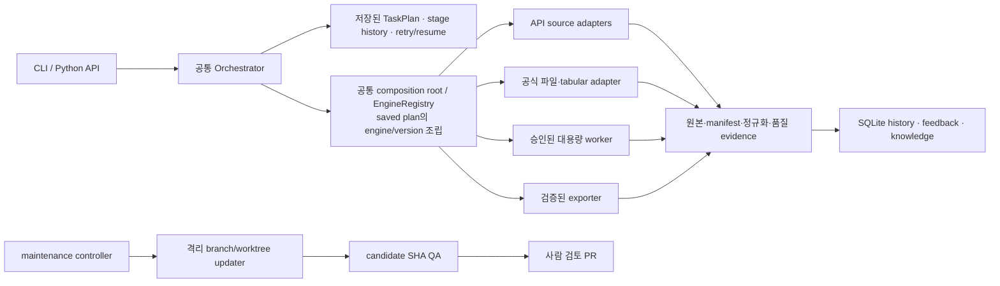

# MacroAtlas 통합 제품 기획서

> 문서 ID: MDP-PLAN-002 | 버전: 2.6 | 기준일: 2026-10-28
> 이 문서는 원초 제품 요구사항과 이후 승인된 수정·설계·운영 범위를 하나의 현재 기획으로 통합한다. 회차별 과거 결과는 [`PROJECT_PLAN_ORIGINAL_2026_10_24.md`](PROJECT_PLAN_ORIGINAL_2026_10_24.md)와 보고서에 보존한다.

## 0. 문서 권위와 읽는 법

`PROJECT_PLAN.md`가 제품 목표, 현재 범위, 완료 기준, 남은 구현의 유일한 기준이다. 이 문서와 다른 계획 파일이 충돌하면 이 문서를 먼저 갱신하고, 변경 이유를 `docs/DECISION_LOG.md`에 기록한다.

| 문서 | 역할 |
|---|---|
| 이 문서 | 제품 목표, 지원 범위, 데이터 정책, 완료 기준의 유일한 기준 |
| [구현 현황](docs/IMPLEMENTATION_PLAN.md) | 현재 코드와 gate 상태, 확인된 증거만 기록 |
| [사례 계약](docs/EVALUATION_CASES.md), [출력 정책](docs/OUTPUT_AND_VARIANT_POLICY.md), [최신성 정책](docs/SERIES_FRESHNESS.md) | 세부 데이터 계약 |
| [결정 이력](docs/DECISION_LOG.md) | 결정이 내려진 날짜와 이유 |
| 회차 보고서, live 기록, 2026-10-27 엔진 감사 | 작성 당시의 역사 증거. 현재 상태나 새 작업 순서로 읽지 않음 |

구현 상태는 **완료**, **제한 범위**, **부분 구현**, **미구현**, **미관측**, **현재 범위 제외**를 구별한다. 계획에 적힌 기능, fixture 성공, 자동 테스트 통과만으로 live 지원이나 Gate 통과를 주장하지 않는다.

## 1. 제품 목적과 설계 기준

MacroAtlas는 사용자가 요청한 국제금융·거시경제 통계를 공식 출처에서 찾고, 통계적 의미를 확인해 수집·검증·보존·전달하는 로컬 우선 Python 도구다. 결과에는 출처와 수집 조건, 원본 및 검증 이력을 연결한다.

먼저 제한된 공식 경로를 끝까지 재현 가능하게 만든다. 모든 기관을 자동으로 찾는 챗봇, 투자판단 도구, 무인 데이터 보정 시스템을 현재 제품 목표로 삼지 않는다. 지원되지 않거나 의미가 불확실한 요청은 추정으로 완성하지 않고 이유와 다음 선택지를 보고한다.

기본 원칙은 다음과 같다.

- 기관·dataset·series의 식별자와 공식 근거를 보존한다. 이름이 비슷하다는 이유로 통계 의미나 기관 간 동등성을 확정하지 않는다.
- 원본 응답과 정규화 결과를 분리한다. 원본을 덮어쓰지 않고 결측을 0으로 바꾸거나 값을 묵시적으로 보간하지 않는다.
- 전송, 구조, 의미, 품질, 요청 정합성을 별도로 검증한다. 확인되지 않은 필드는 `unknown`으로 남긴다.
- 사용자의 현재 지시는 이전 설정이나 과거 지식보다 우선한다. 한 작업의 교정을 다른 기관·개념의 공통 규칙으로 자동 확산하지 않는다.
- 비용·시간·요청 횟수·파일 크기는 실행 전에 제한한다. 실패는 정확한 task/stage에 기록하고 명시적으로 재개한다.
- 검증 범위와 증거 종류를 명시한다. 공식 문서 확인, fixture, live API, 실제 수집은 서로 다른 증거다.

## 2. 사용자와 핵심 작업 흐름

주요 사용자는 국제금융·거시경제 분석가와 반복 시계열을 다루는 연구자다. 핵심 작업은 공식 통계 출처·정의 찾기, 후보 비교, 확정된 범위 수집, 원본과 검증 결과 확인, CSV·Excel 분석 자료 전달, 과거 작업 실패 복구다.

제품의 목표 흐름은 다음 순서를 따른다.

1. 요청의 통계 개념, 국가/지역, 기간, 주기, 출력 요구를 확인한다.
2. 허용된 공식 근거와 저장 지식을 제한적으로 조회해 기관·dataset·series 후보를 찾는다. 후보별 정의·식별자·단위·주기·범위·불확실성을 구분한다.
3. 의미나 접근 경로가 모호하면 수집 전에 질문하거나 `NEEDS_REVIEW`로 중단한다. 후보 선택과 출력 조건을 버전이 연결된 확인 기록으로 저장한다.
4. 확정된 계획을 task/stage로 저장한 뒤 지원 connector를 실행한다. 원본·manifest·해시·요청 시각을 보존한다.
5. 정규화·품질·최신성을 확인한다. `STALE` 또는 `FRESHNESS_UNVERIFIED` 값은 성공 결과나 export에 내보내지 않는다.
6. 검증된 결과에 출처·단위·주기·결측·제한사항을 붙여 전달한다. 수집 성공, 링크 제공, 파일 생성은 각각 구분한다.
7. 사용자가 오류나 선호를 교정하면 task/stage에 연결한 피드백 기록으로 남긴다. 그 피드백만으로 코드나 전역 규칙을 바꾸지 않는다.

일반 자연어 UI, 대화형 앱, 전 기관 자동 검색은 현재 구현 범위가 아니다. 현재 입력은 고정·구조화 CLI와 Python API다.

## 3. 현재 지원 기준과 비범위

### 3.1 실제 구현 범위

| 경로 | 현재 지원 | 한계·판정 |
|---|---|---|
| World Bank WDI | 미국 GDP 고정 workflow와 country·indicator를 지정하는 raw-only 1-series 경로(source 2), 최대 100개 연도·단일 page | 일반 경로는 단위·의미 추론, metadata 탐색, CSV/XLSX 전달을 하지 않음. stale/unverified observations는 보류 |
| BOJ | FM08/FXERD01 한 달 수집과 같은 daily series의 1–120개월 범위 query | 다른 series/database 및 120개월 초과는 미지원. CSV export는 freshness 통과 task에 연결 |
| Offline candidate search | WDI 고정 후보 + 이미 보존된 BLS/Census metadata archive의 versioned lexical/semantic CLI 검색 | network/catalog refresh 없음, 후보 자동 선택 없음, 전체 provider catalog가 아님; 의미 동등성 판정은 아님 |
| BLS | 반복 지정한 series ID와 제한 연도를 받는 Public Data API v2 CLI/Python 경로 | 한 요청 최대 20개 ID, 1~20년 구간. Catalogue 의미·단위·주기는 자동 확인하지 않음 |
| Census ACS | 지정 변수·연도·지리범위의 acs/acs1·acs/acs5 CLI/Python 경로 | 최대 50개 variable, `NAME` 필수, geography는 `us:1`·`state:NN`; API key 필수. 전 기관 변수 검색은 미지원 |
| TIC/BIS 지정 파일 | 필요할 때 사용자가 요청하는 제한 파일 intake/watch 명령 | 자료 변경의 반복·예약 확인은 현재 필요 범위에서 제외했고 자동 감시는 중지함. 과거 `unchanged` 및 natural revision 미관측 상태는 기록으로 보존. Gate C는 승격하지 않음 |
| CSV 전달 | 완료·품질 통과 World Bank GDP와 BOJ FXERD01 task | 로컬 저장값 재검증 후 CSV와 provenance sidecar 작성. XLSX·다중 series 비교는 미지원 |
| BIS GLI flat ZIP | 지정 보존 원본 한 건의 명시 승인형 Linux worker | 구조 보존 JSONL만 생성. 일반 파일·Windows worker·경제 의미 정규화는 미지원 |
| 피드백·지식 | task 연결 SQLite append-only 피드백 기록, 검토 상태, 제한된 명시 재사용, 승인 피드백의 비식별 case seed CLI | 자동 사례 생성·corpus 편입·코드 수정·공통 규칙 승격 없음. 실제 사용자 피드백 seed는 아직 생성되지 않음 |
| 주기별 최신성 | daily부터 annual까지 API 시계열과 명시 매핑한 파일 시계열의 freshness gate, 검토 근거가 연결된 exact-series override | 기본 일수는 운영 fallback이며 기관의 실제 공표 일정 보증은 아님. 근거 없는 override는 미확정 처리 |
| 평가·사례 | legacy scaffold 6건, v1 이력 9/36 BLOCKED, GPT 검토 v2 36/36, 검색·확인경계 trace·성능 예산 평가기, AI 명시 승격·rollback hash-chain 원장 | 제품 Gate C는 fixed v2 search scope에서 통과했다. 해당 검색 정책은 AI 검토·적용 기록에 연결했다. AI 결정은 독립 사람 검토로 표시하지 않는다. |

기존 source gate A와 D는 해당 범위에서 통과했고 B/C/E는 제한 범위 판정이다. 이는 아래 제품 평가 A–G와 다른 구분이며, 현재 구현 상태는 구현 현황표를 따른다.

### 3.2 현재 범위에서 제외

- TIC/BIS 자료 변경상태의 반복·예약 확인. Vantage 또는 별도 유료 시장데이터 공급자 연동.
- 일반 자연어 검색·전체 기관 자동 탐색·근거 없는 기관/series 대체.
- 호환성 검증이 없는 단위·통화·주기 변환, 자동 보간·forward-fill, cross-source 의미 매핑.
- 범용 XLSX 출력과 여러 시계열을 한 표로 자동 결합하는 기능(향후 구현 목표는 §9).
- 사용자의 일상 대화 자동 수집, 피드백으로 자동 규칙 승격, 무인 코드 병합·배포.
- 무제한 대용량 파일 처리, 인증·CAPTCHA·접근 제한 우회, 투자 조언.

기관·파일 형식 확대는 반복된 실제 요청, 공식 source contract, 수용 테스트가 정해진 경우에만 하나씩 진행한다.

## 4. 엔진 구조와 통합 원칙

제품 데이터 처리와 개발자 코드 유지보수는 서로 다른 권한·상태를 가진다. 하나의 범용 거대 엔진이나 기관마다 독립 agent를 만드는 방식은 목표가 아니다.
아래 그림은 이 책임 경계의 논리 구성이며, 모든 상자를 현재 통합 완료로 뜻하지 않는다. 현재 구현 상태는 이어지는 표와 §3을 따른다.

- **공통 실행 계층:** `Engine`, `StageInput`, `StageResult`, `TaskPlan` 계약과 `Orchestrator`가 stage lifecycle·attempt·상태·resume·이력을 관리한다. `EngineRegistry`/composition root가 출처별 factory를 `(engine, version)`으로 등록하고 저장 plan에 맞는 runner를 조립한다. 대용량 worker는 별도 잠금·checkpoint recovery runner를 유지한다.
- **출처별 adapter:** 기관 API endpoint, 인증, paging, response schema와 파일 parser는 각 connector/engine adapter가 책임진다. 이 차이를 없애려고 하나의 거대한 source engine으로 합치지 않는다.
- **공유 서비스:** transport 공통 처리, raw/artifact store, metadata projection, freshness evaluator, duration estimator 등 반복되는 정책을 typed service로 둔다. 독립 권한·수명이 없는 부품을 또 다른 “엔진”으로 부르지 않는다.
- **대용량 worker:** 작은 tabular parser와 다른 memory/time/checkpoint 경계를 가진다. qualification 통과는 production 승인이 아니다.
- **개발자 maintenance:** 분석 proposal → 격리 수정 → candidate SHA QA → branch/PR까지만 지원할 수 있다. 제품 task·원본·credential과 분리하며 자동 merge·배포하지 않는다.
- **현재 통합 공백:** `search`는 고정 WDI 후보와 hash-검증된 로컬 BLS/Census metadata만 비교한다. API metadata 전체 수집·갱신이나 기관 전체 catalog 검색은 없다. BLS·Census의 고정 query CLI는 각 source contract와 공통 EngineRegistry/task/resume 경로를 사용한다. 새 provider는 connector/engine adapter와 registry 등록·회귀 사례를 함께 추가한다. 이 정리는 source-specific adapter를 없애는 작업이 아니다.
- **Iteration 29 엔진 정비:** 파일 용량 판정의 transport·parser·preflight 경로를 공유 `CapacityFinding`으로 연결했다. 구조화 reason/observed/threshold/inspection point/disposition을 기록하고 parser 오류 문구로 용량을 추측하지 않는다. 바뀐 용량 상한은 없다. PR #64가 2026-10-28 기본 branch `codex/iteration-04-gate-a`에 병합됐다. 제품 Gate 통과와는 별개다.

| 엔진/계층 | 맡는 일 | 현재 상태 |
|---|---|---|
| Discovery·후보 선택 | 공식 출처 근거와 제한된 dataset/series 후보를 찾고 수집 계획의 근거를 만든다. | 구조화 요청과 일부 제한 경로만 지원. 일반 자연어 및 전 기관 자동 탐색은 제외. |
| Source connector/adapter | World Bank·BOJ·BLS·Census API별 인증, 요청, paging, 응답 해석을 수행한다. | 출처별 adapter로 유지하며 일부 경로만 실제 수집 검증. 기관을 독립 agent로 쪼개지 않는다. |
| 공식 파일 intake/watch | 지정한 TIC/BIS 파일의 범위·출처를 기록하고 허용된 단발 작업을 수행한다. | 필요 시 사용자 요청으로만 사용. 반복 변경 감시 자동화는 중지. |
| Large-file trial/production worker | 자원·시간·범위를 제한해 대용량 원본을 분리 처리하고 결과를 전달한다. | trial/production 경로가 분리됨. 보존한 BIS GLI flat ZIP 1건의 승인형 Linux 구조 보존 경로만 확인. |
| Orchestrator·task history | 저장된 plan을 stage로 실행하고 상태, attempt, 실패, 명시적 resume 이력을 관리한다. | `EngineRegistry`가 World Bank·BOJ·BLS·Census·Gate C adapter를 등록하고 saved `(engine, version)`으로 조립·재개. 승인 조건은 dispatcher에서 재검증하고 large-file recovery는 전용 runner에 둠. |
| Engine 성능 계측 | 각 engine/stage의 실행시간과 병목 단계를 비교해 변경 전 기준선을 만든다. | monotonic stage/선택 phase 계측, 별도 privacy-safe 표본 DB, knowledge latency와 읽기 전용 보고기를 구현한다. 자연 API 기준선과 일부 leaf timing은 미수집이며 fixture 반복 자료로 p95가 20개를 넘기기 전 확정하지 않는다. |
| Quality·freshness | 구조·통계 품질과 최신 관측 period를 평가해 검증되지 않은 값을 차단한다. | World Bank·BOJ·BLS·Census 입력과 명시적으로 mapped된 local file은 공통 typed series 계약을 검증하고 API 및 명시 매핑 파일에는 freshness가 연결된다. exact-series override에는 출처 URL/hash·수집시각·인용과 승인 review metadata가 요구되며 없거나 미승인하면 `FRESHNESS_UNVERIFIED`다. 아직 기관별 승인 evidence는 seed되지 않았고, frequency 일수는 fallback이다. |
| Feedback·knowledge | task에 연결된 교정을 별도 기록하고 승인된 scope-bound 지식만 제한 재사용한다. | SQLite append-only log와 명시적 검토 흐름 구현. 자동 사례·규칙 생성 및 승격은 없음. |
| Evaluation·rule review | 같은 버전 사례로 검색 결과와 확인 전 수집 계획 경계를 비교하고 hash-chain 원장에 reviewer 유형·결정·적용·rollback을 기록한다. | fixed v2 search scope에서 candidate 정책을 검토·적용했고 reviewer type을 `AI`로 기록했다. 독립 사람 검토를 주장하지 않는다. provider/raw/export 경로는 평가 범위 밖이다. |
| Export·alignment | 검증된 원자료와 서로 다른 시계열의 비교 출력을 분리한다. | World Bank/BOJ 한정 CSV만 지원. XLSX 원자료 및 multi-series alignment는 미구현. |
| Developer maintenance workflow | 저장소 개선 후보를 격리 branch/worktree에서 수정·검증해 사람이 검토할 PR로 만든다. | 제품 데이터 Orchestrator와 별도 control plane. 일부 QA/updater 흐름은 있으나 자동 merge·배포는 없음. |

Registry 등록 범위와 세부 호출 경로는 [`docs/ENGINE_CONNECTIONS.md`](docs/ENGINE_CONNECTIONS.md)를 따른다. 성능 계측과 별도 최적화 근거는 [`docs/ENGINE_PERFORMANCE_BASELINE_2026_10_27.md`](docs/ENGINE_PERFORMANCE_BASELINE_2026_10_27.md)를 따른다.

## 5. 원본·메타데이터·정규화 시계열 계약

수집과 분석이 공통으로 이해할 목표 record는 다음을 연결한다.

- **식별:** source agency, dataset/dataflow ID, series ID 및 차원 key, 사용자가 요청한 field/concept.
- **의미:** 원문 정의와 언어, normalized definition, unit·scale, currency, frequency, calendar, seasonal/price adjustment, stock/flow, coverage, revision/vintage.
- **관측:** source period, period start/end, 원래 값, missing/suppressed 상태. `0`, `null`, 결측·미공개·비해당을 섞지 않는다.
- **출처와 재현성:** source URL, retrieval timestamp(UTC), raw path/hash, request manifest/hash, parser/engine version, freshness policy와 series override, exact override에 연결된 `FreshnessEvidence` reference/hash/review metadata.
- **검증:** 구조·의미·quality·freshness 상태와 근거, 검토 시점, 확인되지 않은 필드.

원본 payload를 불변으로 보존하고 정규화·변환은 버전이 붙은 별도 산출물로 만든다. source metadata가 없으면 추측하지 말고 `unknown`으로 남긴다. `contracts.TimeSeries`/`Observation` 공통 모델을 World Bank GDP/WDI, BOJ 월별/범위, BLS, Census adapter와 explicit `series_mapping`을 지정한 local file input이 검증한다. BLS source period code는 별도 보존하며 period type이 혼합되면 frequency를 unknown으로 둔다. Census는 variable과 geography별로 분리하고 의미·단위·주기를 추측하지 않는다. 현행 task 저장 payload 형식은 이전 CLI/export 호환성을 위해 유지한다. freshness를 통과한 API series와 명시 file mapping series는 source raw/manifest reference 및 hash가 연결된 typed-series artifact로 영속화한다. Stale/unverified는 task를 `NEEDS_REVIEW`로 끝내며 workbook 출력 연결은 후속 작업이다.

## 6. 최신성·품질·복구 정책

최신성은 수집 시각이나 metadata update가 아니라 실제 값이 있는 가장 최신 **관측 period**를 사용해 평가한다. null·결측 placeholder의 period는 원본과 결과에 보존하지만 최신 관측일로 보지 않는다. 값이 모두 결측이면 freshness는 미확정이다. 현재 기본 허용일은 daily 7, weekly 21, monthly 120, quarterly 240, semiannual 183, annual 730일이다. 정확한 series ID 또는 canonical series key override는 `FreshnessEvidence`의 허용된 evidence type, credential-free HTTPS URL, 문서 SHA256·수집시각, citation, 명시적 승인 상태와 연결돼야 적용된다. 근거가 빠지거나 pending/rejected면 frequency fallback으로 조용히 대체하지 않고 `FRESHNESS_UNVERIFIED`다. policy ID/hash, frequency 해석과 정책 근거(`series_override`/`frequency_fallback`/`unconfigured`), evidence 상태/reference, 최신 period, age, 허용 일수, 평가 시각을 결과에 기록한다. 이 모델은 URL을 가져오거나 hash·reviewer 신원을 인증하지 않는다. 아직 기관별 승인 evidence는 없다. 공통 `TimeSeries`/`Observation`과 freshness는 World Bank·BOJ·BLS·Census API 및 명시 file mapping에 연결됐으며 통과한 결과는 hash-linked typed-series JSON artifact로 저장한다. 일반 unmapped file은 freshness 대상이 아니고, XLSX 출력 연결은 아직 없다.

이 값은 초기 operational defaults다. 기관별 release calendar와 series-specific publication lag를 검증한 값은 아니다. latest period가 없거나 frequency/period가 불명확하거나 미래 period면 `FRESHNESS_UNVERIFIED`, 허용일을 넘으면 `STALE`이다. 두 상태의 관측값은 normalized result 및 export에서 제외하고 원본만 검토용으로 유지한다.

검증 층위는 전송·압축 무결성 → 구조/series 식별 → 통계 의미/단위/차원 → 결측·중복·단절/개정 → 요청 범위 일치다. 이상치나 원본 값은 자동 수정·삭제하지 않는다.

호출당 기본 요청은 한 번이며 hidden retry를 하지 않는다. 저장된 `Retry-After`가 있으면 최소 대기 전 resume를 차단한다. 장애 해소 후 같은 task/stage를 명시적으로 재개한다. 터미널 실패나 의미 검토는 자동 재시도하지 않는다. 대용량은 사전 계획·메모리/시간/byte/cell budget·고정 승인 범위 안에서만 처리한다.

세부 freshness 정의와 현재 connector 한계는 [`docs/SERIES_FRESHNESS.md`](docs/SERIES_FRESHNESS.md), 오류 유형과 시험 policy는 구현 상태 및 대용량 엔진 문서를 따른다.

## 7. 피드백, 사례 평가, 규칙 반영

개선 흐름은 다음 순서로 분리한다.

**task 연결 피드백 로그 → 사람 검토·분류 → 비식별화한 versioned 사례 → development/validation/holdout 회귀 비교 → 심사 기록 → 별도 branch의 명시 변경·QA·PR**

- 피드백은 task, stage, scope, category, knowledge kind, evidence와 append-only revision으로 저장한다. 사용자가 남긴 피드백은 자동으로 엔진 코드나 전역 지식으로 반영하지 않는다.
- 사례는 원 질문과 변형, 기대 state와 기관/dataset/series/field, 필수 근거, 금지 동작, Excel 기대 정책, 생성 provenance를 가진다. 검토자 유형·정체성(AI 또는 사람), 판정, privacy clearance는 원본 초안 hash를 참조하는 별도 review ledger에 둔다. AI 검토는 실제 사용자 관찰이나 규칙의 사람 승인을 대체하지 않는다.
- 사용자의 결정에 따라 **AI가 가상 사용자로 작성·검토한 사례도 Gate 판정의 사례 증거로 인정한다.** 출처·검토자가 AI임을 명시하고 실제 사람이 관찰된 것처럼 기록하지 않는다. 이미 보고 조정한 사례와 중복 사례는 development에만 사용하며, 독립 validation/holdout의 사례 수를 부풀리지 않는다. 사례 증거의 인정은 미측정 금지 동작이나 holdout을 통과 처리한다는 뜻이 아니다.
- AI가 만든 시험 질문과 피드백은 현재 대화의 GPT가 작성할 수 있으며 별도 OpenAI API나 `OPENAI_API_KEY`가 필요하지 않다. 실제 엔진 결과를 질문에 대한 답으로 기록하고, 충분히 답한 사례에는 억지 피드백을 만들지 않는다. provenance를 `ai_simulated`로 명시하고 실제 사용자 피드백·관찰과 분리한다.
- 비슷하지만 기대 답이 다른 질문은 같은 contrast group에 둔다. development, validation, holdout은 별도 파일로 관리한다. validation/holdout 변경은 의도적 리뷰와 version/hash 변경을 같은 PR에 남긴다.
- baseline과 candidate는 동일한 case version에서 실행한다. 유형별 state/target accuracy, candidate ranking, false confirmation, 금지 동작을 비교한다. promotion gate는 목표 유형 개선, 다른 유형 퇴행 없음, false confirmation 0건, 금지 동작 0건이다.
- 승격 기록은 실패 유형, 근거 case/source/version, 지표, candidate/applied commit, reviewer 유형·결정, rollback commit을 포함한다. 통과한 평가도 사용자 위임이 기록된 명시 AI 검토 또는 사람 결정 전에는 규칙이나 코드를 반영하지 않는다.
- raw feedback body를 공개 case 파일에 복사하지 않는다. 승인된 경우에도 필요한 문장만 비식별화하고 privacy review를 통과시킨다.
- 추후 AI 분류는 운영자가 고정한 지시문을 사용하고 원장과 분리된 versioned 파생 결과만 쓴다. snapshot의 모든 `(feedback_id, revision)`을 정확히 한 번 포함하며 입력/출력 count·key set·canonical hash를 대조한다. 중복 질문 revision을 deduplicate하거나 누락 행을 버리지 않으며 분류 불가 행은 `unclassified`로 보존한다. 분류 실행은 원문 revision/category나 지시문을 수정하지 않는다. **AI 지시문을 바꾸는 일은 자동화하지 않는다. 운영자가 별도로 수정하라고 명시한 경우에만 사람이 수동으로 지시문을 편집·버전 고정하고, 동일한 고정 사례로 변경 전후의 답변 품질·지시 준수·실행 시간 및 모델 비용을 비교한다. 적용 여부는 운영자가 결정한다.** 모델 호출 시간·비용과 로컬 snapshot/검증 시간은 분리 계측한다. 외부 모델 전송, 스케줄러, 모델 자격증명은 별도 승인 전 미구현이다.

FeedbackStore와 명시적 knowledge reuse는 구현돼 있다. `macro-eval feedback-draft`는 ID와 revision을 지정한 현재 수락된 `user_instruction`만 받고, 사용자가 입력한 sanitized question과 명시 privacy attestation을 포함한 local development seed를 만든다. 원문 피드백, task ID, scope, evidence는 복사하지 않으며 초안은 전체 EvaluationCase가 아니고 corpus에 자동 추가되지 않는다. 실제 사용자 피드백은 아직 seed하지 않았다. legacy validator의 READY는 synthetic scaffold 6건 구조 검증만 뜻한다. 초기 v1 corpus 9/36은 변경하지 않고 BLOCKED 이력으로 보존한다. v2 loader는 36개 사례, 13개 고정 후보, 27개 GPT 검토 ledger row, 원본 draft·채택 case·근거 hash와 split leakage를 검사한다. v2 READY는 사례/증거 gate이며 search engine 평가 통과가 아니다. GPT case review는 human review나 실제 분석가 관찰로 표시하지 않는다. 제품 Gate C는 fixed v2 catalog 검색 범위에서 development/validation, 확인 경계·금지 동작 trace, p50/p95·시간/비용 예산과 hash 고정 holdout을 2026-10-28 통과했다. validation은 후보 조정 중 확인돼 blind가 아니며 public holdout도 비밀은 아니다. 실제 provider API, raw writer, exporter 동작은 평가하지 않았다. `macro-promotion`은 C evidence hash와 reviewer 유형·결정·적용·rollback을 append-only hash-chain JSONL 원장에 남긴다. 사용자가 위임한 AI 검토는 `AI`·모델·범위·위임 참조를 기록하며 독립 사람 검토를 주장하지 않는다. 도구는 reviewer 신원을 인증하지 않는다. 자세한 case schema는 사례 계약 문서를 따른다.

## 8. 지식 검색과 제한적 재사용

이력 전체와 raw payload를 매 요청마다 읽지 않는다. SQLite projection/index에서 기관·dataset·concept·분류/버전·유효 시점·verification state로 범위를 좁혀 관련 근거만 bounded lookup한다. 근거 만료·충돌·unknown은 숨기지 않는다.

명시적으로 검토된 사실과 사용자의 scope-bound instruction을 분리한다. 사용자 instruction reuse는 적용할 stage/category를 확인하고 현재 지시가 우선한다. unreviewed feedback과 inference는 기본 재사용에서 제외한다. index stale, pending update, scope mismatch는 선택한 stage skip이나 실행을 허용하지 않는다. 이 지식 계층은 source collection engine과 별도의 중앙 control plane이다.

구현 호출 경로와 lookup 제약은 [`docs/ENGINE_CONNECTIONS.md`](docs/ENGINE_CONNECTIONS.md), 검증 사례는 [`docs/REFERENCE_SCENARIOS.md`](docs/REFERENCE_SCENARIOS.md)에 있다. 과거 11–13회 지식 엔진 구현 근거는 해당 회차 보고서에 보존한다.

## 9. CSV·Excel·다중 시계열 출력 기준

출력 계약은 원본 전달과 비교/가공을 분리한다.

1. **개별 원자료 전달:** 검증된 series의 source period, 원래 값·상태, 단위·통화·주기, 기관/dataset/series, 조회 시각, URL, raw/manifest hash를 함께 제공한다. Excel 원자료 출력은 아직 구현되지 않았다.
2. **여러 원자료 series:** 의미·calendar·frequency·unit·currency·revision contract가 호환됨을 확인한 series만 같은 sheet에 둔다. 호환되지 않으면 별도 sheet로 분리한다. 겹치는 날짜의 값이 다르면 덮어쓰지 않고 양쪽을 보존하거나 `NEEDS_REVIEW`로 보낸다.
3. **정렬/가공 비교:** 원자료 시트와 분리된 alignment sheet를 만든다. 날짜 기준, timezone/calendar, 집계·주기 변환, 단위 변환, 정렬 방식과 결측 처리를 provenance에 명시한다.
4. **결측과 변환:** 기본 missing output은 빈 셀이다. 자동 보간과 forward-fill은 금지한다. 계산/정렬에 필요한 변환은 사용자가 확인한 명시 정책으로만 수행하고 식·원본 값을 보존한다.

현재 지원은 완료·quality-passed World Bank/BOJ task의 CSV와 provenance sidecar다. XLSX exporter, multi-series workbook, alignment sheet는 미구현이다. 저장 task CSV를 Excel 또는 비교 워크북 완료로 간주하지 않는다. 상세 출력/variant 정책은 [`docs/OUTPUT_AND_VARIANT_POLICY.md`](docs/OUTPUT_AND_VARIANT_POLICY.md)를 따른다.

## 10. 보안·외부 접근·운영

- 필요한 기관/경로의 API credential만 선택적으로 설정한다. 키는 환경변수/로컬 비추적 설정에 두고 코드·URL·문서·fixture·로그에 기록하지 않는다. 다른 기관 자격 증명으로 대체하거나 인증·접근 제한을 우회하지 않는다.
- 허용된 공식 source와 문서화된 API만 사용한다. 호출 제한·라이선스·attribution을 확인하고 live GET은 목적·범위가 분명할 때 실행한다.
- task 계획과 예산을 네트워크 요청 전 저장한다. request, stage, attempt, raw, manifest, normalized artifact 및 hash를 연결한다.
- 파일 output은 project 경계·no-overwrite·symlink/path 가드를 지킨다. 대용량 worker는 fixed source, resource cap, source/hash check, explicit approval을 요구한다.
- maintenance updater는 clean base 또는 지정 base의 격리 worktree에서 허용 경로를 수정하고 동일 candidate SHA를 QA한다. 자동 merge/publish는 하지 않는다.
- Windows Task Scheduler는 정적/dry-run 검증과 실제 사용자 동작을 구분한다. 예약 등록·활성화는 현재 계획상 비활성이며, 실제 invocation을 확인하기 전에 사용 중이라 주장하지 않는다.

## 11. 남은 구현 순서와 완료 조건

아래는 저장소를 새로 설계하지 않고 **2026-10-29 PR #89 병합본 `e5a6569`의 실제 코드**에서 빠진 부분을 이어서 완성하는 단일 실행 계획이다. 이미 동작하는 공통 Orchestrator, EngineRegistry, append-only feedback log, frequency freshness 함수, 검색 ranker, CSV exporter는 다시 만들지 않고 기준선으로 재사용한다. 사용자 안내는 end-user 기능만 다루고 feedback 분류·사례 검토·승격은 운영자/개발자 흐름에서 다룬다. 제한 API query CLI는 제품 gate 통과로 간주하지 않는다. local candidate search는 fixed v2 scope의 C/D만 통과했으며 provider 수집·freshness·export를 승인하지 않는다.

선행 순서는 `feedback 결과 보존(B) → 검색 안전평가(C) → 명시 승격/rollback(D) → 공통 시계열·최신성(E) → 원자료 XLSX(F) → 비교 XLSX(G) → 분석가 관찰`이다. 한 Gate의 완료 조건을 충족하지 못하면 그 Gate의 상태를 제한/미완료로 남기고 후속 제품 Gate를 완료 처리하지 않는다. 구현 checkpoint나 테스트 통과만으로 Gate 승격을 주장하지 않는다.

### 선행 엔진 정비 — Iteration 29, 제품 Gate와 독립 · 구현 완료

`connectors/official_files.py`, `connectors/tabular_files.py`, `ingestion/non_api_capacity.py`, `ingestion/tabular_files.py`의 용량 판정은 Iteration 29에서 하나의 typed `CapacityFinding`으로 통합했다. 공통 필드는 고정 reason, 관측량, 한도, 검사 지점, 처분 상태다. parser는 예외 문구의 `limit`/`exceed` 부분 문자열로 용량을 추론하지 않는다. 숫자 제한, 다운로드 차단, 작은 파일 parsing, 기존 `NEEDS_REVIEW` 처분은 유지한다.

완료 결과: 입력 byte/row/cell/parser·ZIP·official download limit이 같은 typed finding으로 변환되고, 비관련 parser error는 deferral로 분류되지 않는다. targeted regression, 전체 pytest, Ruff가 통과했다. 이 정비는 검색·규칙 Gate C/D의 통과 판정이나 제품 우선순위를 바꾸지 않는다.

| 순서 / checkpoint | 작업 및 코드 경계 | 다음으로 넘어가는 판정 기준 |
|---|---|---|
| A 완료 | 사례 corpus·검토 원장 (`evaluation/cases.py`, `review_ledger.py`) | v2 사례 36건, split별 quota, source/case/evidence hash와 review ledger 검증 완료. GPT 검토 provenance는 사람 검토와 구분한다. |
| B / 30회차 | feedback 분류 batch 계약 (`storage/feedback.py`, `feedback_cli.py`, 신규 versioned batch 저장 adapter) | feedback 원장은 append-only로 계속 보존한다. 운영자가 고정 snapshot을 내보내 privacy를 확인하고, 고정 prompt/version을 사용해 AI 분류 결과를 별도 versioned batch로 가져온다. 모든 `(feedback_id, revision)`이 정확히 한 번 존재하고, 입력·출력 count/key set/hash가 일치하며 중복 revision도 각각 보존되고 분류 불가 행은 `unclassified`로 남아야 한다. 원문/category/instruction은 수정하지 않는다. CLI는 snapshot 내보내기·결과 검증·batch 조회를 제공하며 AI 호출은 기본 자동화·예약 실행하지 않는다. |
| C / 31–33회차 | 검색·실행 금지행동 회귀 평가 (`evaluation/search_baseline.py`, `evaluation/cli.py`, workflow confirmation boundary) | 우선 development에서 후보를 조정하고 validation에서 유형별 정확도·Top-1/MRR·abstention·false-exact·금지 후보 반환·필드 구조·시간을 비교한다. 같은 질문·사례/카탈로그 snapshot을 사용하고 count/key/hash가 일치해야 한다. 실제 호출 경계에는 선택 확인 전 수집·raw write·export가 없다는 trace를 추가한다. 후보와 입력/case/catalog/policy hash를 고정한 뒤 holdout은 한 번만 실행한다. 목표 유형 개선, 비대상 유형 퇴행 없음, false-exact 0, 금지 동작 0, 시간/비용 예산 충족이 모두 필요하다. 시간·비용은 case type/workload별 p50/p95·처리량·표본 수를 기록하고 통과 한도는 실행 전에 candidate manifest에 고정한다. 실패 후 원 holdout을 튜닝에 재사용하지 않는다. AI 합성 사례도 표시된 출처와 적절한 split/검토 조건을 충족하면 사례 증거로 사용한다. |
| D / 34회차 | 명시 규칙 승격·rollback 원장 (`evaluation/promotion.py`, `storage/promotion.py`) | `macro-promotion`은 C artifact/hash/metrics를 검증하고 append-only chain에 사람 또는 사용자 위임 AI 결정을 기록한다. AI event는 `AI`, model, authorization reference, 범위를 보존하고 독립 사람 검토로 표시할 수 없다. 승격은 적용 commit을, rollback은 그 뒤 새 commit을 참조한다. Gate D는 fixed v2 local-search 범위의 AI 검토·적용으로 통과했다. provider/raw/export 경로는 평가 범위 밖이다. Gate C/hash 불일치와 C 미통과는 accept를 차단하며 도구는 신원을 인증하지 않는다. |
| E / 35–36회차 | typed Series/Observation 및 source-aware freshness (`contracts.py`, `metadata/series.py`, `ingestion/freshness.py`, provider adapters) | 기관/dataset/series, dimension, period/calendar, 원값/상태, unit/currency/frequency, source revision, retrieval time, raw/manifest reference를 보존하는 공통 계약을 만든다. freshness는 관측 period와 평가 시각을 비교하며 다운로드 시각으로 최신성을 대체하지 않는다. exact-series override는 version/hash가 연결된 공식 근거와 명시 검토가 있어야 적용한다. 주기 기본값은 fallback임을 표시한다. 근거 없는 override나 주기/관측 period 미상은 `FRESHNESS_UNVERIFIED`; 허용치 초과는 `STALE`; 두 상태 값은 성공 payload/export에서 차단한다. 현재 API 및 explicit file mapping freshness, freshness-passed typed artifact persistence와 fail-closed evidence enforcement가 구현됐다. BLS CPI 60일 한도는 AI가 `retain_pending`으로 남겼고, Census ACS1 400일 후보는 10월 14일 보도자료 목록일을 10월 29일 예정 데이터 공개일로 오인해 AI가 `reject_candidate`로 판정했다. 둘 다 비활성이다. WDI/BOJ 공식 lag 근거, BLS 실제 availability 검증, Census 연속 release 간 지연 표본, 독립 threshold 승인과 typed artifact 기반 XLSX output이 남아 Gate E는 PARTIAL이다. freshness 판정과 중간 period 누락 검사는 분리하고 live 검증은 별도 evidence로 표시한다. |
| F / 37회차 | 원자료 XLSX exporter (신규 `ingestion/xlsx_export.py`, CLI 출력 연결) | Gate E 통과 typed series만 입력받아 신규 `.xlsx`와 provenance를 쓴다. 원본 period/value/missing status/단위/주기/source/retrieval/raw hash를 보존하고 no-overwrite·project path/symlink guard를 적용한다. 빈 값과 0, 텍스트 원값을 구분하고 formula-like source text는 수식으로 실행되지 않게 쓴다. 검증 실패·stale/unverified 입력은 workbook을 만들지 않는다. |
| G / 38회차 | 정렬·비교 XLSX (신규 compatibility validator 및 `ingestion/xlsx_export.py`) | Gate F의 원자료 sheet를 변경하지 않고 별도 alignment sheet를 만든다. 개념·통화·단위·주기·calendar·dimension·revision 정책이 호환될 때만 한 비교 표에 둔다. 기간 정렬, 집계·주기/단위 변환은 사용자 확정 정책·식·시간대를 provenance에 쓴다. 호환성이 unknown이면 분리/검토; 날짜 충돌을 덮어쓰지 않으며 결측은 빈 셀, 자동 보간·forward-fill은 없다. |
| 통합 / 39회차 | A–G contract·보안·성능 회귀 (`tests/`, `scripts/run_maintenance_qa.py`, 관련 docs) | 전체 offline suite, CLI help, 출력 workbook 재검증, no-overwrite/path/formula injection, API·비API 구분, privacy-safe 성능 측정과 이전 기능 회귀를 수행한다. fixture·synthetic·live evidence를 따로 보고한다. 사용자 문서·구현 현황·엔진 링크를 코드 상태와 맞춘다. |
| 최종 / 40회차 | 분석가 작업 흐름 관찰 (운영 검증 기록) | A–G와 39회차 검증 후 AI 가상 분석가 시나리오를 우선 실행해 임시 Gate 증거로 사용할 수 있다. AI 작성·판정과 실제 사람 관찰을 구분하고, 질문, 선택/수정, 결과 채택·거부, 오류, task 소요시간과 관찰 한계를 기록한다. 실제 분석가 1–2명 관찰은 가능할 때 별도로 기록하며 AI 결과를 사람 관찰로 표시하지 않는다. 관찰로 발견한 변경은 새 사례/회귀 평가를 거쳐 별도 PR로 제안한다. |

#### 작업별 운영 규칙

- **feedback 분류와 지시문 편집은 별개다.** 분류는 사람이 실행을 지시한 snapshot에만 수행하며 결과는 파생 label이다. AI 지시문 변경은 자동화하지 않는다. 운영자가 별도로 수정하라고 지시한 경우에만 사람이 prompt를 편집·버전 고정한 뒤 같은 고정 사례로 품질·지시 준수·실행 시간·모델 비용을 전후 비교한다. 적용 여부는 운영자가 정한다.
- **분류 전후 데이터량을 맞춘다.** 입력 revision별 key 집합과 출력 key 집합이 정확히 같아야 한다. AI로 보낼 수 있도록 안전하게 비식별화할 수 없는 행도 버리지 않고 AI 전달에서 제외해 `unclassified/privacy_excluded` 결과 행으로 남긴다. run report는 입력/출력 수, 누락/중복 수, key hash, prompt/model version, 모델 호출 시간·비용(제공되는 경우), 로컬 검증 시간을 남긴다. 비밀·원문을 성능 로그에 복사하지 않는다.
- **코드 후보 비교는 사용자 데이터에 무작위 적용하지 않는다.** baseline/candidate는 동일한 고정 사례와 환경에서 격리해 실행하고 기능 결과와 시간을 비교한다. 운영자 명시 승인과 D 기록 전 제품 기본 경로는 바꾸지 않는다. live traffic A/B는 개인정보·비용·실행 격리 설계와 별도 승인 전 하지 않는다.
- **증거 출처와 미측정 항목을 구분한다.** AI가 가상 사용자 사례를 만들 수 있지만 실제 사용자 관찰이나 자연 장애·원본 개정으로 표시하지 않는다. Gate의 다른 필수 측정이 빠지면 `미관측/미통과`로 기록한다.

평가 corpus 목표는 split별 12건, 네 case type별 split당 3건이다. 초기 v1 9건은 그대로 보존하고 GPT 검토를 거친 신규 v2에서 27건을 연결해 총 36건을 채웠다. 원본 draft는 generation-time provenance로 남기고, v2의 unrelated 판정은 13개 candidate를 담은 고정 catalog 범위로 한정한다. v2 데이터 gate 통과는 engine ranking 평가나 production 지원을 뜻하지 않는다. AI가 반환한 새 분류는 case 승인이나 기존 사례 label 수정과 동일하지 않다.

개발은 코드 review를 줄이고 순서를 분명히 하기 위해 네 구현 PR로 묶는다. PR 1은 B와 C(30–33회차), PR 2는 D(34회차), PR 3은 E(35–36회차), PR 4는 F/G와 통합 검증(37–39회차)이다. 각 PR은 해당 Gate exit check와 필요한 회귀 suite를 포함하며 선행 Gate 통과 기록 없이 후속 Gate를 완료로 표시하지 않는다. 회차 번호는 검증 checkpoint이지 PR 개수가 아니다. 분석가 작업 흐름 관찰은 마지막 40회차이며 AI 시뮬레이션 결과는 그 출처를 표시한다.

### 별도 작업

- 실제 병목이 확인되기 전 성능 최적화를 하지 않는다. 현재 161개 표본은 fixture·저장 자료 기반이며 live API latency 증거가 아니다.
- Windows changed-candidate/failure-recovery와 scheduler 검증은 유지보수 작업이다. 제품 A–G의 선행 조건이 아니며 scheduler는 비활성으로 둔다.
- TIC/BIS 반복 변경 감시와 Vantage 연동은 현재 사용자 범위에서 제외한다.

## 12. 완료·검토 규칙

각 변경은 문제와 사용자 영향, 입출력 contract, 최소 정상·실패 사례, 데이터 완전성·보안 영향, 회귀 검증, 남은 한계를 포함한다. Tests, lint, diff 검사와 필요 CI를 실행한다. Fixture, synthetic, live evidence를 구분한다. 코드나 문서에 “완료”라고 적으려면 현재 branch/base에서 해당 범위에 맞는 증거가 있어야 한다. 28–39회차 계획과 구현 기록은 위 표와 상세 실행 일정에 연결하고, 23회차 분석가 관찰은 그 모든 제품 gate 뒤에만 수행한다.

외부 데이터 변경, 의미 판단, 새 credential, 라이선스·접근권, 원본 덮어쓰기, 자동 promotion/merge/publish는 명시된 안전 경계와 검토 승인을 따라야 한다. 정상적인 reversible 코드·문서 변경은 전용 branch에서 진행하고 human review PR로 제공한다.

## 13. 관련 증거·설계 자료

- 실행 가능 범위: [`docs/USER_GUIDE.md`](docs/USER_GUIDE.md), [`README.md`](README.md)
- 현재 상태: [docs/IMPLEMENTATION_PLAN.md](docs/IMPLEMENTATION_PLAN.md). 이전 backlog snapshot은 현행 우선순위가 아닙니다.
- 엔진 구현과 한계: [`docs/ENGINE_CONNECTIONS.md`](docs/ENGINE_CONNECTIONS.md), [`docs/ENGINE_IMPLEMENTATION_STATUS.md`](docs/ENGINE_IMPLEMENTATION_STATUS.md)
- 세부 계약·사례: [`docs/OUTPUT_AND_VARIANT_POLICY.md`](docs/OUTPUT_AND_VARIANT_POLICY.md), [`docs/ITERATION_23_PLAN.md`](docs/ITERATION_23_PLAN.md), [`docs/REFERENCE_SCENARIOS.md`](docs/REFERENCE_SCENARIOS.md), [`docs/EVALUATION_CASES.md`](docs/EVALUATION_CASES.md)
- 과거 실행 결과·변경 이유: `docs/ITERATION_*_REPORT.md`, [`docs/DECISION_LOG.md`](docs/DECISION_LOG.md)
