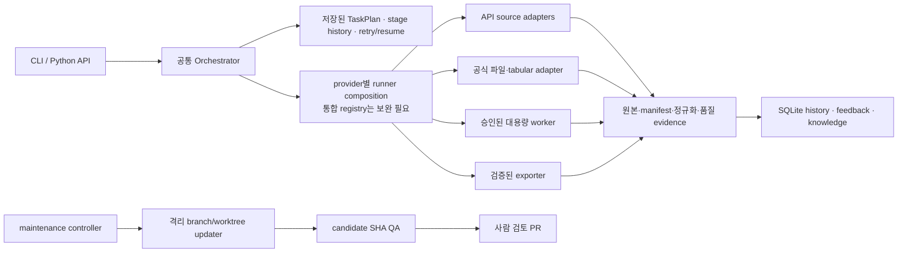

# MacroAtlas 통합 제품 기획서

> 문서 ID: MDP-PLAN-002 | 버전: 2.0 | 기준일: 2026-10-27
> 이 문서는 원초 제품 요구사항과 이후 승인된 수정·설계·운영 범위를 하나의 현재 기획으로 통합한다. 회차별 과거 결과는 [`PROJECT_PLAN_ORIGINAL_2026_10_24.md`](PROJECT_PLAN_ORIGINAL_2026_10_24.md)와 보고서에 보존한다.

## 0. 문서 권위와 읽는 법

`PROJECT_PLAN.md`가 제품 목표, 현재 범위, 완료 기준, 남은 구현의 유일한 기준이다. 이 문서와 다른 계획 파일이 충돌하면 이 문서를 먼저 갱신하고, 변경 이유를 `docs/DECISION_LOG.md`에 기록한다.

| 문서 | 역할 |
|---|---|
| 이 문서 | 제품 요구사항, 엔진 경계, 데이터·품질 정책, 현재 범위, 통합 실행 순서 |
| [`docs/IMPLEMENTATION_PLAN.md`](docs/IMPLEMENTATION_PLAN.md) | 구현·Gate 상태와 검증 증거의 현황표. 요구사항이나 우선순위를 새로 만들지 않음 |
| [`docs/ROADMAP_2026_10_26.md`](docs/ROADMAP_2026_10_26.md) | 이 문서에서 파생한 짧은 실행 순서. 독립 기준이 아님 |
| [`docs/ENGINE_REQUIREMENTS_AUDIT_2026_10_27.md`](docs/ENGINE_REQUIREMENTS_AUDIT_2026_10_27.md) | 엔진·피드백·평가·최신성·출력 항목별 구현 대조 |
| [`docs/ENGINE_CONSOLIDATION_PLAN.md`](docs/ENGINE_CONSOLIDATION_PLAN.md), [`docs/KNOWLEDGE_ENGINE_PLAN.md`](docs/KNOWLEDGE_ENGINE_PLAN.md), [`docs/SERIES_FRESHNESS.md`](docs/SERIES_FRESHNESS.md), [`docs/EVALUATION_CASES.md`](docs/EVALUATION_CASES.md), [`docs/OUTPUT_AND_VARIANT_POLICY.md`](docs/OUTPUT_AND_VARIANT_POLICY.md) | 해당 하위 기능의 상세 계약. 현재 우선순위와 완료 여부는 이 문서 및 구현 증거를 따름 |
| `docs/ITERATION_*_PLAN.md`, `docs/*_REPORT.md`, Gate·live 기록 | 과거 범위·실행·검증 증거. 과거 계획을 현재 구현으로 간주하지 않음 |

구현 상태는 **완료**, **제한 범위**, **부분 구현**, **미구현**, **미관측**, **현재 범위 제외**를 구별한다. 계획에 적힌 기능, fixture 성공, 자동 테스트 통과만으로 live 지원이나 Gate 통과를 주장하지 않는다.

## 1. 제품 목적과 설계 기준

MacroAtlas는 사용자가 요청한 국제금융·거시경제 통계를 공식 출처에서 찾고, 통계적 의미를 확인해 수집·검증·보존·전달하는 로컬 우선 Python 도구다. 결과에는 출처와 수집 조건, 원본 및 검증 이력을 연결한다.

먼저 제한된 공식 경로를 끝까지 재현 가능하게 만든다. 모든 기관을 자동으로 찾는 챗봇, 투자판단 도구, 무인 데이터 보정 시스템을 현재 제품 목표로 삼지 않는다. 지원되지 않거나 의미가 불확실한 요청은 추정으로 완성하지 않고 이유와 다음 선택지를 보고한다.

기본 원칙은 다음과 같다.

- 기관·dataset·series의 식별자와 공식 근거를 보존한다. 이름이 비슷하다는 이유로 통계 의미나 기관 간 동등성을 확정하지 않는다.
- 원본 응답과 정규화 결과를 분리한다. 원본을 덮어쓰지 않고 결측을 0으로 바꾸거나 값을 묵시적으로 보간하지 않는다.
- 전송, 구조, 의미, 품질, 요청 정합성을 별도로 검증한다. 확인되지 않은 필드는 `unknown`으로 남긴다.
- 사용자의 현재 지시는 이전 설정이나 과거 지식보다 우선한다. 한 작업의 교정을 다른 기관·개념의 공통 규칙으로 자동 확산하지 않는다.
- 비용·시간·요청 횟수·파일 크기는 실행 전에 제한한다. 실패는 정확한 task/stage에 기록하고 명시적으로 재개한다.
- 검증 범위와 증거 종류를 명시한다. 공식 문서 확인, fixture, live API, 실제 수집은 서로 다른 증거다.

## 2. 사용자와 핵심 작업 흐름

주요 사용자는 국제금융·거시경제 분석가와 반복 시계열을 다루는 연구자다. 핵심 작업은 공식 통계 출처·정의 찾기, 후보 비교, 확정된 범위 수집, 원본과 검증 결과 확인, CSV·Excel 분석 자료 전달, 과거 작업 실패 복구다.

제품의 목표 흐름은 다음 순서를 따른다.

1. 요청의 통계 개념, 국가/지역, 기간, 주기, 출력 요구를 확인한다.
2. 허용된 공식 근거와 저장 지식을 제한적으로 조회해 기관·dataset·series 후보를 찾는다. 후보별 정의·식별자·단위·주기·범위·불확실성을 구분한다.
3. 의미나 접근 경로가 모호하면 수집 전에 질문하거나 `NEEDS_REVIEW`로 중단한다. 후보 선택과 출력 조건을 버전이 연결된 확인 기록으로 저장한다.
4. 확정된 계획을 task/stage로 저장한 뒤 지원 connector를 실행한다. 원본·manifest·해시·요청 시각을 보존한다.
5. 정규화·품질·최신성을 확인한다. `STALE` 또는 `FRESHNESS_UNVERIFIED` 값은 성공 결과나 export에 내보내지 않는다.
6. 검증된 결과에 출처·단위·주기·결측·제한사항을 붙여 전달한다. 수집 성공, 링크 제공, 파일 생성은 각각 구분한다.
7. 사용자가 오류나 선호를 교정하면 task/stage에 연결한 피드백 기록으로 남긴다. 그 피드백만으로 코드나 전역 규칙을 바꾸지 않는다.

일반 자연어 UI, 대화형 앱, 전 기관 자동 검색은 현재 구현 범위가 아니다. 현재 입력은 고정·구조화 CLI와 Python API다.

## 3. 현재 지원 기준과 비범위

### 3.1 실제 구현 범위

| 경로 | 현재 지원 | 한계·판정 |
|---|---|---|
| World Bank WDI | 미국 GDP `NY.GDP.MKTP.CD`, source 2, 1–10개 연도 수집 | 고정된 annual 경로. 일반 지표·국가 탐색으로 확대하지 않음 |
| BOJ | FM08/FXERD01 한 달 수집 | 단일 시리즈·월 범위. 다른 series·기간은 미지원/미검증 |
| BLS/Census | 제한 Python API connector 경로 | 일반 CLI 검색·기관 전반 series catalog로 확장하지 않음 |
| TIC/BIS 지정 파일 | 필요할 때 사용자가 요청하는 제한 파일 intake/watch 명령 | 자료 변경의 반복·예약 확인은 현재 필요 범위에서 제외했고 자동 감시는 중지함. 과거 `unchanged` 및 natural revision 미관측 상태는 기록으로 보존. Gate C는 승격하지 않음 |
| CSV 전달 | 완료·품질 통과 World Bank GDP와 BOJ FXERD01 task | 로컬 저장값 재검증 후 CSV와 provenance sidecar 작성. XLSX·다중 series 비교는 미지원 |
| BIS GLI flat ZIP | 지정 보존 원본 한 건의 명시 승인형 Linux worker | 구조 보존 JSONL만 생성. 일반 파일·Windows worker·경제 의미 정규화는 미지원 |
| 피드백·지식 | task 연결 SQLite append-only 피드백 기록, 검토 상태, 제한된 명시 재사용 | 자동 사례 생성·코드 수정·공통 규칙 승격 없음 |
| 주기별 최신성 | daily부터 annual까지 frequency 정책과 exact-series override를 적용하는 공통 gate | 기본 일수는 운영 기본값이며 각 기관의 실제 공표 일정 보증은 아님 |
| 평가 사례 | versioned development/validation/holdout 형식·누수 및 frozen hash 검사기 | 현재 세 set이 비어 있음. 후보 엔진 실행·점수·승격은 아직 없음 |

Gate A와 D는 해당 범위에서 통과했다. Gate B/C/E는 제한 범위 판정이다. Gate 판정의 상세 evidence는 [`docs/IMPLEMENTATION_PLAN.md`](docs/IMPLEMENTATION_PLAN.md)와 각 회차 보고서를 따른다.

### 3.2 현재 범위에서 제외

- TIC/BIS 자료 변경상태의 반복·예약 확인. Vantage 또는 별도 유료 시장데이터 공급자 연동.
- 일반 자연어 검색·전체 기관 자동 탐색·근거 없는 기관/series 대체.
- 호환성 검증이 없는 단위·통화·주기 변환, 자동 보간·forward-fill, cross-source 의미 매핑.
- 범용 XLSX 출력과 여러 시계열을 한 표로 자동 결합하는 기능(향후 구현 목표는 §9).
- 사용자의 일상 대화 자동 수집, 피드백으로 자동 규칙 승격, 무인 코드 병합·배포.
- 무제한 대용량 파일 처리, 인증·CAPTCHA·접근 제한 우회, 투자 조언.

기관·파일 형식 확대는 반복된 실제 요청, 공식 source contract, 수용 테스트가 정해진 경우에만 하나씩 진행한다.

## 4. 엔진 구조와 통합 원칙

제품 데이터 처리와 개발자 코드 유지보수는 서로 다른 권한·상태를 가진다. 하나의 범용 거대 엔진이나 기관마다 독립 agent를 만드는 방식은 목표가 아니다.
아래 그림은 이 책임 경계의 논리 구성이며, 모든 상자를 현재 통합 완료로 뜻하지 않는다. 현재 구현 상태는 이어지는 표와 §3을 따른다.

- **공통 실행 계층:** `Engine`, `StageInput`, `StageResult`, `TaskPlan` 계약과 `Orchestrator`가 stage lifecycle·attempt·상태·resume·이력을 관리한다. provider별 runner factory와 CLI mapping은 아직 각 진입점에 나뉘어 있고, 전역 engine/version registry는 구현되지 않았다.
- **출처별 adapter:** 기관 API endpoint, 인증, paging, response schema와 파일 parser는 각 connector/engine adapter가 책임진다. 이 차이를 없애려고 하나의 거대한 source engine으로 합치지 않는다.
- **공유 서비스:** transport 공통 처리, raw/artifact store, metadata projection, freshness evaluator, duration estimator 등 반복되는 정책을 typed service로 둔다. 독립 권한·수명이 없는 부품을 또 다른 “엔진”으로 부르지 않는다.
- **대용량 worker:** 작은 tabular parser와 다른 memory/time/checkpoint 경계를 가진다. qualification 통과는 production 승인이 아니다.
- **개발자 maintenance:** 분석 proposal → 격리 수정 → candidate SHA QA → branch/PR까지만 지원할 수 있다. 제품 task·원본·credential과 분리하며 자동 merge·배포하지 않는다.
- **현재 통합 공백:** 실행 계약은 공통이지만 provider별 runner factory와 CLI dispatch의 engine mapping 생성은 완전히 한곳으로 모이지 않았다. 새 source를 추가하기 전에 공통 composition/registry 경계를 보완한다. 이 정리는 source-specific adapter를 없애는 작업이 아니다.

| 엔진/계층 | 맡는 일 | 현재 상태 |
|---|---|---|
| Discovery·후보 선택 | 공식 출처 근거와 제한된 dataset/series 후보를 찾고 수집 계획의 근거를 만든다. | 구조화 요청과 일부 제한 경로만 지원. 일반 자연어 및 전 기관 자동 탐색은 제외. |
| Source connector/adapter | World Bank·BOJ·BLS·Census API별 인증, 요청, paging, 응답 해석을 수행한다. | 출처별 adapter로 유지하며 일부 경로만 실제 수집 검증. 기관을 독립 agent로 쪼개지 않는다. |
| 공식 파일 intake/watch | 지정한 TIC/BIS 파일의 범위·출처를 기록하고 허용된 단발 작업을 수행한다. | 필요 시 사용자 요청으로만 사용. 반복 변경 감시 자동화는 중지. |
| Large-file trial/production worker | 자원·시간·범위를 제한해 대용량 원본을 분리 처리하고 결과를 전달한다. | trial/production 경로가 분리됨. 보존한 BIS GLI flat ZIP 1건의 승인형 Linux 구조 보존 경로만 확인. |
| Orchestrator·task history | 저장된 plan을 stage로 실행하고 상태, attempt, 실패, 명시적 resume 이력을 관리한다. | 공통 lifecycle이 구현됨. provider 전체의 runner composition은 아직 전역 단일 registry로 통합되지 않음. |
| Quality·freshness | 구조·통계 품질과 최신 관측 period를 평가해 검증되지 않은 값을 차단한다. | 주기 정책과 connector 연결은 구현됐으나 초기 기본 일수이며 모든 generic tabular 경로·공표 달력까지 검증된 것은 아님. |
| Feedback·knowledge | task에 연결된 교정을 별도 기록하고 승인된 scope-bound 지식만 제한 재사용한다. | SQLite append-only log와 명시적 검토 흐름 구현. 자동 사례·규칙 생성 및 승격은 없음. |
| Evaluation·rule review | 사례 split에서 baseline/candidate를 비교하고 통과한 변경의 근거·리뷰·rollback을 남긴다. | 사례 schema 및 split/hash validator만 구현됐고 세 set은 비어 있음. 실행 비교기·promotion registry는 미구현. |
| Export·alignment | 검증된 원자료와 서로 다른 시계열의 비교 출력을 분리한다. | World Bank/BOJ 한정 CSV만 지원. XLSX 원자료 및 multi-series alignment는 미구현. |
| Developer maintenance workflow | 저장소 개선 후보를 격리 branch/worktree에서 수정·검증해 사람이 검토할 PR로 만든다. | 제품 데이터 Orchestrator와 별도 control plane. 일부 QA/updater 흐름은 있으나 자동 merge·배포는 없음. |

현재 코드 대조와 남은 공백은 [`docs/ENGINE_REQUIREMENTS_AUDIT_2026_10_27.md`](docs/ENGINE_REQUIREMENTS_AUDIT_2026_10_27.md), 세부 호출 경로는 [`docs/ENGINE_CONNECTIONS.md`](docs/ENGINE_CONNECTIONS.md)를 따른다.

## 5. 원본·메타데이터·정규화 시계열 계약

수집과 분석이 공통으로 이해할 목표 record는 다음을 연결한다.

- **식별:** source agency, dataset/dataflow ID, series ID 및 차원 key, 사용자가 요청한 field/concept.
- **의미:** 원문 정의와 언어, normalized definition, unit·scale, currency, frequency, calendar, seasonal/price adjustment, stock/flow, coverage, revision/vintage.
- **관측:** source period, period start/end, 원래 값, missing/suppressed 상태. `0`, `null`, 결측·미공개·비해당을 섞지 않는다.
- **출처와 재현성:** source URL, retrieval timestamp(UTC), raw path/hash, request manifest/hash, parser/engine version, freshness policy와 series override.
- **검증:** 구조·의미·quality·freshness 상태와 근거, 검토 시점, 확인되지 않은 필드.

원본 payload를 불변으로 보존하고 정규화·변환은 버전이 붙은 별도 산출물로 만든다. source metadata가 없으면 추측하지 말고 `unknown`으로 남긴다. 공통 typed series/batch 계약은 아직 부분 구현이며, 먼저 World Bank와 BOJ의 현재 제한 경로를 연결해 다른 provider를 건드리지 않고 검증한다.

## 6. 최신성·품질·복구 정책

최신성은 수집 시각이나 metadata update가 아니라 가장 최신 **관측 period**를 사용해 평가한다. 현재 기본 허용일은 daily 7, weekly 21, monthly 120, quarterly 240, semiannual 183, annual 730일이다. 정확한 series ID 또는 canonical series key override가 기본 frequency를 대체할 수 있다. policy ID/hash, frequency 근거, 최신 period, age, 허용 일수, 평가 시각을 결과 evidence에 기록한다.

이 값은 초기 operational defaults다. 기관별 release calendar와 series-specific publication lag를 검증한 값은 아니다. latest period가 없거나 frequency/period가 불명확하거나 미래 period면 `FRESHNESS_UNVERIFIED`, 허용일을 넘으면 `STALE`이다. 두 상태의 관측값은 normalized result 및 export에서 제외하고 원본만 검토용으로 유지한다.

검증 층위는 전송·압축 무결성 → 구조/series 식별 → 통계 의미/단위/차원 → 결측·중복·단절/개정 → 요청 범위 일치다. 이상치나 원본 값은 자동 수정·삭제하지 않는다.

호출당 기본 요청은 한 번이며 hidden retry를 하지 않는다. 저장된 `Retry-After`가 있으면 최소 대기 전 resume를 차단한다. 장애 해소 후 같은 task/stage를 명시적으로 재개한다. 터미널 실패나 의미 검토는 자동 재시도하지 않는다. 대용량은 사전 계획·메모리/시간/byte/cell budget·고정 승인 범위 안에서만 처리한다.

세부 freshness 정의와 현재 connector 한계는 [`docs/SERIES_FRESHNESS.md`](docs/SERIES_FRESHNESS.md), 오류 유형과 시험 policy는 구현 상태 및 대용량 엔진 문서를 따른다.

## 7. 피드백, 사례 평가, 규칙 반영

개선 흐름은 다음 순서로 분리한다.

**task 연결 피드백 로그 → 사람 검토·분류 → 비식별화한 versioned 사례 → development/validation/holdout 회귀 비교 → 심사 기록 → 별도 branch의 명시 변경·QA·PR**

- 피드백은 task, stage, scope, category, knowledge kind, evidence와 append-only revision으로 저장한다. 사용자가 남긴 피드백은 자동으로 엔진 코드나 전역 지식으로 반영하지 않는다.
- 사례는 원 질문과 변형, 기대 state와 기관/dataset/series/field, 필수 근거, 금지 동작, Excel 기대 정책, provenance/reviewer/privacy clearance를 가진다.
- 비슷하지만 기대 답이 다른 질문은 같은 contrast group에 둔다. development, validation, holdout은 별도 파일로 관리한다. validation/holdout 변경은 의도적 리뷰와 version/hash 변경을 같은 PR에 남긴다.
- baseline과 candidate는 동일한 case version에서 실행한다. 유형별 state/target accuracy, candidate ranking, false confirmation, 금지 동작을 비교한다. promotion gate는 목표 유형 개선, 다른 유형 퇴행 없음, false confirmation 0건, 금지 동작 0건이다.
- 승격 기록은 실패 유형, 근거 case/source/version, 지표, candidate/applied commit, reviewer decision, rollback commit을 포함한다. 통과한 평가도 사람 승인 전에는 규칙이나 코드를 반영하지 않는다.
- raw feedback body를 공개 case 파일에 복사하지 않는다. 승인된 경우에도 필요한 문장만 비식별화하고 privacy review를 통과시킨다.

현재 feedback log와 명시적 knowledge reuse는 구현돼 있다. evaluation case schema/split validator는 추가됐지만 세 set이 비어 있다. 후보 engine output을 공통 형식으로 실행·점수화하는 비교기와 rule promotion/rollback registry는 아직 구현되지 않았다. 따라서 지금은 평가나 승격 완료라고 부를 수 없다. 사용법과 schema는 [`docs/EVALUATION_CASES.md`](docs/EVALUATION_CASES.md)를 따른다.

## 8. 지식 검색과 제한적 재사용

이력 전체와 raw payload를 매 요청마다 읽지 않는다. SQLite projection/index에서 기관·dataset·concept·분류/버전·유효 시점·verification state로 범위를 좁혀 관련 근거만 bounded lookup한다. 근거 만료·충돌·unknown은 숨기지 않는다.

명시적으로 검토된 사실과 사용자의 scope-bound instruction을 분리한다. 사용자 instruction reuse는 적용할 stage/category를 확인하고 현재 지시가 우선한다. unreviewed feedback과 inference는 기본 재사용에서 제외한다. index stale, pending update, scope mismatch는 선택한 stage skip이나 실행을 허용하지 않는다. 이 지식 계층은 source collection engine과 별도의 중앙 control plane이다.

상세 query budget·index lifecycle 및 11–13회 구현 근거는 [`docs/KNOWLEDGE_ENGINE_PLAN.md`](docs/KNOWLEDGE_ENGINE_PLAN.md), [`docs/REFERENCE_SCENARIOS.md`](docs/REFERENCE_SCENARIOS.md)에 있다.

## 9. CSV·Excel·다중 시계열 출력 기준

출력 계약은 원본 전달과 비교/가공을 분리한다.

1. **개별 원자료 전달:** 검증된 series의 source period, 원래 값·상태, 단위·통화·주기, 기관/dataset/series, 조회 시각, URL, raw/manifest hash를 함께 제공한다. Excel 원자료 출력은 아직 구현되지 않았다.
2. **여러 원자료 series:** 의미·calendar·frequency·unit·currency·revision contract가 호환됨을 확인한 series만 같은 sheet에 둔다. 호환되지 않으면 별도 sheet로 분리한다. 겹치는 날짜의 값이 다르면 덮어쓰지 않고 양쪽을 보존하거나 `NEEDS_REVIEW`로 보낸다.
3. **정렬/가공 비교:** 원자료 시트와 분리된 alignment sheet를 만든다. 날짜 기준, timezone/calendar, 집계·주기 변환, 단위 변환, 정렬 방식과 결측 처리를 provenance에 명시한다.
4. **결측과 변환:** 기본 missing output은 빈 셀이다. 자동 보간과 forward-fill은 금지한다. 계산/정렬에 필요한 변환은 사용자가 확인한 명시 정책으로만 수행하고 식·원본 값을 보존한다.

현재 지원은 완료·quality-passed World Bank/BOJ task의 CSV와 provenance sidecar다. XLSX exporter, multi-series workbook, alignment sheet는 미구현이다. 저장 task CSV를 Excel 또는 비교 워크북 완료로 간주하지 않는다. 상세 출력/variant 정책은 [`docs/OUTPUT_AND_VARIANT_POLICY.md`](docs/OUTPUT_AND_VARIANT_POLICY.md)를 따른다.

## 10. 보안·외부 접근·운영

- 필요한 기관/경로의 API credential만 선택적으로 설정한다. 키는 환경변수/로컬 비추적 설정에 두고 코드·URL·문서·fixture·로그에 기록하지 않는다. 다른 기관 자격 증명으로 대체하거나 인증·접근 제한을 우회하지 않는다.
- 허용된 공식 source와 문서화된 API만 사용한다. 호출 제한·라이선스·attribution을 확인하고 live GET은 목적·범위가 분명할 때 실행한다.
- task 계획과 예산을 네트워크 요청 전 저장한다. request, stage, attempt, raw, manifest, normalized artifact 및 hash를 연결한다.
- 파일 output은 project 경계·no-overwrite·symlink/path 가드를 지킨다. 대용량 worker는 fixed source, resource cap, source/hash check, explicit approval을 요구한다.
- maintenance updater는 clean base 또는 지정 base의 격리 worktree에서 허용 경로를 수정하고 동일 candidate SHA를 QA한다. 자동 merge/publish는 하지 않는다.
- Windows Task Scheduler는 정적/dry-run 검증과 실제 사용자 동작을 구분한다. 예약 등록·활성화는 현재 계획상 비활성이며, 실제 invocation을 확인하기 전에 사용 중이라 주장하지 않는다.

## 11. 통합 실행 순서와 완료 조건

아래 순서는 제품 작업 간 의존성과 현재 미완료 상태를 통합한 기준이다. 데이터 파이프라인과 maintenance tool은 서로 다른 workstream으로 관리한다. 사용자 관찰 23회차는 명시적으로 마지막 단계다.

| 순서 | Workstream | 작업 | 완료 조건 |
|---:|---|---|---|
| 1 | 평가 | 검토·비식별화된 사례를 development set에 추가하고 contrast group을 검토한다. Validation/holdout은 사례 근거와 review/hash update가 함께 있을 때만 고정한다. | 세 set이 실제 사례를 포함하고 structural/leakage/hash 검증에 통과. Synthetic 사례는 `synthetic`으로만 표시하고 사용자 evidence로 세지 않음 |
| 2 | 평가 | 공통 EngineOutcome adapter와 baseline/candidate runner를 구현한다. | 동일 case version의 state/target/ranking/근거/금지 동작 비교, 유형별 결과 및 false confirmation 집계 재현 |
| 3 | 규칙 | explicit promotion record와 rollback 추적을 구현한다. | 검증/holdout 및 금지 동작·false confirmation gate 통과, reviewer·applied commit·rollback 기록 완료 전에는 미승격 |
| 4 | 시계열 모델 | 공통 typed Series/ObservationBatch를 설계하고 World Bank·BOJ 고정 경로에 먼저 연결한다. | source identity, field, currency/unit, frequency/calendar, period, override, raw/source provenance와 unknown 보존; 기존 raw/hash 계약 유지 |
| 5 | 원자료 출력 | 개별 호환 series의 XLSX 원자료 출력 및 provenance를 구현한다. | 파일 경계/no-overwrite 검증, source 값과 결측 보존, stale/unverified 차단, 지원 connector별 fixture와 실제 저장 task 확인 |
| 6 | 비교 출력 | 다중 series worksheet 분리와 alignment sheet를 구현한다. | compatibility rule, date/calendar, 집계/변환식, 결측 빈칸, overlap 충돌 보존/검토, 보간·forward-fill 금지를 회귀 테스트 |
| 7 | 엔진 조립 | provider별 mapping을 더 쉽게 검토·등록할 공통 composition registry를 보완한다. | 같은 Orchestrator lifecycle에서 source-specific adapters를 등록하고 plan/version 검증과 resume가 회귀 없이 동작. 현재 provider 전체를 무리하게 통합하지 않음 |
| 8 | 유지보수 | Windows changed-candidate/handoff 및 failure-recovery pilot을 실측한다. | candidate SHA, 동일 SHA QA, allowlist, 실패/no-push, cleanup 및 handoff report 확인 |
| 9 | 유지보수 | scheduler invocation은 정책을 확인한 뒤 별도 검증한다. | 등록 여부와 무관하게 우선 정적/dry-run 검증. 명시 승인 전까지 예약 작업은 비활성으로 유지하고 실제 invocation을 임의로 주장하지 않음 |
| 10 | 유지보수 | 실행 시간 추정과 statistical metadata/quality를 실제 승인 작업에서 보정한다. | operation별 paired forecast가 3건 쌓인 후 error 재평가. 선택된 실제 series의 정의·단위·주기·calendar·revision evidence를 확인 |
| 11 | 확장 | 반복 실수요가 확인된 provider/file format 하나를 선정해 qualification한다. | 공식 source contract, 예산, cancel/orphan recovery, 단위 정상/실패 evidence를 하나의 범위에서 통과. 전 기관 지원으로 일반화하지 않음 |
| 12 | 사용자 검증 | 실제 분석가 1–2명이 저장 결과→파일 전달 흐름을 수행하는 23회차 관찰 | 참여자 동의·익명 기록, 업무 성공/실패·오해·수동 시간·재사용 여부를 기록. 참가자 evidence 없이 usability 통과 선언 금지. **모든 기술 workstream 뒤 마지막 순서** |

회차 한 번에는 하나의 번호가 붙은 High scope만 구현한다. 현재 gate가 실패하면 의존하는 다음 구현을 통과 처리하지 않는다. 순서를 바꿀 때는 영향·이유·새 수용 기준을 기록하고 미통과 gate는 그대로 남긴다.

### 별도 유지보수 상태

PR #34 이후 공통 maintenance QA, isolated updater, candidate SHA handoff, Windows installer dry-run/no-op/cleanup/lock 경로는 일부 확인됐다. 아직 실제 Windows changed candidate와 failure recovery, 실제 scheduler invocation은 확인되지 않았다. updater scheduler는 비활성이다. 시간 예측은 qualification 15건·production 1건의 과거 catalog 표본과 paired forecast 0건으로 낮은 신뢰도다. 최신 수치와 실행 근거는 구현 상태·27회차 보고서를 참조한다.

## 12. 완료·검토 규칙

각 변경은 문제와 사용자 영향, 입출력 contract, 최소 정상·실패 사례, 데이터 완전성·보안 영향, 회귀 검증, 남은 한계를 포함한다. Tests, lint, diff 검사와 필요 CI를 실행한다. Fixture, synthetic, live evidence를 구분한다. 코드나 문서에 “완료”라고 적으려면 현재 branch/base에서 해당 범위에 맞는 증거가 있어야 한다.

외부 데이터 변경, 의미 판단, 새 credential, 라이선스·접근권, 원본 덮어쓰기, 자동 promotion/merge/publish는 명시된 안전 경계와 검토 승인을 따라야 한다. 정상적인 reversible 코드·문서 변경은 전용 branch에서 진행하고 human review PR로 제공한다.

## 13. 관련 증거·설계 자료

- 실행 가능 범위: [`docs/USER_GUIDE.md`](docs/USER_GUIDE.md), [`README.md`](README.md)
- 현재 Gate·상태: [`docs/IMPLEMENTATION_PLAN.md`](docs/IMPLEMENTATION_PLAN.md), [`docs/UNRESOLVED_ITEMS.md`](docs/UNRESOLVED_ITEMS.md)
- 통합/유지보수 설계: [`docs/ENGINE_CONSOLIDATION_PLAN.md`](docs/ENGINE_CONSOLIDATION_PLAN.md), [`docs/ENGINE_CONNECTIONS.md`](docs/ENGINE_CONNECTIONS.md)
- 사용자 흐름·출력: [`docs/WORKFLOW_ALIGNMENT_PLAN.md`](docs/WORKFLOW_ALIGNMENT_PLAN.md), [`docs/OUTPUT_AND_VARIANT_POLICY.md`](docs/OUTPUT_AND_VARIANT_POLICY.md), [`docs/ITERATION_23_PLAN.md`](docs/ITERATION_23_PLAN.md)
- scenario/evaluation: [`docs/REFERENCE_SCENARIOS.md`](docs/REFERENCE_SCENARIOS.md), [`docs/EVALUATION_CASES.md`](docs/EVALUATION_CASES.md)
- 과거 실행 결과·변경 이유: `docs/ITERATION_*_REPORT.md`, [`docs/DECISION_LOG.md`](docs/DECISION_LOG.md)
