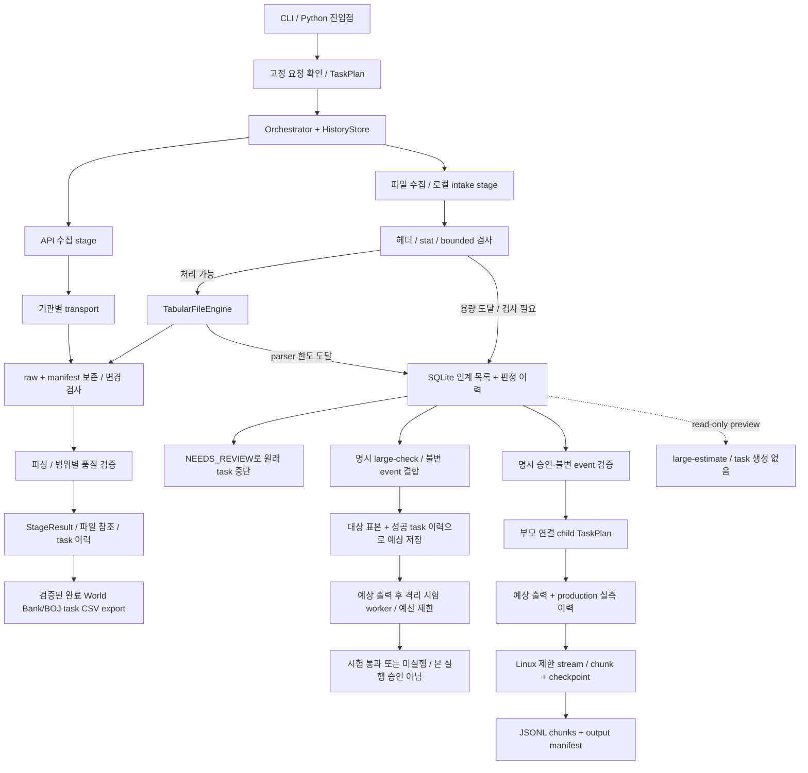

# 엔진 연결 설계 — 실제 흐름과 대용량 인계

기준: 2026-10-27 현행 소스 확인. **실선은 구현된 호출, 점선은 후속 연결 설계**다.
출처별 runner가 같은 Orchestrator 계약을 사용하지만, 공통 전역 registry는 아직 없다. transport·parser·capacity 검사·storage는 엔진의 내부 부품이다.
제품 요구사항·우선순위는 [통합 제품 기획](../PROJECT_PLAN.md), 실행 순서 요약은
[로드맵](ROADMAP_2026_10_26.md)을 따른다.

이 문서는 사용자 데이터 제품의 실행 경로를 다룬다. 저장소 코드를 분석·수정·QA하는 개발자 유지보수 흐름은 제품
Orchestrator 및 source engine과 별도 control plane이다. 현재 중복 실행기와 통합 목표는
[엔진 통합·분리 개선안](ENGINE_CONSOLIDATION_PLAN.md)을 따른다.

그림의 파일 경로는 논리 흐름이다. 현재 `GateCFileEngine` 내부 호출 순서는 transport의 HTTP 용량 검사 →
inbox 보존 → `TabularFileEngine`의 preflight → raw package/변경 검사 → parser/normalized 저장이다.
로컬 intake는 HTTP 단계를 거치지 않는다. API는 기관별 응답 예산을 사용하며 비API 인계 기준을 적용하지 않는다.
그림의 raw/manifest는 공통적인 보존 책임을 뜻한다. 현재 작은 파일 저장 함수는 16 MiB 입력/64 MiB
정규화 상한을 유지하며, 19회차 대용량 실행은 BIS flat ZIP 한 건에 한해 별도 budget과 segmented JSONL manifest를 쓴다.

## 현재 실제 연결표

| 진입점 | 저장되는 stage / 실제 호출 | 출력·다음 연결 |
|---|---|---|
| `collect worldbank-gdp` | CLI → WorkflowService의 명시 확인 → WorldBankRequestDispatcher → `worldbank_collect_audit` → `worldbank_validate` | raw/manifest + 검증 payload/AuditStore. 실행 전 저장된 확인 조건 재검사 |
| `collect boj-fxer` | `build_boj_plan` → `boj_metadata` → `boj_observations` | 검증된 metadata payload를 observations의 upstream으로 전달. raw/manifest 및 제한된 observations |
| `watch tic/bis` | `build_gate_c_watch_plan` → `gate_c_file_watch`; 내부에서 OfficialFileTransport → TabularFileEngine | 정상 파일은 raw/normalized/manifest. 용량 도달은 인계 record. 내부 부품 호출은 별도 stage가 아님 |
| 기존 로컬 파일 | Python API로 `tabular_file` engine 등록 → TabularFileEngine | inbox 경로 검사 → capacity → raw/변경 guard → parser → 저장. 범용 파일 CLI는 없음 |
| BLS/Census | Python API에서 BLSEngine/CensusEngine을 runner에 명시 등록 | 기관별 query/transport → raw/변경·품질 guard → StageResult. 현재 고정 CLI dispatch 대상에는 없음 |
| `status` / `resume` | task 조회 / 저장된 workflow·engine plan으로 해당 runner 선택 | 새 source 범위를 만들지 않고 같은 task 재개. World Bank/BOJ/watch는 저장된 계획을 재개하고, 대용량 시험 task는 중단 worker의 종료를 확인해 미확정 결과를 기록 |
| `export TASK_ID --format csv --output data/exports/name.csv` | CLI → read-only `export_task` → task/audit/raw/manifest 재검증 | 완료된 World Bank GDP/BOJ FXER task만 UTF-8 CSV와 provenance sidecar로 전달. 네트워크·task DB 쓰기 없이, 덮어쓰기 금지 |
| `large-check ID [--event-seq N]` | create_trial → 불변 event/scope·stat·코드/예산과 duration profile/forecast 결합 → worker 직전 예상 표시 → large_file_trial stage | Linux 격리 시험만 실행. TRIAL_PASSED 또는 NOT_EXECUTED, 본 실행 자동 승격 없음. 완료 요약에 actual stage seconds 포함 |
| `large-estimate qualification/production ID [--event-seq N]` | SQLite와 로컬 표본의 read-only 조회 → 선택 엔진 이력으로 예측 | task/event/worker 실행 없이 시간 범위·신뢰도·표본 수만 반환 |
| `deferred [ID]` | DeferredNonAPIStore의 read-only 조회 | 대상 목록 / 최근 이력 조회. 조회가 대용량 엔진 실행을 유발하지 않음 |
| `deferred ID --events` | read-only append-only event 조회 | 불변 event sequence를 포함해 정확한 handoff 대상을 지정 |
| `large-run ID --event-seq N --approve-production` | 성공한 동일 event/hash qualification 확인 → 보존 raw/request manifest binding 및 duration forecast를 child에 저장 → worker 직전 예상 표시 → resource-limited worker | BIS GLI flat ZIP 1개만 Linux에서 처리. JSONL string chunks/checkpoint/output manifest, 완료 시 `resolved` event. 새 네트워크 요청 없음 |
| `large-resume CHILD_TASK_ID` | 같은 child plan과 artifact checkpoint 재검증 → 남은 작업 예상 표시 → 같은 task 재개 | 원본·manifest 변경 시 중단. Worker 중단 시 lock 해제 후 같은 child를 재개. 임의 source/engine 변경 불가 |

검색은 `discovery/series_search.py`의 근거 후보 생성과 명시 선택으로 분리돼 있다. 현재 고정 CLI는
범용 검색 전체를 호출하지 않는다. `acquisition_planning.py`는 API chunk 계획만 반환하며 실행 queue가 아니다.
지식 재사용은 `plan_with_knowledge`에서 명시 선택·범위 검사를 거쳐 허용 stage만 생략한다. raw 데이터를 바꾸지 않는다.

## 엔진 간 공통 계약과 상태

- 연결: `TaskPlan(StageSpec...)`에 순서·engine/version·입력·시도 예산을 고정한다. registry는 `(engine, version)`으로 선택한다.
- 입력: `StageInput(task_id, request, stage_id, input_data, upstream, input_refs, knowledge_context)`.
  runner가 직전 성공 결과의 payload와 evidence_refs를 전달한다. 현재 runner는 순차 실행이며 일반 DAG·분산 queue가 아니다.
- 반환: `StageResult(status, payload, evidence_refs, warnings, error_code, retry_hint, retry_after_seconds)`.
  runner가 실행 전 RUNNING과 실행 후 결과·attempt/event를 SQLite에 저장한다.
- 성공이면 다음 stage로 간다. retryable이면 원래 task를 멈추고 Retry-After/시도 예산 후 같은 task를 resume한다.
  성공 prefix 재사용은 fingerprint·TTL·검증기를 모두 통과해야 한다.
- 대용량 qualification은 task claim 전부터 workspace lock을 잡고 child worker에 상속한다. process가 강제 종료되면
  worker가 끝날 때까지 lock이 유지된다. 그 뒤 `resume`은 표시된 scratch를 정리하고 `trial_state=UNKNOWN`과
  `NOT_EXECUTED`를 기록하며, 같은 qualification을 다시 실행하지 않는다.
- 용량 인계/권한/보안/schema/의미 검토는 NEEDS_REVIEW로 멈춘다. 현재 capacity도 SCHEMA_CHANGED 코드를 사용하므로
  구체 원인은 `non_api_deferral.reason/status`로 판단한다. task 상태·전송 오류·데이터 판정을 하나로 합치지 않는다.
- 예측기는 최근 최대 500개의 성공 task stage wall time을 qualification/production별로 분리해 사용한다. bounded input
  profiling은 원문 값을 저장하지 않는다. paired forecast 3개 전에는 유사 성공 실측 3건 이상이면 경험 후보를 쓰고,
  그보다 적으면 warm-up baseline을 사용한다. 이후 paired shadow forecast에서 MAPE가 낮은 후보를 고른다. 예측은 worker
  상한·approval·미실행 조건을 바꾸지 않으며 시간의 범위와 신뢰도로만 안내한다.
- 큰 원본·정규화 본문은 파일로 둔다. 후속 대용량 stage 간 payload는 `artifact_id, relative_path, manifest_ref,
  sha256(확인된 경우), schema/version, counts/quality` 참조로 제한한다. 현재 작은 API payload 전체를 즉시 재작성하지 않는다.

## 엔진별 시간 근거와 병목 계측 공백

일반 Orchestrator는 stage별 UTC `started_at`/`finished_at`을 보존하지만 `duration_ms`는 저장하지 않는다. 이 값으로 대략적인 경과시간은 사후 계산할 수 있으나 시스템 시계 변경에 영향을 받고, engine 호출 전후의 저장·직렬화 비용과 engine 내부 network/parse/quality 시간을 나누지 못한다. 대용량 worker는 monotonic `elapsed_seconds`와 일부 실행의 RSS를 별도 반환한다. knowledge lookup은 후보 row/byte 수 및 cache hit를 남기지만 elapsed time은 없다.

| 엔진/계층 | 현재 시간 자료 | 다음 baseline 측정 단위 |
|---|---|---|
| Discovery·candidate search | 실행시간 없음. 저장 metadata package의 manifest/raw/normalized를 검증하고 읽는 상한만 있음 | package 수·읽은 byte·hash 검증 시간·ranking 시간을 분리하고, metadata 규모별 fixture/replay로 측정 |
| World Bank·BOJ·BLS·Census API | 일반 stage의 UTC 경계만 있음. workspace에 분석 가능한 `catalog.sqlite` task 이력은 없음 | request/response 완결 시간, raw 저장, parse, quality/freshness, SQLite stage 완료 시간. BOJ는 metadata 재사용/수집을 따로 기록 |
| TIC/BIS watch·tabular parser | 공통 하위시간 없음. 파일 fetch와 `TabularFileEngine` 호출이 한 stage 안에 있음 | 다운로드 bytes/time, bounded read, archive/hash, parse·normalization 단계 시간과 행/열 수 |
| Large-file qualification | worker가 elapsed/RSS를 기록. 합성 CSV worker는 1 MiB 0.051–0.053초, 16 MiB 0.803–0.900초, 64 MiB 3.425–4.408초, 127 MiB 6.326–7.041초 | 기존 fixture 범위는 재사용하되 worker 시간과 전체 stage/child-process 시간을 분리 |
| Large-file production | 공식 BIS flat 24,378×21 단일 생산 실행의 stage 약 0.593초라는 기록; production sample 1건 | qualification과 섞지 말고 production input size·rows·output bytes·wall/RSS를 축적. 신뢰도는 낮음으로 유지 |
| Feedback·knowledge | candidate rows/bytes, cache hit/miss는 있으나 lookup 시간 없음 | cold/warm lookup, index refresh, candidate 수별 elapsed time 및 scan cap 상태 |
| CSV exporter·평가 validator | 별도 elapsed 없음; exporter의 검증·재파싱, evaluation set은 현재 비어 있음 | 저장 task 크기와 case 수별 읽기·hash·parse·쓰기/검증 시간을 측정. 비어 있는 평가 set 결과는 benchmark로 세지 않음 |

현재 보이는 후보 병목은 API network 대기, discovery metadata 재검증, task JSON 전체 직렬화·SQLite 갱신, exporter의 raw 재검증·재파싱이다. 측정 전에는 어느 항목도 실제 bottleneck으로 확정하지 않는다. 첫 보완은 공통 `perf_counter_ns()` stage wall time과 가능한 하위 phase timing, engine/version/status/input size·code SHA·environment를 기록하는 것이다. 사용자 요청문·원본 값·credential·query URL은 성능 기록에 넣지 않는다. fixture/synthetic/live를 구분하고, engine/version/workload tier당 표본 20개 전에는 p95를 확정하지 않는다. 성능 표본을 위해 live API 요청을 반복하지 않는다. 우선순위와 완료 조건은 통합 제품 기획 §11의 7번 작업을 따른다.

## 대용량 엔진 연결 규칙

1. 진입점은 한 개의 handoff service로 둔다. 인계 record ID뿐 아니라 **변경 불가한 판정 event/version**을 선택한다.
   현재 목록의 최신 raw 경로를 나중에 다시 읽어 선택 당시 원본이 바뀌는 일을 막는다.
2. 인계 입력은 `origin_task/stage/stage_run`, `deferral_id/event`, `policy_version`, `source/parser scope`,
   `input_kind=local_artifact|remote_source`, `raw/manifest refs`, `known hash 또는 unknown`, `scope_confirmation_ref`, `resource budget`이다.
   HTTP 헤더에서 중단된 건은 raw가 없으므로 원격 수집을 별도 대용량 예산으로 계획한다. 작은 엔진에 다시 내려보내지 않는다.
3. handoff 승인·자식 task 생성·인계 상태 갱신은 같은 SQLite transaction으로 묶고,
   선택 event+target engine/version+처리 scope를 idempotency key로 사용한다. 같은 인계의 중복 실행을 차단한다.
   구현 시 HistoryStore transaction의 connection을 인계 저장에도 전달해 DB 연결 두 개로 나눠 commit하지 않는다.
4. 원래 task의 NEEDS_REVIEW와 이력은 보존한다. 새 task를 parent/child 참조로 연결하고 별도 예산·checkpoint로 실행한다.
   같은 작업의 일시 장애는 자식 task를 resume한다. 승인된 scope·engine이 바뀌면 새 인계로 기록한다.
5. 보안 검토는 대용량 실행 승인과 따로 충족해야 한다. 더 큰 엔진도 경로·압축·TLS·출처·변경 검사를 유지한다.
   stream 원본 hash와 manifest를 보존하고, 변경/품질 검토가 필요하면 새 normalized 산출물을 공개하지 않는다.
6. 완료는 자식의 검증된 output manifest와 인계 event에 연결한다. 현재 대용량 결과는 구조 보존 JSONL이며,
   World Bank/BOJ CSV exporter 입력으로 승격하지 않는다. exporter는 provider별 검증 artifact만 읽는다.
   원본 다운로드·파싱·resume·출처 검사를 exporter에 다시 구현하지 않는다.

## 코드 대조에서 확인한 연결 공백과 최소 보완 순서

| 현재 공백 | 연결 전에 필요한 보완 |
|---|---|
| 정식 production handoff는 BIS flat ZIP 단일 source profile만 지원 | 다른 agency/file type은 별도 qualification·예산·안전 경계를 정하기 전까지 `NOT_EXECUTED` |
| stage 실행 ID는 runner 내부에 있고 현재 StageInput에는 없음 | 19회차 handoff는 immutable origin task/event와 child stage를 연결함. 세부 stage_run lineage 확장은 후속 검토 |
| task stage 완료와 output 파일 작성은 SQLite/파일 시스템에 따로 저장됨 | idempotent child task, atomic checkpoint/manifest, 재개 시 hash 검증으로 crash 창을 복구. 일반 cross-store transaction은 보장하지 않음 |
| capacity 상수는 parser 모듈에 있고 parser 한도 분류 일부는 오류 문자열에 의존 | 작은 공통 policy/reason 모듈로 정리. transport/parser/engine이 같은 typed capacity reason 사용 |
| 보안/데이터/용량에 모두 NEEDS_REVIEW가 사용됨 | 상태를 늘려 라우팅하지 말고 고정된 reason·result kind로 분기. 범용 resume가 자동 handoff하지 않음 |
| 작은 파일 저장도 용량 상한을 갖고 있음 | 작은 parser/storage 재호출 없이 대용량 전용 budget·segmented artifact manifest로 보존 |
| 대용량 output의 경제 의미·단위 해석과 CSV 전달은 없음 | 현재 World Bank/BOJ 검증 task만 CSV exporter에 연결됐다. 대용량 artifact export와 다른 provider는 별도 범위 |

확인 소스: [CLI](../src/macro_data_platform/cli.py), [runner](../src/macro_data_platform/orchestration/runner.py),
[공통 입력](../src/macro_data_platform/orchestration/models.py), [StageResult](../src/macro_data_platform/contracts.py),
[World Bank dispatch](../src/macro_data_platform/ingestion/worldbank_request.py), [BOJ](../src/macro_data_platform/ingestion/boj.py),
[파일 watcher](../src/macro_data_platform/ingestion/gate_c_watch.py), [파일 intake](../src/macro_data_platform/ingestion/tabular_files.py),
[capacity/목록](../src/macro_data_platform/ingestion/non_api_capacity.py).

17회차 시험과 19회차 제한 production handoff 경로·예산·미실행 응답은 [대용량 엔진 설정](LARGE_FILE_ENGINE.md)을 따른다.
