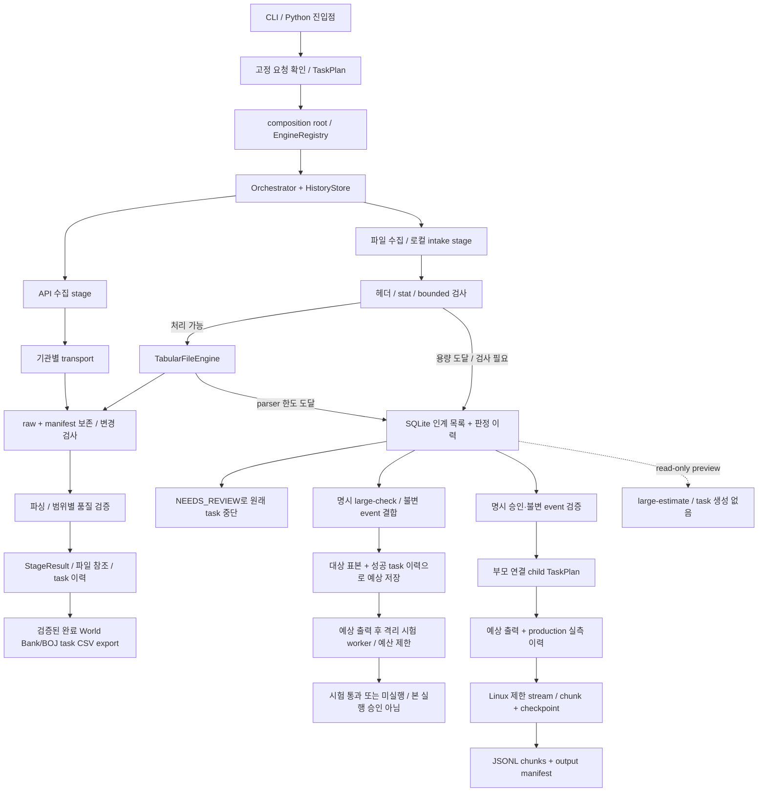

# 엔진 연결 설계 — 실제 흐름과 대용량 인계

기준: 2026-10-28, 기본 브랜치 `acc972b` 소스 확인. **실선은 구현된 호출, 점선은 후속 연결 설계**다.
API·BOJ·BLS·Census·파일 감시의 runner 조립과 저장 plan 재개는 공통 composition root/EngineRegistry를 사용한다.
transport·parser·capacity 검사·storage는 출처별 engine adapter의 내부 부품이다. 대용량 worker는 잠금·checkpoint 복구가
별도이므로 전용 runner를 유지한다.
제품 요구사항·우선순위·실행 순서는 [통합 제품 기획](../PROJECT_PLAN.md), 관측된 현재 코드 상태는
[구현 현황](IMPLEMENTATION_PLAN.md)을 따른다. 축약된 [로드맵](ROADMAP_2026_10_26.md)은 인덱스이며 독립 backlog가 아니다.

이 문서는 사용자 데이터 제품의 실행 경로를 다룬다. 저장소 코드를 분석·수정·QA하는 개발자 유지보수 흐름은 제품
Orchestrator 및 source engine과 별도 control plane이다. 현재 중복 실행기와 통합 목표는
[통합 제품 기획](../PROJECT_PLAN.md) §4를 따른다.

그림의 파일 경로는 논리 흐름이다. 현재 `GateCFileEngine` 내부 호출 순서는 transport의 HTTP 용량 검사 →
inbox 보존 → `TabularFileEngine`의 preflight → raw package/변경 검사 → parser/normalized 저장이다.
로컬 intake는 HTTP 단계를 거치지 않는다. API는 기관별 응답 예산을 사용하며 비API 인계 기준을 적용하지 않는다.
그림의 raw/manifest는 공통적인 보존 책임을 뜻한다. 현재 작은 파일 저장 함수는 16 MiB 입력/64 MiB
정규화 상한을 유지하며, 19회차 대용량 실행은 BIS flat ZIP 한 건에 한해 별도 budget과 segmented JSONL manifest를 쓴다.

## 현재 실제 연결표

| 진입점 | 저장되는 stage / 실제 호출 | 출력·다음 연결 |
|---|---|---|
| `collect worldbank-gdp` | CLI → WorkflowService의 명시 확인 → WorldBankRequestDispatcher → 공통 EngineRegistry → `worldbank_collect_audit` → `worldbank_validate` | raw/manifest + 검증 payload/AuditStore. 실행 전 저장된 확인 조건 재검사 |
| `collect boj-fxer` | `build_boj_plan` → 공통 EngineRegistry → `boj_metadata` → `boj_observations` | 검증된 metadata payload를 observations의 upstream으로 전달. raw/manifest 및 제한된 observations |
| `watch tic/bis` | `build_gate_c_watch_plan` → 공통 EngineRegistry → `gate_c_file_watch`; 내부에서 OfficialFileTransport → TabularFileEngine | 정상 파일은 raw/normalized/manifest. 용량 도달은 인계 record. 내부 부품 호출은 별도 stage가 아님 |
| 기존 로컬 파일 | Python API로 `tabular_file` engine 등록 → TabularFileEngine | inbox 경로 검사 → capacity → raw/변경 guard → parser → 저장. 범용 파일 CLI는 없음 |
| BLS/Census | 공통 EngineRegistry가 `bls/1`, `census/1`을 등록; Python API로 계획 실행 | 기관별 query/transport → raw/변경·품질 guard → StageResult. 현재 고정 CLI collect 명령은 없음 |
| `status` / `resume` | task 조회 / 저장 plan의 `(engine, version)`을 공통 EngineRegistry가 해석 | 새 source 범위를 만들지 않고 같은 task 재개. Workflow confirmation은 WorldBank dispatcher가 재검증하고, 대용량 시험·production은 중단 worker 확인과 checkpoint 검증을 위해 전용 recovery runner를 유지 |
| `export TASK_ID --format csv --output data/exports/name.csv` | CLI → read-only `export_task` → task/audit/raw/manifest 재검증 | 완료된 World Bank GDP/BOJ FXER task만 UTF-8 CSV와 provenance sidecar로 전달. 네트워크·task DB 쓰기 없이, 덮어쓰기 금지 |
| `large-check ID [--event-seq N]` | create_trial → 불변 event/scope·stat·코드/예산과 duration profile/forecast 결합 → worker 직전 예상 표시 → large_file_trial stage | Linux 격리 시험만 실행. TRIAL_PASSED 또는 NOT_EXECUTED, 본 실행 자동 승격 없음. 완료 요약에 actual stage seconds 포함 |
| `large-estimate qualification/production ID [--event-seq N]` | SQLite와 로컬 표본의 read-only 조회 → 선택 엔진 이력으로 예측 | task/event/worker 실행 없이 시간 범위·신뢰도·표본 수만 반환 |
| `deferred [ID]` | DeferredNonAPIStore의 read-only 조회 | 대상 목록 / 최근 이력 조회. 조회가 대용량 엔진 실행을 유발하지 않음 |
| `deferred ID --events` | read-only append-only event 조회 | 불변 event sequence를 포함해 정확한 handoff 대상을 지정 |
| `large-run ID --event-seq N --approve-production` | 성공한 동일 event/hash qualification 확인 → 보존 raw/request manifest binding 및 duration forecast를 child에 저장 → worker 직전 예상 표시 → resource-limited worker | BIS GLI flat ZIP 1개만 Linux에서 처리. JSONL string chunks/checkpoint/output manifest, 완료 시 `resolved` event. 새 네트워크 요청 없음 |
| `large-resume CHILD_TASK_ID` | 같은 child plan과 artifact checkpoint 재검증 → 남은 작업 예상 표시 → 같은 task 재개 | 원본·manifest 변경 시 중단. Worker 중단 시 lock 해제 후 같은 child를 재개. 임의 source/engine 변경 불가 |

검색은 `discovery/series_search.py`의 근거 후보 생성과 명시 선택으로 분리돼 있다. 현재 고정 CLI는
범용 검색 전체를 호출하지 않는다. `acquisition_planning.py`는 API chunk 계획만 반환하며 실행 queue가 아니다.
지식 재사용은 `plan_with_knowledge`에서 명시 선택·범위 검사를 거쳐 허용 stage만 생략한다. raw 데이터를 바꾸지 않는다.

## 엔진 간 공통 계약과 상태

- 연결: `TaskPlan(StageSpec...)`에 순서·engine/version·입력·시도 예산을 고정한다. registry는 `(engine, version)`으로 선택한다.
- 입력: `StageInput(task_id, request, stage_id, input_data, upstream, input_refs, knowledge_context)`.
  runner가 직전 성공 결과의 payload와 evidence_refs를 전달한다. 현재 runner는 순차 실행이며 일반 DAG·분산 queue가 아니다.
- 반환: `StageResult(status, payload, evidence_refs, warnings, error_code, retry_hint, retry_after_seconds)`.
  runner가 실행 전 RUNNING과 실행 후 결과·attempt/event를 SQLite에 저장한다.
- 성공이면 다음 stage로 간다. retryable이면 원래 task를 멈추고 Retry-After/시도 예산 후 같은 task를 resume한다.
  성공 prefix 재사용은 fingerprint·TTL·검증기를 모두 통과해야 한다.
- 대용량 qualification은 task claim 전부터 workspace lock을 잡고 child worker에 상속한다. process가 강제 종료되면
  worker가 끝날 때까지 lock이 유지된다. 그 뒤 `resume`은 표시된 scratch를 정리하고 `trial_state=UNKNOWN`과
  `NOT_EXECUTED`를 기록하며, 같은 qualification을 다시 실행하지 않는다.
- 용량 인계/권한/보안/schema/의미 검토는 NEEDS_REVIEW로 멈춘다. 현재 capacity도 SCHEMA_CHANGED 코드를 사용하므로
  구체 원인은 `non_api_deferral.reason/status`로 판단한다. task 상태·전송 오류·데이터 판정을 하나로 합치지 않는다.
- 예측기는 최근 최대 500개의 성공 task stage wall time을 qualification/production별로 분리해 사용한다. bounded input
  profiling은 원문 값을 저장하지 않는다. paired forecast 3개 전에는 유사 성공 실측 3건 이상이면 경험 후보를 쓰고,
  그보다 적으면 warm-up baseline을 사용한다. 이후 paired shadow forecast에서 MAPE가 낮은 후보를 고른다. 예측은 worker
  상한·approval·미실행 조건을 바꾸지 않으며 시간의 범위와 신뢰도로만 안내한다.
- 큰 원본·정규화 본문은 파일로 둔다. 후속 대용량 stage 간 payload는 `artifact_id, relative_path, manifest_ref,
  sha256(확인된 경우), schema/version, counts/quality` 참조로 제한한다. 현재 작은 API payload 전체를 즉시 재작성하지 않는다.

## 엔진 실행시간 계측과 남은 기준선

Orchestrator는 engine 호출 전후를 `perf_counter_ns()`로 재며 stage 결과 검증과 직렬화까지를 전체 실행시간으로 기록한다. 저장된 `started_at`·`finished_at`과 보고서의 `observed_at`은 UTC 이벤트 시각으로만 쓴다. 공통 성능 표본은 task 이력의 `catalog.sqlite`와 분리된 `data/performance.sqlite`에 둔다. stage 시작/완료를 위한 task DB 쓰기는 stage 실행시간에 포함하지 않는다.

표본에는 engine/version, stage, 결과 상태, task/stage 시도 번호, monotonic 전체 시간, 숫자 입력·출력 크기, workload tier, code SHA, Python·플랫폼 정보와 구분된 실행 범위를 둔다. 자연어 요청, task ID, 관측값, credential, source URL은 저장하지 않는다. 저장 전 필드 allowlist처럼 numeric shape와 고정 label만 투영한다. 작업 트리가 수정된 상태에서는 commit SHA를 오인해 쓰지 않고 `unknown`으로 둔다.

| 계측 경계 | 기록 방법 | 해석할 때 주의할 점 |
|---|---|---|
| 전체 Orchestrator stage | 각 engine 호출당 monotonic wall time, engine/version/status/attempt | task claim·상태 전이용 SQLite 시간은 제외하고 결과 검증·직렬화는 포함 |
| World Bank·BOJ·BLS·Census 전송 | 실제 공통 transport 호출의 `network` 시간 | fixture transport를 통한 응답은 network 시간이 아니며, 승인된 자연 요청 표본만 live로 분류 |
| API raw 보존 | 응답 byte 수와 `raw_write` 시간 | 본문·URL은 표본에 복사하지 않음 |
| API parser·quality | parser wrapper의 `parse`, freshness/quality 검사의 `quality` | 행·열 수만 관측. `parse`/`quality`는 구현에서 측정한 경계이며 stage 전체를 대체하지 않음 |
| Task/knowledge SQLite | `HistoryStore` 연결 작업 및 knowledge 조회 시간, 후보 행·논리 byte/cache hit·miss | knowledge `query()` 결과에 `latency_ns`도 반환. 입력 scope와 텍스트는 성능 DB에 남기지 않음 |
| CSV exporter | 저장 task 읽기, parse/quality, CSV 생성·파일 기록 | `csv_export` scope로 분리하며 내보내기 후에도 `catalog.sqlite` hash가 유지됨 |
| 대용량 worker | 기존 qualification/production elapsed·RSS 자료 유지 | `worker` 기록을 orchestrator wall이나 API phase로 변환/합산하지 않음 |

SQLite phase는 해당 DB 작업 경계의 inclusive 측정이고 전체 stage와 일부 세부 phase는 겹칠 수 있으므로 phase 값을 더해 전체 시간으로 해석하지 않는다. Discovery·일반 tabular·평가 validator에는 아직 별도 leaf timing이 없으며 해당 stage가 Orchestrator에서 실행된 경우 전체 stage만 얻는다.

읽기 전용 `macro-perf report --project-root .`은 execution scope·engine/version·stage·workload tier·evidence class·cache 상태·코드 SHA·환경별로 표본 수, 상태 수, p50/p95, 중앙 크기, 처리량을 집계한다. p95는 그룹에 20개 이상일 때만 표시하고, 그보다 적으면 `INSUFFICIENT_SAMPLE`이다. 현재 production 자연 요청 표본은 별도로 승인·수집되지 않았다. parser/exporter/knowledge는 보존 자료나 fixture로 반복 측정하고, live API 요청을 benchmark 용도로 만들지 않는다. EngineRegistry는 현재 저장 plan으로 각 source adapter와 공통 Orchestrator를 조립하는 구조 정리다. 이 변경은 성능 개선 수치를 주장하지 않으며, cache·SQLite·raw 저장 최적화는 자연 API나 큰 보존 자료에서 병목이 재현될 때까지 보류한다.

## 대용량 엔진 연결 규칙

1. 진입점은 한 개의 handoff service로 둔다. 인계 record ID뿐 아니라 **변경 불가한 판정 event/version**을 선택한다.
   현재 목록의 최신 raw 경로를 나중에 다시 읽어 선택 당시 원본이 바뀌는 일을 막는다.
2. 인계 입력은 `origin_task/stage/stage_run`, `deferral_id/event`, `policy_version`, `source/parser scope`,
   `input_kind=local_artifact|remote_source`, `raw/manifest refs`, `known hash 또는 unknown`, `scope_confirmation_ref`, `resource budget`이다.
   HTTP 헤더에서 중단된 건은 raw가 없으므로 원격 수집을 별도 대용량 예산으로 계획한다. 작은 엔진에 다시 내려보내지 않는다.
3. handoff 승인·자식 task 생성·인계 상태 갱신은 같은 SQLite transaction으로 묶고,
   선택 event+target engine/version+처리 scope를 idempotency key로 사용한다. 같은 인계의 중복 실행을 차단한다.
   구현 시 HistoryStore transaction의 connection을 인계 저장에도 전달해 DB 연결 두 개로 나눠 commit하지 않는다.
4. 원래 task의 NEEDS_REVIEW와 이력은 보존한다. 새 task를 parent/child 참조로 연결하고 별도 예산·checkpoint로 실행한다.
   같은 작업의 일시 장애는 자식 task를 resume한다. 승인된 scope·engine이 바뀌면 새 인계로 기록한다.
5. 보안 검토는 대용량 실행 승인과 따로 충족해야 한다. 더 큰 엔진도 경로·압축·TLS·출처·변경 검사를 유지한다.
   stream 원본 hash와 manifest를 보존하고, 변경/품질 검토가 필요하면 새 normalized 산출물을 공개하지 않는다.
6. 완료는 자식의 검증된 output manifest와 인계 event에 연결한다. 현재 대용량 결과는 구조 보존 JSONL이며,
   World Bank/BOJ CSV exporter 입력으로 승격하지 않는다. exporter는 provider별 검증 artifact만 읽는다.
   원본 다운로드·파싱·resume·출처 검사를 exporter에 다시 구현하지 않는다.

## 코드 대조 결과와 남은 공백

Iteration 29에서 transport/parser/preflight 용량 판정을 공유 `CapacityFinding`으로 연결했다. `CapacityReason`,
observed/threshold, inspection point, disposition을 deferral record에 직렬화하며 parser error-message 검색은 없다.

| 현재 공백 | 연결 전에 필요한 보완 |
|---|---|
| 정식 production handoff는 BIS flat ZIP 단일 source profile만 지원 | 다른 agency/file type은 별도 qualification·예산·안전 경계를 정하기 전까지 `NOT_EXECUTED` |
| stage 실행 ID는 runner 내부에 있고 현재 StageInput에는 없음 | 19회차 handoff는 immutable origin task/event와 child stage를 연결함. 세부 stage_run lineage 확장은 후속 검토 |
| task stage 완료와 output 파일 작성은 SQLite/파일 시스템에 따로 저장됨 | idempotent child task, atomic checkpoint/manifest, 재개 시 hash 검증으로 crash 창을 복구. 일반 cross-store transaction은 보장하지 않음 |
| 보안/데이터/용량에 모두 NEEDS_REVIEW가 사용됨 | 상태를 늘려 라우팅하지 말고 고정된 reason·result kind로 분기. 범용 resume가 자동 handoff하지 않음 |
| 작은 파일 저장도 용량 상한을 갖고 있음 | 작은 parser/storage 재호출 없이 대용량 전용 budget·segmented artifact manifest로 보존 |
| 대용량 output의 경제 의미·단위 해석과 CSV 전달은 없음 | 현재 World Bank/BOJ 검증 task만 CSV exporter에 연결됐다. 대용량 artifact export와 다른 provider는 별도 범위 |

확인 소스: [CLI](../src/macro_data_platform/cli.py), [runner](../src/macro_data_platform/orchestration/runner.py),
[공통 입력](../src/macro_data_platform/orchestration/models.py), [StageResult](../src/macro_data_platform/contracts.py),
[World Bank dispatch](../src/macro_data_platform/ingestion/worldbank_request.py), [BOJ](../src/macro_data_platform/ingestion/boj.py),
[파일 watcher](../src/macro_data_platform/ingestion/gate_c_watch.py), [파일 intake](../src/macro_data_platform/ingestion/tabular_files.py),
[capacity/목록](../src/macro_data_platform/ingestion/non_api_capacity.py).

17회차 시험과 19회차 제한 production handoff 경로·예산·미실행 응답은 [대용량 엔진 설정](LARGE_FILE_ENGINE.md)을 따른다.
