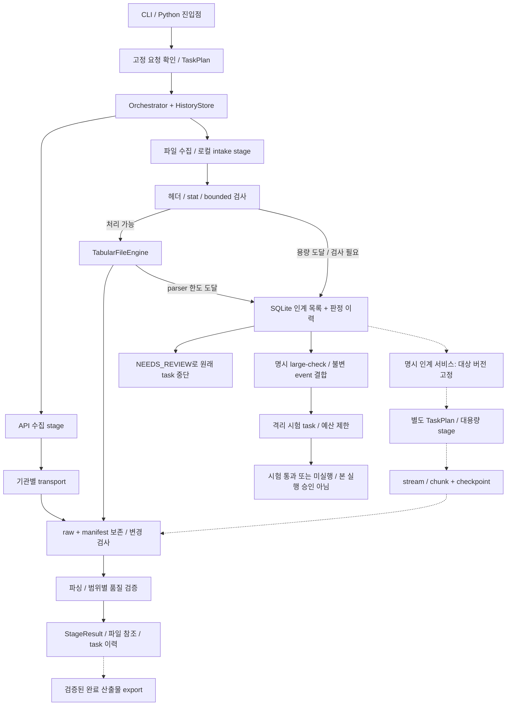

# 엔진 연결 설계 — 실제 흐름과 대용량 인계

기준: 2026-10-26 현행 소스 확인. **실선은 구현된 호출, 점선은 후속 연결 설계**다.
실행 제어는 하나의 Orchestrator를 사용한다. transport·parser·capacity 검사·storage는 엔진의 내부 부품이다.

그림의 파일 경로는 논리 흐름이다. 현재 `GateCFileEngine` 내부 호출 순서는 transport의 HTTP 용량 검사 →
inbox 보존 → `TabularFileEngine`의 preflight → raw package/변경 검사 → parser/normalized 저장이다.
로컬 intake는 HTTP 단계를 거치지 않는다. API는 기관별 응답 예산을 사용하며 비API 인계 기준을 적용하지 않는다.
그림의 raw/manifest는 공통적인 보존 책임을 뜻한다. 현재 작은 파일 저장 함수는 16 MiB 입력/64 MiB
정규화 상한이 있으므로, 대용량 엔진은 별도 예산의 segmented artifact 저장·chunk manifest로 연결해야 한다.

## 현재 실제 연결표

| 진입점 | 저장되는 stage / 실제 호출 | 출력·다음 연결 |
|---|---|---|
| `collect worldbank-gdp` | CLI → WorkflowService의 명시 확인 → WorldBankRequestDispatcher → `worldbank_collect_audit` → `worldbank_validate` | raw/manifest + 검증 payload/AuditStore. 실행 전 저장된 확인 조건 재검사 |
| `collect boj-fxer` | `build_boj_plan` → `boj_metadata` → `boj_observations` | 검증된 metadata payload를 observations의 upstream으로 전달. raw/manifest 및 제한된 observations |
| `watch tic/bis` | `build_gate_c_watch_plan` → `gate_c_file_watch`; 내부에서 OfficialFileTransport → TabularFileEngine | 정상 파일은 raw/normalized/manifest. 용량 도달은 인계 record. 내부 부품 호출은 별도 stage가 아님 |
| 기존 로컬 파일 | Python API로 `tabular_file` engine 등록 → TabularFileEngine | inbox 경로 검사 → capacity → raw/변경 guard → parser → 저장. 범용 파일 CLI는 없음 |
| BLS/Census | Python API에서 BLSEngine/CensusEngine을 runner에 명시 등록 | 기관별 query/transport → raw/변경·품질 guard → StageResult. 현재 고정 CLI dispatch 대상에는 없음 |
| `status` / `resume` | task 조회 / 저장된 workflow·engine plan으로 해당 runner 선택 | 새 source 범위를 만들지 않고 같은 task 재개. World Bank/BOJ/watch는 저장된 계획을 재개하고, 대용량 시험 task는 중단 worker의 종료를 확인해 미확정 결과를 기록 |
| `large-check ID [--event-seq N]` | create_trial → 불변 event/scope·stat·코드/예산 결합 → large_file_trial stage | Linux 격리 시험만 실행. TRIAL_PASSED 또는 NOT_EXECUTED, 본 실행 자동 승격 없음 |
| `deferred [ID]` | DeferredNonAPIStore의 read-only 조회 | 대상 목록 / 최근 이력 조회. 조회가 대용량 엔진 실행을 유발하지 않음 |

검색은 `discovery/series_search.py`의 근거 후보 생성과 명시 선택으로 분리돼 있다. 현재 고정 CLI는
범용 검색 전체를 호출하지 않는다. `acquisition_planning.py`는 API chunk 계획만 반환하며 실행 queue가 아니다.
지식 재사용은 `plan_with_knowledge`에서 명시 선택·범위 검사를 거쳐 허용 stage만 생략한다. raw 데이터를 바꾸지 않는다.

## 엔진 간 공통 계약과 상태

- 연결: `TaskPlan(StageSpec...)`에 순서·engine/version·입력·시도 예산을 고정한다. registry는 `(engine, version)`으로 선택한다.
- 입력: `StageInput(task_id, request, stage_id, input_data, upstream, input_refs, knowledge_context)`.
  runner가 직전 성공 결과의 payload와 evidence_refs를 전달한다. 현재 runner는 순차 실행이며 일반 DAG·분산 queue가 아니다.
- 반환: `StageResult(status, payload, evidence_refs, warnings, error_code, retry_hint, retry_after_seconds)`.
  runner가 실행 전 RUNNING과 실행 후 결과·attempt/event를 SQLite에 저장한다.
- 성공이면 다음 stage로 간다. retryable이면 원래 task를 멈추고 Retry-After/시도 예산 후 같은 task를 resume한다.
  성공 prefix 재사용은 fingerprint·TTL·검증기를 모두 통과해야 한다.
- 대용량 qualification은 task claim 전부터 workspace lock을 잡고 child worker에 상속한다. process가 강제 종료되면
  worker가 끝날 때까지 lock이 유지된다. 그 뒤 `resume`은 표시된 scratch를 정리하고 `trial_state=UNKNOWN`과
  `NOT_EXECUTED`를 기록하며, 같은 qualification을 다시 실행하지 않는다.
- 용량 인계/권한/보안/schema/의미 검토는 NEEDS_REVIEW로 멈춘다. 현재 capacity도 SCHEMA_CHANGED 코드를 사용하므로
  구체 원인은 `non_api_deferral.reason/status`로 판단한다. task 상태·전송 오류·데이터 판정을 하나로 합치지 않는다.
- 큰 원본·정규화 본문은 파일로 둔다. 후속 대용량 stage 간 payload는 `artifact_id, relative_path, manifest_ref,
  sha256(확인된 경우), schema/version, counts/quality` 참조로 제한한다. 현재 작은 API payload 전체를 즉시 재작성하지 않는다.

## 대용량 엔진 연결 규칙 — 후속 구현 계약

1. 진입점은 한 개의 handoff service로 둔다. 인계 record ID뿐 아니라 **변경 불가한 판정 event/version**을 선택한다.
   현재 목록의 최신 raw 경로를 나중에 다시 읽어 선택 당시 원본이 바뀌는 일을 막는다.
2. 인계 입력은 `origin_task/stage/stage_run`, `deferral_id/event`, `policy_version`, `source/parser scope`,
   `input_kind=local_artifact|remote_source`, `raw/manifest refs`, `known hash 또는 unknown`, `scope_confirmation_ref`, `resource budget`이다.
   HTTP 헤더에서 중단된 건은 raw가 없으므로 원격 수집을 별도 대용량 예산으로 계획한다. 작은 엔진에 다시 내려보내지 않는다.
3. handoff 승인·자식 task 생성·인계 상태 갱신은 같은 SQLite transaction으로 묶고,
   선택 event+target engine/version+처리 scope를 idempotency key로 사용한다. 같은 인계의 중복 실행을 차단한다.
   구현 시 HistoryStore transaction의 connection을 인계 저장에도 전달해 DB 연결 두 개로 나눠 commit하지 않는다.
4. 원래 task의 NEEDS_REVIEW와 이력은 보존한다. 새 task를 parent/child 참조로 연결하고 별도 예산·checkpoint로 실행한다.
   같은 작업의 일시 장애는 자식 task를 resume한다. 승인된 scope·engine이 바뀌면 새 인계로 기록한다.
5. 보안 검토는 대용량 실행 승인과 따로 충족해야 한다. 더 큰 엔진도 경로·압축·TLS·출처·변경 검사를 유지한다.
   stream 원본 hash와 manifest를 보존하고, 변경/품질 검토가 필요하면 새 normalized 산출물을 공개하지 않는다.
6. 완료는 자식의 검증된 output manifest와 인계 event에 연결한다. exporter는 그 검증된 artifact만 읽는다.
   원본 다운로드·파싱·resume·출처 검사를 exporter에 다시 구현하지 않는다.

## 코드 대조에서 확인한 연결 공백과 최소 보완 순서

| 현재 공백 | 연결 전에 필요한 보완 |
|---|---|
| 17회차 시험 task가 event seq·원본 stat·worker 코드에 결합됨. 일반 인계 목록 조회는 seq를 직접 표시하지 않음 | 정식 handoff는 검증된 immutable artifact/hash와 승인 상태를 추가 |
| stage 실행 ID는 runner 내부에 있고 현재 StageInput에는 없음 | 인계 bridge가 origin stage_run/attempt를 신뢰 가능하게 연결하도록 최소 계약 확장 |
| 인계 저장과 stage 결과 저장은 현재 별도 transaction | 중단 후 record만 남거나 event가 중복될 경우를 대비한 stage-run idempotency·복구 reconciliation |
| capacity 상수는 parser 모듈에 있고 parser 한도 분류 일부는 오류 문자열에 의존 | 작은 공통 policy/reason 모듈로 정리. transport/parser/engine이 같은 typed capacity reason 사용 |
| 보안/데이터/용량에 모두 NEEDS_REVIEW가 사용됨 | 상태를 늘려 라우팅하지 말고 고정된 reason·result kind로 분기. 범용 resume가 자동 handoff하지 않음 |
| 작은 파일 저장도 용량 상한을 갖고 있음 | 작은 parser/storage 재호출 없이 대용량 전용 budget·segmented artifact manifest로 보존 |
| 격리 용량 시험은 구현. 정식 대용량 정규화·artifact 공통 adapter·exporter 연결은 없음 | 시험 증거 → 정식 handoff 승인/원본 artifact → 대용량 stage → 검증 artifact adapter → exporter 순서로 구현 |

확인 소스: [CLI](../src/macro_data_platform/cli.py), [runner](../src/macro_data_platform/orchestration/runner.py),
[공통 입력](../src/macro_data_platform/orchestration/models.py), [StageResult](../src/macro_data_platform/contracts.py),
[World Bank dispatch](../src/macro_data_platform/ingestion/worldbank_request.py), [BOJ](../src/macro_data_platform/ingestion/boj.py),
[파일 watcher](../src/macro_data_platform/ingestion/gate_c_watch.py), [파일 intake](../src/macro_data_platform/ingestion/tabular_files.py),
[capacity/목록](../src/macro_data_platform/ingestion/non_api_capacity.py).

17회차 시험 경로·실측 예산·미실행 응답은 [대용량 엔진 설정](LARGE_FILE_ENGINE.md)을 따른다.
