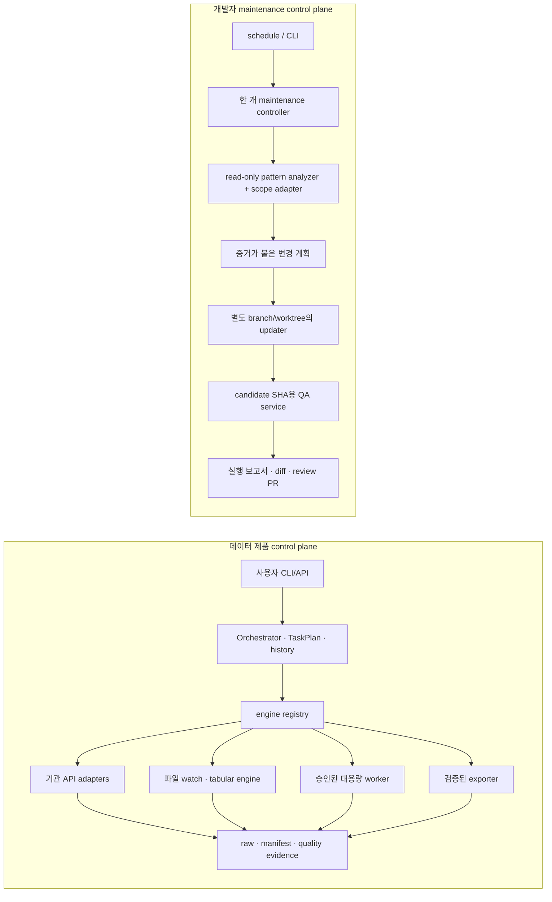

# 엔진 통합·분리 개선안

기준일: 2026-10-27. 이 문서는 현재 실행 경로를 대조해 중복을 줄이고 경계를 선명하게 하는 설계와 단계별 구현 기록이다. 24회차에서 common check entrypoint, 26회차에서 isolated updater handoff를 구현했다. 제품 데이터 경로와 개발자 코드 업데이트 경로는 하나의 거대 엔진으로 합치지 않는다. 각 경로 내부에서 반복되는 실행·기록·검증만 공통화한다.

## 용어

- **Engine:** 제품 Orchestrator가 실행하는 독립된 stage 구현. source/format별 입력과 검증 계약을 갖는다.
- **Orchestrator:** 제품 task·stage·attempt·retry/resume을 관리하고 등록된 engine을 순서대로 실행한다.
- **Maintenance workflow:** 저장소 분석부터 코드 candidate·QA·review 자료까지 잇는 개발자 도구 흐름이다. 기획서의 기존 “Improvement Engine” 표현은 이 흐름을 가리키며 제품 데이터 engine과 다른 trust boundary다.
- **Shared service:** transport, raw/artifact store, parser helpers, capacity/duration profile처럼 여러 stage에서 호출하는 부품이다. 독립 권한·수명 주기가 없는 한 이를 별도의 engine으로 부르지 않는다.

## 먼저 답: 무엇을 합치고 무엇을 남길까

MacroAtlas에는 성격이 다른 두 제어 흐름이 필요하다.

1. **데이터 제품 흐름**은 사용자 요청을 저장된 `TaskPlan`으로 만들고 Orchestrator가 등록된 source engine을 호출한다. World Bank·BOJ API, TIC/BIS 파일 watch, 작은 파일 parser, 대용량 worker, CSV exporter는 입력과 위험이 달라 독립 adapter/worker로 남긴다. 공통 `Engine` / `StageInput` / `StageResult`, task history, raw/artifact 참조, 명시적 retry 정책을 사용한다.
2. **개발자 유지보수 흐름**은 저장소 근거를 분석하고 코드 변경 후보를 만든 뒤, 별도 worktree에서 수정·QA·검토 자료를 생성한다. 제품 task나 수집 원본을 처리하는 Orchestrator와 분리한다. 사용자가 요청한 자동 업데이트는 검증된 전용 branch까지 자동화할 수 있지만 merge와 배포는 사람 검토로 남긴다.

즉, 제품 엔진은 **공통 실행 계약 아래 분리**하고, 유지보수 스크립트는 **한 개발자 workflow controller 아래 통합**한다. source별 처리 규칙이나 대용량 worker를 공통 로직에 억지로 흡수하지 않는다.

## 현재 코드에서 확인한 중복과 단절

| 구성요소 | 지금 하는 일 | 확인한 중복·공백 | 목표 위치 |
|---|---|---|---|
| `Orchestrator`와 `Engine` protocol | 제품 task/stage를 저장하고 `(engine, version)` 구현을 순차 호출 | 공통 제품 실행 계약은 이미 존재한다. 새로운 상위 data super-engine은 중복이다. | 데이터 제품 control plane으로 유지 |
| API·file·large engines | provider transport, parser, source guard, resource budget 등 서로 다른 작업 | 역할이 달라 이름만 비슷한 중복으로 취급하면 안전 경계가 사라진다. | 전문 engine/adapter/worker로 유지, 반복되는 값 계약만 공통화 |
| `large_file_duration.py` | qualification과 production/resume 양쪽에서 같은 bounded profiler/forecast service 호출 | 여기서는 유용한 중복 제거가 이미 되어 있다. 두 실행의 기록/승인/자원 한도는 여전히 다르다. | 공유 estimator를 유지하고 `qualification`/`production` 학습 이력과 실행 가드를 분리 |
| `pattern_cli` / `PatternAnalyzer` | SQLite 이력을 읽고 개선 후보를 제안하는 read-only 분석 | 제안을 실제 코드 수정이나 QA에 넘기는 연결이 없다. scope가 unknown이면 근거를 만들지 않는다. | 유지보수 controller의 분석 단계 |
| `scripts/run_improvement.ps1` / `run_improvement.py` | clean base에서 task branch/worktree를 만들고 Codex를 실행. 변경 경로를 allowlist로 검사한 뒤 candidate commit·QA·조건부 push/PR을 수행 | 실제 Codex 장시간 pilot과 scheduler 운영 증거는 아직 없다. 허용 경로 밖 변경은 보존하되 push하지 않는다. | supervised pilot 후 scheduler policy 평가 |
| `scripts/run_maintenance_qa.py` | clean `HEAD` 또는 지정 base→candidate SHA를 detached worktree에서 pytest/Ruff/diff/CLI 검사 | QA 실패·timeout이면 push/PR 단계로 가지 않는다. updater는 같은 candidate SHA를 넘긴다. | 공통 QA service로 유지 |
| `scripts/run_checks.ps1` | 24회차부터 `run_maintenance_qa.py`를 호출하는 Windows wrapper | 이전에는 현재 checkout에서 pytest/health를 따로 돌리고 text report를 썼다. | 단일 Python runner만 호출. 실제 Windows wrapper invocation은 CI matrix에서 확인 |
| `scripts/install_tasks.ps1` | 매일 health task와 매주 improvement task를 따로 등록 | scheduled improvement가 별도 QA flow와 연결되지 않는다. 운영 설명과 실행 경로가 여러 파일에 나뉜다. | 단일 maintenance command를 부르는 scheduler entry |

`run_improvement.ps1`은 `run_improvement.py`의 Windows wrapper다. updater는 원래 checkout을 전환하지 않고, Git에 저장된 base만 별도 worktree로 가져온다. allowlist 검사와 동일 candidate SHA QA가 통과한 경우에만 push하고 review PR을 연다. merge와 publish는 자동화하지 않는다. 실제 Codex task 실행 pilot과 예약 작업 경계는 별도 확인 대상이다.

2026-10-27 첫 read-only pattern 분석은 47 tasks/55 stages에서 insufficient-evidence 7개를 반환했다. 재검증에서는 다섯 fixture 오류와 BIS 오류 둘의 성격이 달랐다. 보존 event와 manifest를 연결한 후 analyzer snapshot은 49 tasks/57 stages 중 synthetic qualification fixture 15건, 보존 파일 qualification trial 5건, operational stage 37건으로 분리된다. 전체 69 task/57 stage catalog audit에서는 operational 오류 3건(BIS 2, World Bank 1)과 BLS/Census/large-file-production 성공 stage의 projection 공백 5건을 확인했다. 전체 집계와 후속 scope 작업은 [scope evidence recovery 기록](SCOPE_EVIDENCE_RECOVERY_PLAN.md) 및 [engine×institution 감사](ENGINE_INSTITUTION_ERROR_AUDIT_2026_10_27.md)에 있다.

## 목표 구성

두 control plane은 코드를 공유할 수 있지만 task DB, worker, 권한, 결과 상태를 공유하지 않는다. 유지보수 updater는 제품 CLI의 source collection 경로를 호출하지 않는다. 제품 실행 중에는 저장소 파일을 수정하지 않는다.

### 공통화할 것

- **데이터 경로:** `TaskPlan`, `(engine, version)` registry, `StageInput/StageResult`, retry budget, artifact references. 기존 Orchestrator 계약을 기준으로 빠진 adapter만 연결한다.
- **대용량 예측:** `large_file_duration.py`의 bounded profiling과 estimator를 qualification 및 production/resume에서 공유한다. workload profile 계산 중복은 만들지 않되, 성공 실측·신뢰도·예측 오차는 operation별로 분리한다. qualification 성공은 production 승인으로 이어지지 않는다.
- **개발 경로:** 환경 점검, run manifest, timeout, subprocess log, QA 결과, diff 요약, 종료 상태 처리를 한 maintenance controller/service로 둔다.
- **이력 표현:** 실행마다 input commit, base commit, candidate commit, OS/Python/tool versions, 실행 mode, 검사별 결과, 변경 파일, 최종 상태를 구조화 report에 남긴다.

### 분리해서 유지할 것

- 기관별 API endpoint, authentication, pagination, response schema는 connector/engine adapter에 둔다.
- `TabularFileEngine`과 대용량 worker는 parser 범위·memory/time budget·checkpoint가 다르므로 분리한다. trial qualification은 production 승인으로 승격하지 않는다.
- `PatternAnalyzer`는 운영 task evidence만 읽는다. 개발자 코드 diff를 고치거나 품질을 승인하지 않는다.
- Codex updater는 격리 worktree에서 코드만 수정한다. source raw, catalog, credentials, 환경 권한을 읽거나 바꾸지 않는다.
- QA service는 candidate를 검사하고 결과를 판정한다. updater의 성공 메시지를 신뢰해 QA를 생략하지 않는다.
- 사람 리뷰는 merge/deploy 결정으로 남긴다. 자동화는 검증된 branch commit/push와 PR까지 지원할 수 있지만 main 병합·환경 publish를 하지 않는다.

## 실행 단계를 하나로 잇는 설계

현재 초기 유지보수 check 진입점은 `python scripts/run_maintenance_qa.py`다. 제품 사용자용 `macroatlas`와 구별하며,
장기적인 maintenance subcommand 이름은 후속 CLI 설계에서 결정한다.

1. `check` (24회차 완료): OS·Python의 clean committed checkout에서 project health, pytest, Ruff, commit whitespace, Python/installed CLI help를 한 번씩 실행하고 structured JSON report와 check별 log를 남긴다. `run_checks.ps1`은 이 Python entrypoint만 호출한다.
2. `analyze`: PatternAnalyzer와 scope adapter를 읽기 전용으로 실행한다. missing scope는 unknown으로 남기고, 파일/라인 또는 task/event 근거가 없는 후보를 `NOT_ACTIONABLE`로 끝낸다.
3. `improve --finding <id>`: 명시 근거와 수용 조건이 있는 변경만 최대 3개 선택한다. clean base SHA에서 task 전용 branch/worktree를 만들며 기존 checkout의 branch를 바꾸지 않는다. `Codex`는 허용 경로 안에서만 수정한다.
4. `qa --candidate <sha> --base <sha>` (검증기 완료): 전체 commit SHA 두 개를 받고 base가 candidate의 조상인지 확인한 뒤 detached worktree에서 candidate 자체를 검사한다. 원 checkout은 dirty여도 되며 report에 두 SHA·변경 파일·원 checkout 상태를 남긴다.
5. `report` (isolated updater handoff 완료): Codex의 변경 경로와 symlink/credential/database 파일을 검사하고, 허용 변경만 commit한다. 같은 candidate SHA의 QA가 통과할 때만 push와 PR 생성으로 넘어간다. no-op은 worktree와 생성 branch를 정리하며, 실패·범위 밖 결과는 로컬 보고서와 검토용 worktree를 보존한다. 자동 merge와 publish는 제공하지 않는다.

한 주기 실행은 동시 update를 막는 lock/idempotency key를 가져야 한다. 이미 실행 중이면 두 번째 수정 작업을 시작하지 않고 `ALREADY_RUNNING`으로 끝낸다. 변경이 정당화되지 않으면 `NO_ACTIONABLE_FINDING`, 정보 부족이면 `INSUFFICIENT_EVIDENCE`, 환경을 쓸 수 없으면 `NOT_EXECUTED`를 구분한다.

## 도입 순서와 완료 기준

한 회차에 아래 항목 중 하나씩 진행한다. 24회차 공통 검사 경로, 25회차 검증된 scope adapter, 26회차 candidate SHA QA와 updater handoff 구현이 끝났다. 실제 supervised pilot 및 scheduler 검토는 남아 있다. 예약 설정을 실행하거나 활성화하지 않았다.

| 순서 | 다음 작업 | 선행 이유 | 완료 기준 |
|---|---|---|---|
| 24 완료 | Cross-platform maintenance check service | pytest 중복과 text/JSON report 차이를 줄인다. | `run_maintenance_qa.py`가 health·pytest·Ruff·CLI·commit whitespace를 구조화 report로 실행한다. `run_checks.ps1`은 wrapper다. CI matrix가 동일 Python entrypoint를 실행한다. [24회차 보고서](ITERATION_24_REPORT.md) |
| 25 후속 완료 | Analyzer evidence domain, institution scope adapters, technical/economic requirements | 초기 분석이 합성 시험과 운영 오류를 섞고 보존 provider scope 일부를 읽지 못했다. | 저장 event 검증으로 trial 분리, BIS/BLS/Census exact raw/manifest scope 검증, production plan hash 확인을 수행한다. BLS dataset ID는 근거가 없어 unknown으로 남긴다. 기술 오류는 concept 없이 같은 engine/version/stage/dataset에서만 검토하며 경제 의미는 concept이 없으면 제안하지 않는다. [검토 기록](SCOPE_EVIDENCE_RECOVERY_PLAN.md) |
| 26 완료 | Isolated updater와 candidate QA handoff | 기존 updater가 현재 branch를 바꾸고 QA를 호출하지 않았다. | `run_improvement.py`는 origin/명시 base에서 isolated worktree를 만들고 경로 allowlist·no-op·동일 SHA QA·조건부 push/PR을 연결한다. CI dry run과 unit tests가 no-op 정리 및 QA 실패 시 무push를 확인한다. 실제 Codex pilot은 27회차에서 확인한다. [보고서](ITERATION_26_REPORT.md) |
| 27 | Schedule consolidation and supervised pilot | 자동 주기는 통합 흐름이 Windows에서 운영 가능한지 입증한 뒤에만 검토한다. | 먼저 Windows에서 사람이 직접 시작한 pilot 1회로 no-op·failure·success 보고를 검토한다. 실제 Codex 실행은 이 검토 뒤에만 한다. 반복 scheduler는 비활성 상태로 유지하고 중복 실행 방지, 환경·base ref 설정, 로그 보존을 확인한다. 이후 사용하지 않는 launcher를 제거한다. |

2026-10-27 상태: PR #26 뒤 첫 Linux updater 시도는 token refresh `401`로 실패했지만 device-code 재인증 후 재실행은 candidate QA/PR handoff에 성공해 PR #28로 병합됐다. 성공 경로는 확인했으나 no-op과 실제 Windows 사용자 pilot은 미확인이다. Windows 수동 pilot과 중복 실행 방지·base ref·로그 보존을 검토하기 전까지 scheduler를 활성화하지 않는다. 자세한 실행 근거는 [27회차 pilot 보고서](ITERATION_27_PILOT_REPORT.md)에 기록했다.

이 순서는 코드 업데이트 자동화의 완결성을 우선한다. 제품 사용자 관찰은 참가자가 필요하므로 준비된 세션 절차와 병행할 수 있지만, 유지보수 실행 결과를 제품 사용성이나 Gate 증거로 세지 않는다.

## 안전 조건과 미결 설계 결정

- updater write allowlist는 `src/`, `tests/`, `docs/`, `.py/.ps1/.sh` 형식의 `scripts/`, `README.md`, `PROJECT_PLAN.md`로 고정한다. `data/`, `.env`, credential/database 파일, symlink, `.github/`, reports 원본 dump는 제외한다. Codex는 git worktree에서 실행하므로 source checkout의 ignored/untracked 파일을 포함하지 않는다.
- `Codex CLI`/`gh` 부재, `origin/HEAD` 또는 명시 base 부재, 네트워크 실패는 자동 fallback하지 않고 미실행/단계 실패 사유로 남긴다.
- QA가 통과해도 acceptance criteria, data-integrity guard, 사용자 변경 범위는 수동 검토한다.
- commit/push는 통과 candidate branch에만 허용한다. merge, deploy, publish, 보호 정책 변경은 범위 밖이다.
- Windows 예약 실행은 현재 사용자의 sign-in/권한/작업 경로를 확인하고 실제 Windows dry run을 통과하기 전까지 켜지 않는다.
- 공통 code utility를 만들 때 source별 분기 대신 typed contract와 adapter를 사용한다. 공통화로 source-specific timeout, schema guard, capacity budget이 약해지는지 회귀 검사한다.

### 2026-10-27 scope 재점검 정정

근거 부족 7건 재검토와 full-catalog engine×institution 오류 감사를 완료했다. 현재 저장 이력에는 운영 오류가 BIS 2건과 World Bank 1건 있으며, 미상 institution/dataset을 가진 오류 stage는 없다. 이어 BLS·Census·large-file-production 성공 stage 5건의 projection을 manifest/raw 근거로 보완했다. 재검증 시 institution unknown은 0건이며 dataset unknown 2건은 BLS payload의 명시적 null로 남겼다. 다음은 BLS official series metadata를 확인하는 일이다. 전체 근거와 범위는 [scope recovery](SCOPE_EVIDENCE_RECOVERY_PLAN.md) 및 [full-catalog 감사](ENGINE_INSTITUTION_ERROR_AUDIT_2026_10_27.md)를 따른다.
