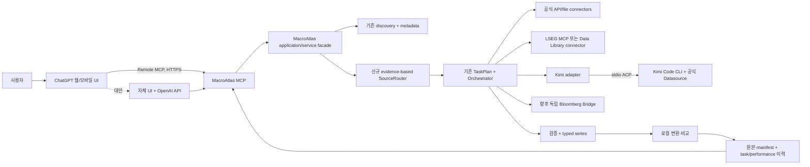

# MacroAtlas 아키텍처 재구조화 및 AI 금융 데이터 통합 설계 제안

- **상태:** 검토용 설계 초안. 구현 변경은 아직 하지 않았다.
- **조사 기준일:** 2026-10-28.
- **MacroAtlas 기준 코드:** `codex/iteration-04-gate-a`, `c5c7886`.
- **Kimi Code 기준 코드:** `MoonshotAI/kimi-code`, `0c63065`; `pi-provider-kimi-code`, `54dbd3e`.

## 제안 요약

1. MacroAtlas를 새로 쓰지 않는다. 현재 Python 패키지의 discovery, metadata, connector, ingestion, orchestration, storage, analysis, performance 경계를 유지하고, source routing과 MCP 진입 계층을 추가한다.
2. ChatGPT는 기본 UI, MacroAtlas MCP는 유일한 기본 데이터 도구 경계로 둔다. 모델은 후보를 설명하고 결과를 표현하며, provider 탐색·권한 확인·선택·조회·검증은 MacroAtlas가 결정한다.
3. Kimi는 먼저 공식 Kimi Code CLI의 공식 Datasource 플러그인을 ACP 표준입출력으로 구동하는 경로를 검증한다. `pi-provider-kimi-code`의 자체 `/tools` HTTP 호출은 비교 분석용 비공식 경로로 분리한다.
4. LSEG MCP의 직접 연동은 공개 제품 자료가 확인하는 범위까지만 설계에 반영한다. 실제 endpoint, 도구 목록, 계정 권한, 데이터 이용 조건은 LSEG 계정에서 확인할 때까지 미확인으로 둔다. LSEG Data Library for Python은 대안으로 둔다.
5. 먼저 기존 지원 provider를 MCP에 노출한다. IMF·OECD·FRED·BIS·ECB·Eurostat 등은 각 connector의 공식 문서와 제한된 실측을 통과한 순서대로 추가한다.

## 1. 현재 아키텍처 분석

### 1.1 코드 구조와 실행 경계

저장소는 `src/macro_data_platform/` 아래에 Python 패키지 하나를 두고, `macroatlas` CLI 및 Python API를 제공한다. 구조는 이미 책임별로 나뉘어 있다.

| 현재 모듈 | 현재 책임과 재사용 가치 |
|---|---|
| `discovery/` | 기관 목록·기관 가이드·제한된 시리즈 후보 검색. 검색과 수집은 분리되어 있다. |
| `metadata/`, `mapping/` | 출처 메타데이터를 보존하고 근거가 있을 때만 공통 필드와 개념 관계를 정리한다. 모르는 값은 unknown으로 유지한다. |
| `connectors/`, `ingestion/` | provider별 요청·응답 어댑터, 공식 파일 입력, 원자료 보존, 검증. 일반 URL을 임의로 실행하지 않는 경계를 재사용할 수 있다. |
| `contracts.py`, `orchestration/` | `TaskPlan`, `StageSpec`, `EngineRegistry`, `Orchestrator`, `StageResult`로 순차 실행·상태·재개를 관리한다. 엔진 연결은 `(engine, version)`으로 찾는다. |
| `storage/` | SQLite task/event 이력, 원본 다운로드와 manifest, metadata archive, feedback 및 평가 기록. 관측치 전체를 일반 카탈로그 DB에 저장하는 구조는 아니다. |
| `analysis/` | 현재 주요 기능은 실행·품질·피드백 패턴 분석이다. 범용 경제 시계열 변환·비교 엔진은 아직 없다. |
| `performance/` | stage와 일부 세부 phase 시간을 monotonic clock으로 계측하고, 민감한 요청문·관측값 없이 구간별 요약을 만든다. |
| `evaluation/` | 후보 검색의 고정 평가 세트, 분할·승격 검토 및 검색 경계 안전성을 검사한다. 이는 provider 데이터 호출 성능 검증과는 별도다. |

### 1.2 검색, 조회, 결과 전달의 실제 범위

- `macroatlas search`는 현재 고정 World Bank 후보와 로컬에 보존된 BLS/Census metadata를 영어 token 기반으로 검색한다. 공식 전체 catalog를 자동 수집·갱신하지 않고, 기관을 모르는 자연어 요청을 범용적으로 해석하지도 않는다. 검색 결과만으로 선택·수집하지 않는다.
- 실제 관측치 경로는 World Bank WDI, BOJ의 고정 FM08/FXERD01, 정확한 시리즈 ID를 지정하는 BLS Public Data API v2, 지정 변수·geography의 Census ACS로 한정돼 있다. World Bank에는 연간 단일 시리즈·단일 페이지 제한 경로가 있다. 모든 provider를 하나의 검색·다운로드 API처럼 다루지는 않는다.
- TIC 및 BIS는 일부 지정 공식 파일을 사용자가 요청할 때 단발 intake할 수 있고 격리·변경 검토 이력이 있다. 반복 변경 감시는 현재 활성 작업이 아니다. BIS 대용량 production 경로도 단일 flat ZIP의 구조 보존 작업이다. 이를 일반 BIS 통계 API나 여러 기관에 적용되는 대용량 엔진으로 해석하면 안 된다.
- XLS/XLSX 및 CSV 계열 입력용 표 파일 처리 경계는 있지만, XLSX workbook 출력은 없다. CSV export는 검증된 제한 World Bank GDP 및 BOJ 결과에 한정되고 provenance sidecar를 만든다. BLS/Census export, 다중 시계열 정렬 workbook, 범용 그래프 출력은 미구현이다.
- 공통 `TimeSeries`/`Observation` 계약은 World Bank와 BOJ 일부 검증 흐름에 연결돼 있다. null과 0을 구분하고 원값·출처·수집 시각을 보존하는 설계는 재사용한다. 이 계약은 아직 모든 provider와 저장/export 경로에 연결되지 않았다.
- IMF·OECD·FRED·BIS 일반 observation API·ECB·Eurostat·중앙은행 전반과 Kimi/LSEG/Bloomberg connector는 이 코드 snapshot에서 구현된 것으로 확인되지 않는다.

### 1.3 우선순위, 실행 이력, 성능

현재 `SourceRouter` 또는 provider별 자동 우선순위 모듈은 없다. 후보 검색의 순위는 자료 의미·출처 품질을 증명하지 않으며, provider 접근 권한·비용·라이선스·응답시간으로 실제 조회 provider를 고르지 않는다. 반면 `Orchestrator`는 task, stage, 시도 횟수, 상태, 결과/오류를 남기고, 성능 저장소는 엔진·stage·상태별 시간과 p50/p95(표본이 충분한 경우)를 집계한다. `HistoryStore.document()`는 task의 `request` 문자열도 저장하므로 MCP 요청을 연결하기 전에 자연어 보존·접근·retention 정책을 정해야 한다. 성능 DB가 prompt text를 제외한다는 사실이 task DB에도 요청문이 남지 않는다는 뜻은 아니다. 기존 이력은 향후 routing의 입력으로 쓸 수 있지만, 그 자체가 이미 성공률 기반 routing을 제공하지는 않는다.

현재 runner는 동기식·순차식이며 일반 분산 queue나 durable background job service는 없다. 따라서 `get_job_status` 도구를 먼저 노출해도 실행 중인 원격 작업을 poll하는 기능이 생기는 것은 아니다. 기존 이력·성능 기록은 재사용하되 provider/series/기간별 표본 수, 품질 판정, entitlement, query cost와 최신성을 구분해서 쌓는 작업이 추가로 필요하다.

현재 목표 범위와 한계는 [`README.md`](../README.md), [`ENGINE_IMPLEMENTATION_STATUS.md`](ENGINE_IMPLEMENTATION_STATUS.md), [`IMPLEMENTATION_PLAN.md`](IMPLEMENTATION_PLAN.md), [`ENGINE_CONNECTIONS.md`](ENGINE_CONNECTIONS.md)에 기록돼 있다. 이 초안은 위 문서와 코드 기준을 AI 연동 요구에 맞게 확장하는 제안이다.

## 2. 목표 아키텍처

### 2.1 경계



MacroAtlas가 검색, 출처 선택, 조회, 검증과 provenance를 책임진다. ChatGPT·OpenAI API는 요청을 전달하고 반환 자료를 설명하는 UI/모델 층이다. 기본 흐름에서는 ChatGPT가 LSEG/Kimi/Bloomberg를 직접 골라 조회하지 않는다. 사용자가 특정 provider를 지정하면 그 조건을 존중하고, 그렇지 않은 경우 MacroAtlas가 후보와 출처 근거를 만든다.

### 2.2 현재 구조에 맞춘 디렉터리 경계

`core/` 아래로 기존 코드를 일괄 이동하지 않는다. 지금의 package boundary가 이미 core 역할을 한다. 권장 추가 범위는 다음과 같다.

```text
src/macro_data_platform/
├── discovery/             # 기존 후보 검색 및 catalog discovery 확장
├── metadata/              # 기존 원문 보존·정규화
├── mapping/               # 기존 개념 연결과 근거
├── routing/               # 신규 capability, policy, evidence 기반 source 선택
├── connectors/
│   ├── public_api/         # 현재 API/file 커넥터를 점진적으로 묶을 때만
│   ├── lseg/               # 신규, entitlement 확인 뒤
│   ├── kimi/               # 신규 CLI/ACP adapter 경계
│   └── bloomberg/          # 후속 독립 Bridge client 경계
├── ingestion/             # 기존 실행·검증 경로를 먼저 재사용
├── orchestration/          # 기존 registry/runner/plan 재사용
├── analysis/               # 향후 명시적 시계열 연산
├── storage/                # 기존 task/raw/manifest 저장
└── services/
    ├── mcp/                # 신규 remote MCP tool facade
    └── jobs/               # durable background queue가 필요해진 뒤 추가
```

`public_api/` 하위 패키지 이동이나 `macro_data_platform` 이름 변경은 당장 하지 않는다. 기존 import와 CLI를 유지하고, 새 connector는 기존 엔진 등록·계약에 맞춰 추가한다.

### 2.3 공통 source/series 계약

현재 `TimeSeries`와 `StageResult`를 기반으로 다음 계약을 점진적으로 추가한다.

- `IndicatorRequest`: 개념, 국가/지역, 기간, 빈도, 단위/가격기준, 비교 의도, provider 선호·금지 조건.
- `SeriesCandidate`: 출처, dataset/series 식별자, 원문 이름·정의, 단위/빈도/차원/기간, 원자료 링크, 메타데이터 수집 시각, 식별 신뢰도와 근거.
- `ConnectorCapabilities`: 지원 query 유형·범위, 인증 방식, entitlement 상태, API 비용/요청 제한, 허용되는 저장·모델 전달 조건.
- `SeriesResult`: 기존 typed observations, task ID, source/provider ID, quality/freshness/validation 결과, raw/manifest opaque reference, source revision, 조회 시간과 실행시간.
- `TransformationRecord`: 입력 series IDs, 연산·단위·달력·결측 처리·기간 정렬 규칙과 버전.

Router는 먼저 권한, 라이선스, 범위, 데이터 의미·빈도 호환성을 hard filter로 적용한다. 남은 후보만 최근 성공률·품질 결과·응답시간·비용·coverage evidence로 정렬한다. 표본 수와 갱신시각을 함께 보고하며, 소스 호출 횟수만으로 영구 우선순위를 만들지 않는다. 사용자가 source를 고정하면 자동으로 다른 유료/라이선스 source를 추가 호출하지 않는다. 실패 코드는 인증/권한, 라이선스, rate limit, 전송, schema, 품질 문제로 나눠 fallback 여부를 다르게 한다.

## 3. 기존 코드 재사용과 변경 범위

| 영역 | 유지/재사용 | 필요한 확장 |
|---|---|---|
| Task/engine 계약과 runner | `StageResult`, `TaskPlan`, `EngineRegistry`, 순차 runner, resume·이력 | MCP service facade에서 CLI와 같은 application entry를 호출하도록 묶는다. MCP 안에 provider 로직을 복제하지 않는다. |
| 검색/metadata | 기관 목록, metadata archive, 정규화, 후보 ranking과 평가 경계 | provider별 catalog 수집·갱신, 다국어 요청/metadata, 데이터 정의·unit·frequency·coverage 기반 후보 비교. 의미 일치 불충분 시 abstain. |
| 데이터 connector | World Bank, BOJ, BLS, Census, 공식 파일 transport 및 raw/manifest 저장 | 새 API는 source별 connector와 parser/validator를 추가한다. source 전용 조건문을 공통 엔진 전체로 확산하지 않는다. |
| 이력·성능 | task/event와 privacy-filtered 성능 표본, 실행 보고서 | source/series·기간·quality/cost evidence를 추가하되 요청문, 비밀, 상용 원자료를 성능 DB에 복사하지 않는다. |
| 결과/분석 | 기존 제한 CSV exporter와 typed series 일부 | provider별 validated exporter를 점진 확장. 성장률·변환·비교는 raw source를 불변으로 두고 재현 가능한 `TransformationRecord`로 추가한다. 그래프는 ChatGPT 반환 자료로 시작하고 독립 plot/export 요구가 확인된 뒤 구현한다. |
| 신규 인터페이스 | 현재 CLI와 Python API를 유지 | `services/mcp`만 외부 MCP 도구 계약을 소유한다. API/REST와 job queue는 실제 사용 사례가 생기면 추가한다. |

## 4. ChatGPT MCP 연동 상세 설계

### 4.1 제품 지원과 연결 요건

OpenAI의 현재 ChatGPT 도움말은 **Business 및 Enterprise/Edu**에서 custom MCP 연결과 full MCP를 지원한다고 명시한다. Business는 workspace admin/owner가 custom MCP plugin을 만들고 publish한다. Enterprise/Edu에서는 RBAC로 개발자 연결 권한과 앱 접근을 제어하며 admin/owner가 publish한다. 같은 도움말의 FAQ에 따르면 **Pro** 사용자는 custom MCP 서버를 read/fetch 권한으로 연결할 수 있지만 full MCP는 Business/Enterprise/Edu에 한정된다. 확인한 공식 문서에는 **Plus**의 custom MCP 서버 지원이 명시되지 않아 구현 전제로 삼지 않는다. 이는 사용자 개인 계정·관리자 정책·기능 rollout을 대신 검증하지 않는다. 연결 절차는 ChatGPT 웹 기준이다.

| ChatGPT 계정 | 확인한 공식 문서 기준 | 설계 적용 |
|---|---|---|
| Plus | custom remote MCP 지원 확인 불가 | 연결 가능으로 가정하지 않는다. |
| Pro | read/fetch 권한 custom MCP; full MCP는 현재 미지원 | MacroAtlas MCP가 read-only tool만 노출할 MVP에서 조건부 사용 가능. |
| Business | full custom MCP; workspace admin/owner가 생성·게시 | 기본 조직형 경로. workspace permissions 확인 필요. |
| Enterprise/Edu | full MCP; admin/owner 및 RBAC로 접근·게시 통제 | 보안·감사 요건을 갖춘 조직형 경로. |

ChatGPT는 원격 MCP 서버를 연결한다. 공식 도움말은 public HTTPS endpoint 또는 Secure MCP Tunnel을 안내하고, OpenAI 연결 문서는 SSE 및 streaming HTTP transport를 지원한다고 설명한다. 신설 서비스는 Streamable HTTP transport를 기본으로 하고, 인증은 계정별 접근을 보장하는 OAuth/OIDC를 우선 검토한다. 개발 PC에서는 Secure MCP Tunnel을 선택할 수 있지만 제품·계정에서 사용할 수 있는지는 실제 계정으로 확인한다. 인터넷에 인증 없는 endpoint를 공개하지 않는다.

### 4.2 도구 경계

MVP에는 역할이 겹치는 도구를 잘게 나누지 않고 다음 3개만 우선 검토한다.

1. `search_indicators(query, filters)` — `discover_sources`와 기본 `get_metadata`를 포함해 후보·메타데이터·출처 신뢰도·불확실성·이용 조건을 반환한다. 후보를 뽑는 검색 단계이며 조회하지 않는다.
2. `fetch_series(candidate_id, period, options)` — 검증된 후보 ID와 제한된 범위로만 조회한다. arbitrary URL/임의 API 이름/credential은 도구 입력으로 받지 않는다. 반환은 기존 task/ingestion 경로를 사용한다.
3. `compare_sources(candidate_ids, period)` — 사용자가 요청하거나 명시한 경우에만 같은 개념 후보를 둘 이상 조회·비교한다. 의미가 다른 후보를 하나의 계열로 합치지 않고 `exact/comparable/related/review_required`와 차이를 반환한다.

`transform_series`는 비교·변환 모듈과 missing/calendar/unit 정책이 구현된 뒤 추가한다. `get_job_status`는 실제 durable background worker를 도입할 때 추가한다. 초기에는 bounded query를 동기로 완료하고, ChatGPT 호출 시간 제한과 실제 provider 응답시간이 맞지 않으면 durable job service를 먼저 설계한다.

도구는 schema-versioned JSON 결과, 제한된 응답 크기, 명시적 오류 코드, opaque `task_id`/artifact reference를 쓴다. 후보가 모호하거나 단위·가격 기준이 충돌하면 조회 전에 질문하거나 후보를 제시한다. tool descriptions에는 지원범위, 권한 제한, 변환 금지/경계 사례를 적어 ChatGPT가 자체 source selection을 하지 않도록 한다.

### 4.3 방식 A와 B

- **방식 A — 기본:** ChatGPT 웹 → MacroAtlas remote MCP → Python application facade → 기존 Orchestrator/Registry. ChatGPT는 MacroAtlas tool을 호출하고, MacroAtlas가 source 후보·provider를 결정한다. MCP 앱의 도구 정의를 바꿀 때는 ChatGPT workspace가 서버 tool snapshot을 새로 scan/review/publish해야 할 수 있으므로 기존 schema를 호환되게 변경한다.
- **방식 B — 대안:** 자체 웹/desktop UI → OpenAI Responses API의 remote MCP tool → 동일한 MacroAtlas MCP. API는 `mcp` tool, `server_url`/tunnel과 OAuth를 지원한다. ChatGPT 구독과 API 사용량·인증은 별도이므로 별도 비용 및 key 운영을 계획한다. UI 또는 gateway 구현도 추가된다.

방식 A가 요금제·workspace policy 때문에 사용할 수 없으면 B를 대안으로 선택한다. 어느 쪽이든 MacroAtlas MCP와 Python core는 그대로 유지하며, OpenAI 전용 라우팅은 `interfaces/chatgpt` 바깥에 두지 않는다.

## 5. LSEG Connector 상세 설계

LSEG 공식 MCP 제품 페이지는 자체 애플리케이션(“Direct”) 연결, ChatGPT 등 partner platform, 기존 LSEG Workspace license/entitlement의 존중을 안내한다. 같은 공식 페이지는 rollout이 phased이며 파트너별 제공범위가 license에 좌우된다고 적는다. 공개 개발자 MCP catalog에는 LSEG Financial Analytics MCP 항목이 있지만, 이 조사에서 MacroAtlas가 사용할 공개 endpoint·인증 parameter·도구 schema·요청 quota·가격을 확정할 세부 계약은 얻지 못했다. 따라서 `MacroAtlas → LSEG MCP`는 설계상 가능한 connector type이지만 특정 endpoint나 성공한 연결로 표시하지 않는다.

**서로 다른 연결로 구현한다.**

- **ChatGPT의 LSEG 앱/연결:** LSEG 공식 자료상 ChatGPT는 지원 platform 목록에 포함된다. 이는 ChatGPT UI에서 쓰는 별도 앱 경로다. LSEG connector를 Python engine이 직접 호출할 권한을 주지 않으며, 그 결과를 외부 MacroAtlas로 전달할 API라고 가정하지 않는다. 데이터가 ChatGPT 대화에 들어가는 권한도 별도 확인한다.
- **MacroAtlas Direct MCP:** LSEG가 제공하는 공식 remote MCP URL, 인증/identity 연결법, tool list, Workspace entitlement별 dataset scope, rate/cost, 저장·모델 전달권한을 계정 담당자/개발자 문서에서 받아 확인한 뒤 Python MCP client adapter를 만든다. 공개 제품 설명의 “기존 entitlement 존중”은 데이터 이용권·추가 비용이 모두 해결됐다는 뜻은 아니다.
- **대안 — LSEG Data Library for Python:** 공식 `lseg-data` Python library가 있다. 문서는 Workspace Desktop session과 Data Platform endpoint wrapper 경로를 설명한다. Desktop session은 인증된 Workspace 실행 PC와 결합되는 구성이며, 서버형 운용은 실제 계정에 맞는 Platform session·App Key/entitlement를 확인한다. 라이선스와 배포 모델을 확인한 뒤 MCP Direct와 비교한다.

Connector는 LSEG 식별자, 원시 반환, 공식 method/tool, 데이터 지연·revision, 원출처, entitlement 오류를 보존한다. MacroAtlas canonical series로 정규화할 수 없는 응답은 원문과 검증 미완료 상태로 반환하고, 차트나 통계 계산에 넣지 않는다. LSEG 데이터의 ChatGPT 전달, 원본 저장, CSV/XLSX export는 각 계약의 권한 범위가 확인될 때까지 비활성으로 둔다.

## 6. Kimi Connector 상세 설계

### 6.1 공식 Kimi Code 경로

Kimi 공식 CLI 문서의 현재 Datasource 플러그인은 공식 Kimi Code 플러그인으로 표기돼 있다. 공식 문서가 provider 예로 든 곳은 World Bank, IMF, OECD, FRED, WHO, FAO, 중국 국가통계국, Wind, S&P Capital IQ, SEC EDGAR, Caixin, Xinhua Finance, Hundsun Juyuan이다. `/login` OAuth가 필요하고 data query는 Kimi Code plan quota를 사용하며 호출당 account credits를 차감한다고 명시한다. 플러그인은 read-only query라고 설명한다. 이는 제공 범위와 비용 여부의 공식 근거지만, MacroAtlas가 받을 observation의 안정된 JSON schema나 API identifier를 보장하는 공개 data API 규격은 아니다.

Kimi Code CLI는 공식적으로 `kimi acp` subprocess를 stdio JSON-RPC로 제공하고, `session/new`, `session/prompt`, `session/update`, 취소 및 종료 기능을 문서화한다. 일반 CLI도 `kimi -p` 및 `--output-format stream-json` 비대화형 호출을 지원한다. 따라서 권장 검증 순서는 다음과 같다.

1. 프로필을 분리한 공식 Kimi Code CLI 설치, OAuth 로그인, 공식 Datasource 플러그인 설치·버전 확인.
2. 읽기 전용 범위의 테스트 workspace에서 ACP로 새 세션을 열고 Datasource skill을 명시 호출한다. 사용자 요청 전체·MacroAtlas 저장소를 Kimi로 보내지 않고 필요한 시리즈 질의만 전달한다.
3. ACP 이벤트에서 tool call/result가 구조적으로 전달되는지 확인한다. final answer만 문장으로 오는 경우 숫자를 정규식으로 추출해 authoritative series라고 취급하지 않는다.
4. publisher, dataset/series ID, 국가·기간, unit/frequency, 값과 missing 상태, 원출처 link, retrieved time, quota 소비가 검증된 query만 `SeriesResult`로 승인한다. 그 정보가 부족하면 `NEEDS_REVIEW`로 끝낸다.

`kimi acp`는 agent protocol이지 전용 금융 data API가 아니다. 공식 플러그인의 실제 tool output을 ACP client에 반환하는지, headless/ACP에서 Datasource를 호출할 수 있는지, session storage·query retention, 계정별 비용·quota, automation 이용약관을 실제 계정으로 검증해야 한다. Kimi Code에는 Datasource 이외에도 `Read`, `Bash`, `Grep` 같은 built-in tool이 있으므로 Datasource의 read-only 특성만으로 agent process 전체가 read-only가 되지 않는다. ACP session은 전용 빈 working directory에서 열고 MacroAtlas 저장소/파일을 추가 노출하지 않으며, 가능한 경우 불필요한 도구 권한을 차단한다. Kimi CLI는 prompts/tool trace가 포함된 session 기록을 로컬에 남길 수 있으므로 retention 설정도 Gate에 포함한다.

### 6.2 지정 TypeScript 프로젝트의 실제 구현

분석한 `pi-provider-kimi-code`는 Pi Coding Agent 확장(TypeScript, package version 0.6.13)이며 MacroAtlas Python SDK나 standalone HTTP server가 아니다. Pi가 host tool을 등록할 때 `kimi_datasource`를 opt-in으로 제공한다. 소스의 tool은 Kimi service의 `POST {Kimi base}/tools`에 `get_data_source_desc` 또는 `call_data_source_tool` payload를 보내고, Pi 저장 OAuth token을 `Bearer`로 사용하며 401에서 token refresh를 한 번 시도한다. 기본 timeout은 180초다. 결과는 `result.assistant/user` text를 우선 추출하고, 응답 파일은 실제 파일이 아니라 이름만 알린다.

해당 구현의 datasource enum에는 `world_bank_open_data`, `wind`, `imf`, `gildata`, `sp_data` 등이 있다. 이것은 공식 현재 Kimi CLI 문서의 provider 이름/범위와 다르다. 특히 `gildata`, `sp_data`를 공식 `Hundsun Juyuan`, `S&P Capital IQ`와 동등하다고 단정하지 않는다. README는 프로젝트가 Moonshot과 무관한 독립 확장이며 Kimi API Key는 datasource tool에 쓰이지 않고 Kimi Code OAuth와 server-side access가 필요하다고 설명한다. 즉 source가 확인한 private `/tools` 호출은 공식 public integration contract가 아니다.

### 6.3 Node/Python 통신 선택

| 방식 | 장점 | 비용·위험 | 제안 |
|---|---|---|---|
| 표준입출력 | `kimi acp` 공식 JSON-RPC를 그대로 사용; local port 없음; 단일 Windows 실행환경에서 Python core와 인증 CLI를 분리하기 쉽다. | Python에 ACP lifecycle/event client가 필요하고, agent 결과가 정형 data를 보장하지 않는다. | **공식 경로 우선.** CLI를 supervised child process로 관리한다. 처음에는 `kimi -p` stream-json으로 호출 동작을 빠르게 확인하고, 지속 운용은 ACP 세션/취소·정리 기능을 기준으로 검증한다. Node는 필요하지 않다. |
| Local HTTP | Python·다른 process가 간단히 호출하고 장기 프로세스 상태를 재사용하기 쉽다. | loopback server, authentication, lifecycle, stale session, local port 접근 통제와 crash recovery가 새로 생긴다. Kimi 실행을 HTTP로 감싸도 정형 data API가 되지는 않는다. | 단일 MacroAtlas instance에는 우선하지 않는다. 다수 local client 요구와 ACP 안정성이 입증된 뒤 선택한다. |
| 별도 MCP server | 다른 MCP client에서 Kimi adapter를 재사용할 수 있다. | `Kimi Datasource` 자체는 MCP server가 아니라 CLI plugin이다. adapter용 MCP service를 따로 만들면 Core→MCP client→MCP server→agent→data로 hop이 늘고, output schema 문제는 그대로다. | 초기 Kimi connector에 추가하지 않는다. 다른 client가 같은 Kimi route를 요구할 때만 검토한다. |
| `pi-provider` direct `/tools` wrapper | 기존 TypeScript code에 호출과 응답 추출 구현이 있다. | undocumented/private endpoint, Pi OAuth file coupling, API/schema change, account restriction 위험. | 공식 CLI가 막힐 때도 자동 fallback으로 켜지 않는다. 별도 비공식 PoC, 권한·약관 승인, 유지보수 소유자가 있을 때만 채택 여부를 다시 심의한다. |

### 6.4 대상 범위 대조

| 데이터 | 공식 Kimi Code 문서에서 확인 | 지정 Pi 확장 source enum |
|---|---|---|
| Wind | 있음 | `wind` |
| IMF | 있음 | `imf` |
| World Bank | 있음 | `world_bank_open_data` |
| OECD / FRED / 중국 국가통계국 | 있음 | 확인한 enum에는 없음 |
| Hundsun Juyuan / S&P Capital IQ | 있음 | 같은 이름·범위는 확인되지 않음 (`gildata`, `sp_data`는 별도 이름) |

공식 문서의 provider 목록은 **조사된 Kimi 제품 설명**이다. MacroAtlas에서 실제로 provider를 호출하고 시계열·출처를 검증한 근거는 아니며, connector별 성공·범위·latency·credit 테스트는 별도 Gate다.

## 7. 실행 환경 및 인증 구조

- **Core:** Python 3.11+와 현재 CLI/SQLite/raw storage. FastAPI와 MCP dependency는 현재 `pyproject.toml`에 없으므로 optional dependency group으로 먼저 추가한다. MCP transport는 official MCP Python SDK의 Streamable HTTP를 검토하고, REST health/status가 필요해질 때만 FastAPI를 추가하거나 ASGI를 같이 쓴다.
- **ChatGPT:** 웹 계정/workspace가 MacroAtlas remote HTTPS MCP endpoint 또는 Secure MCP Tunnel에 접근한다. ChatGPT 연결 OAuth와 MacroAtlas의 provider credentials는 서로 다른 identity다.
- **Kimi:** Windows에 공식 Kimi Code CLI 및 공식 Datasource plugin을 설치하고, CLI가 관리하는 Kimi OAuth profile을 ACP subprocess가 재사용한다. MacroAtlas가 Kimi auth file을 복사하거나 OAuth token을 MCP model context에 넣지 않는다. Kimi Code Windows 설치 요건(Git for Windows/Git Bash 포함)을 사전 확인한다.
- **LSEG:** LSEG Workspace Desktop user session과 server-side Data Platform credentials를 분리한다. 인증 방식은 LSEG가 계정에 제공한 Direct MCP/Data Library 계약을 따른다.
- **Bloomberg:** Terminal 실행 PC/Bridge service에 별도 자격 증명과 entitlement를 유지하고, MacroAtlas는 allowlisted connector interface로 검증된 반환값만 받는다.
- **비밀 저장:** 개발 시 local secret store를 쓰고, 운영은 Windows Credential Manager/DPAPI 또는 운영 secret manager를 적용한다. API key·OAuth token을 Git, task request, MCP arguments, performance DB, 오류 본문에 남기지 않는다.
- **데이터 전달 권리 및 보존:** ChatGPT 또는 Kimi에 질의와 반환 자료가 노출되는 조건, provider 원자료 저장·재배포·export 권한을 각각 확인한다. MacroAtlas가 외부 AI에 보내도 되는 최소한의 구조화 질의만 전달한다. 현재 `HistoryStore`는 자연어 `request` 문자열을 저장하므로, MCP를 연결하기 전에 원문 전체 대신 정규화된 범위만 저장할지, 접근 권한·보존 기간·삭제 방법을 결정한다. 상용 data는 entitlement와 계약이 허용할 때만 요청·보관·대화 반환한다.
- **로컬/운영:** Codex는 개발 도구다. 운영은 독립 Python service로 실행한다. Windows 초기 개발 시 MCP는 local tunnel로 검증할 수 있고, 운영은 기관 보안 정책·네트워크 경계·TLS 종료·감사 로그에 맞춘 remote HTTPS service로 전환한다.

## 8. 데이터 요청 및 반환 흐름

1. 사용자가 “중국 산업생산 증가율을 2000년부터”처럼 국가·통계·기간·변환을 자연어로 입력한다. ChatGPT는 원문 전체를 직접 재해석해 API에 호출하지 않고 `search_indicators`를 호출한다.
2. MacroAtlas가 요청을 `IndicatorRequest`로 정리하고 고정/저장 metadata 또는 허용된 discovery connector에서 후보를 찾는다. 단위·빈도·가격기준/계절조정·국가코드 등 누락·충돌을 후보에 표시한다.
3. SourceRouter가 capability, user source hint, entitlement, license/data-use rule, coverage, 최근 validated success/quality, latency/cost evidence를 적용한다. 소스 이력이 얕으면 높은 confidence를 부여하지 않고 여러 후보 또는 review를 반환한다.
4. 사용자가 지정한 candidate 또는 단일 신뢰 후보를 `fetch_series`로 확정하면 기존 `TaskPlan`/`EngineRegistry`/`Orchestrator`가 adapter를 실행한다. 이미 source-specific connector가 있는 경우 그 validator와 raw writer를 재사용한다.
5. connector 응답을 raw + manifest로 보존하고 typed series로 검증한다. provider ID, unit/frequency/source revision, period 범위, null·0 구분, coverage, freshness, metadata completeness, 원출처, policy와 warning을 붙인다. schema·identity·권한·quality 불일치는 값을 성공 데이터로 노출하지 않는다.
6. `ExecutionHistory`는 source/엔진/버전/상태/실행시간, retry와 오류 분류를 저장한다. 현재 task 이력에 원 요청문이 포함되므로 retention 정책을 적용하고, 성능 저장소는 PII·원값·credential-free 집계를 유지한다. Kimi/LSEG query 비용도 provider가 제공하거나 측정 가능한 경우에만 기록하고, 계측 불가능한 값은 unknown으로 둔다.
7. MacroAtlas MCP는 제한된 typed JSON와 provenance·quality·task reference를 ChatGPT에 반환한다. ChatGPT는 이를 표·설명·시각화로 표현한다. 변환은 MacroAtlas에서 재현 가능한 변환 기록을 만들고 raw observations는 덮어쓰지 않는다.

## 9. 남은 기술적 불확실성

| 질문 | 현재 근거/상태 | 결정 조건 |
|---|---|---|
| 실제 ChatGPT 계정에서 Plus/Pro/Business/Enterprise 중 어떤 연결을 만들 수 있는가? | 공식 도움말은 Pro read/fetch, Business와 Enterprise/Edu full MCP, Plus 미확인이라고 안내한다. web 및 workspace policy 조건이 있다. | 사용 계정의 제품 기능·admin 권한·tunnel 노출을 확인한 뒤 방식 A 또는 B 선택. |
| ChatGPT MCP authentication을 조직에서 어떤 방식으로 운영할 것인가? | OAuth와 no-auth 설정 옵션이 문서화돼 있으며 public HTTPS/Tunnel을 지원한다. | MacroAtlas 사용자 identity, SSO, token refresh, rate limit, audit와 authorization test. Production endpoint는 auth 설계 전에 공개하지 않음. |
| LSEG Direct MCP의 endpoint, protocol/version, auth, tools, scope, quota/cost는 무엇인가? | LSEG 공식 page는 Direct 및 entitlement-aware rollout을 확인하지만 public page만으로 MacroAtlas account contract를 확정하지 못함. | LSEG account/developer portal 확인, 허용된 데이터 범위, test query, 이용·보관·AI 전달 terms. |
| Kimi Data tool을 ACP에서 호출하고 machine-readable observation을 받을 수 있는가? | Kimi 공식 CLI는 ACP와 공식 Datasource plugin을 문서화한다. ACP가 agent protocol이며 public series API schema는 확인되지 않음. | 실제 OAuth 계정으로 Wind 1건과 public macro 1건 조회, ACP event/result 구조·source ID·비용 확인. |
| Kimi 호출 credit과 external automation policy는 무엇인가? | 공식 Datasource 문서는 query 호출당 account credits/quota 차감을 명시한다. 정확한 비용 및 automation 제한은 계정·query별로 미확인. | 호출 전후 quota/cost와 약관 확인; 자동 retry/비교 호출 비용 상한 설정. |
| `pi-provider`의 `/tools`를 outside Pi에서 공식 지원 대상으로 쓸 수 있는가? | 지정 code는 독립확장이고 endpoint는 private route로 코드에서 사용한다. | 공식 Kimi API contract 또는 명시적 이용 허가가 확인되지 않으면 production connector로 사용하지 않음. |
| source quality/route 통계가 충분한가? | 기존 task와 performance는 있으나 provider·series·terms 기준 동적 routing evidence는 없음. | provider별 fixture/live sample class, 최소 sample, recency decay, 품질 실패율과 cost 미상 처리를 정의. |
| 대기 작업·polling·병렬 비교가 필요한가? | 현재 Orchestrator는 synchronous sequential이고 ChatGPT/provider timeout 수치와 workload 기준이 미측정. | bounded smoke latency를 측정한 뒤 durable job queue 도입 여부를 결정. |

실제 Kimi OAuth, LSEG endpoint, ChatGPT account connection은 이 설계 작성 단계에서 시도하지 않았다. 계정·라이선스와 MCP 서버는 연결된 runtime에서 제공되지 않았고, 이번 요청의 선행 순서는 제안 검토 후 구현이다. 그러므로 live 연결 성공이나 provider별 접근 권한을 주장하지 않는다.

## 10. 단계별 개발 계획과 완료 판정 기준

| 순서 | 범위 | 완료 판정 |
|---|---|---|
| Phase 1 — 현행 분석 | 이 초안에서 확인한 구조·지원 범위·비구현 범위와 출처 snapshot을 기준으로 삼는다. | 현재 provider/API/file 경로와 local search 제한이 문서에 반영되고, 테스트·Gate의 주장을 현재 runtime evidence와 구분한다. **이번 작업 완료.** |
| Phase 2 — 설계 확정 | 사용자가 source policy, MCP tool MVP, ChatGPT plan path, data retention/license boundary를 검토한다. | tool contract, SeriesResult, auth split, routing policy, Kimi/LSEG gate와 migration 범위가 승인되며 기존 Python API/CLI 호환성이 명시된다. **검토 중.** |
| Phase 3 — Kimi Connector 검증 | 공식 Kimi Code CLI + official Datasource + ACP stdio PoC. 별도 계정에서 제한된 Wind/IMF 또는 World Bank query를 실행한다. | 로그인·플러그인 버전·계정권한·명시적 quota 차감·source citation·series ID·기간·unit/frequency·결측값·타임아웃/취소/error mapping·session retention이 기록된다. 파싱 가능한 typed payload가 없으면 `NEEDS_REVIEW`; direct `/tools`는 공식 권한 확인 없이는 통과 불가다. |
| Phase 4 — LSEG Connector 검증 | LSEG Direct MCP 우선으로 공식 account onboarding; 불가/미승인 시 Data Library Python 세션 대안 조사. | endpoint/tool/auth/entitlement와 dataset coverage/price/license/data-sharing terms, 1개 read-only test query, raw/provenance/quality mapping이 증명된다. 연결 실패와 권한 미확인은 별도 판정한다. |
| Phase 5 — MacroAtlas MCP 및 ChatGPT | FastMCP/official Python SDK 기반 read-only MCP service, tool facade, OAuth, ChatGPT web/tunnel 연결. | 기존 provider 중 bounded `search_indicators`와 `fetch_series` request를 ChatGPT에서 실행하고 `task_id`, metadata, source, quality, provenance를 확인한다. 계정 플랜·workspace admin에 따른 실제 연결/scan/publish를 기록한다. Pro는 read/fetch만, full tools는 권한 가능한 plan에서만 사용한다. |
| Phase 6 — provider 확장·통합 검증 | World Bank/BOJ/BLS/Census의 MCP regression, IMF/OECD/FRED/ECB/Eurostat/BIS API 중 우선순위 기관 connector 추가, 요청된 경우에만 multi-source compare와 transform. | 각 provider 별 official endpoint/terms, fixture 계약, 실제 limited query, sample-bound success/latency, quality·coverage, 비용/credits, source ID/raw lineage를 통과한다. 단위·빈도·정의 불일치는 mismatch로 남긴다. |
| Phase 7 — 운영 및 Bloomberg Bridge | HTTPS 배포, Windows local tunnel에서 허가된 production environment로 전환, 별도 Bloomberg Bridge adapter 연동 검토. | TLS/auth/RBAC/secret rotation/audit/rate limit/retention/incident handling과 부하·cancel/restart가 검증된다. Bloomberg는 Bridge 소유 환경에서 자격 증명을 분리하고 common connector contract만 통과시킨다. |

개발 후 검증은 fixture test, local contract test, 실제 계정으로 수행한 제한 live test를 분리 보고한다. live sample을 benchmark 목적으로 반복 발행하지 않는다. provider가 반환한 원문, ChatGPT 대화로 전달 가능한 범위, Kimi credit 비용은 각각 별도 기록한다.

## 참고 자료 및 검토 근거

### MacroAtlas snapshot

- [저장소 snapshot `c5c7886`](https://github.com/jaeu983-lang/MacroAtlas/tree/c5c7886), [`README.md`](../README.md), [`ENGINE_CONNECTIONS.md`](ENGINE_CONNECTIONS.md), [`ENGINE_IMPLEMENTATION_STATUS.md`](ENGINE_IMPLEMENTATION_STATUS.md), [`IMPLEMENTATION_PLAN.md`](IMPLEMENTATION_PLAN.md)
- [search engine](https://github.com/jaeu983-lang/MacroAtlas/blob/c5c7886/src/macro_data_platform/discovery/series_search.py), [contracts](https://github.com/jaeu983-lang/MacroAtlas/blob/c5c7886/src/macro_data_platform/contracts.py), [registry](https://github.com/jaeu983-lang/MacroAtlas/blob/c5c7886/src/macro_data_platform/orchestration/registry.py), [history](https://github.com/jaeu983-lang/MacroAtlas/blob/c5c7886/src/macro_data_platform/storage/history.py), [performance storage](https://github.com/jaeu983-lang/MacroAtlas/blob/c5c7886/src/macro_data_platform/performance/storage.py)

### OpenAI / ChatGPT

- [Connecting custom MCP servers in ChatGPT](https://help.openai.com/en/articles/12584461-connecting-custom-mcp-servers-in-chatgpt) — plan별 custom MCP, roles/RBAC, remote HTTPS/Secure MCP Tunnel, OAuth 설정과 plugin tool snapshot.
- [Add custom MCP server](https://developers.openai.com/api/docs/guides/custom-mcp-server) — ChatGPT의 SSE/streaming HTTP custom MCP 연결, authentication 옵션, web/app 설정.
- [MCP servers for the OpenAI API](https://developers.openai.com/api/docs/guides/tools-connectors-mcp) — Responses API remote MCP, Streamable HTTP/SSE, tunnel 및 authorization flow. 이는 ChatGPT 제품의 플랜 문서와 구분한다.
- [Official MCP Python SDK](https://github.com/modelcontextprotocol/python-sdk) — Python MCP server/client SDK 검토 대상.

### LSEG

- [LSEG MCP product overview](https://www.lseg.com/en/solutions/ai-finance-solutions/lseg-mcp) — Direct/custom apps, partner platform, license entitlement 및 phased availability.
- [LSEG MCP developer catalog](https://developers.lseg.com/en/api-catalog/lseg-financial-analytics/lseg-financial-analytics-apis/mcp), [current offerings](https://developers.lseg.com/en/product/lseg-mcp/current_tool_offerings/lfa-copilot-studio) — developer onboarding과 별도 account/tool availability 확인 대상.
- [LSEG Data Library for Python](https://developers.lseg.com/en/api-catalog/lseg-data-platform/lseg-data-library-for-python) — Python SDK 및 Desktop/Data Platform session 대안.

### Kimi Code

- [Official Kimi Datasource plugin docs at `0c63065`](https://github.com/MoonshotAI/kimi-code/blob/0c63065fbd7386132b3b8c914de37adfff4c8daf/docs/en/customization/plugins.md), [ACP support matrix](https://github.com/MoonshotAI/kimi-code/blob/0c63065fbd7386132b3b8c914de37adfff4c8daf/docs/en/reference/kimi-acp.md), [CLI `-p`/stream-json options](https://github.com/MoonshotAI/kimi-code/blob/0c63065fbd7386132b3b8c914de37adfff4c8daf/docs/en/configuration/overrides.md), [session data locations](https://github.com/MoonshotAI/kimi-code/blob/0c63065fbd7386132b3b8c914de37adfff4c8daf/docs/en/configuration/data-locations.md).
- [Kimi CLI model/API usage docs](https://platform.moonshot.ai/docs) — Open Platform API와 Code plan 경계를 실제 비용 설계 시 별도로 확인한다.
- [`pi-provider-kimi-code` README at `54dbd3e`](https://github.com/Leechael/pi-provider-kimi-code/blob/54dbd3e/README.md), [datasource request](https://github.com/Leechael/pi-provider-kimi-code/blob/54dbd3e/src/tools/datasource.ts), [tool URL/auth helpers](https://github.com/Leechael/pi-provider-kimi-code/blob/54dbd3e/src/tools/common.ts), [OAuth storage](https://github.com/Leechael/pi-provider-kimi-code/blob/54dbd3e/src/oauth.ts). Project README identifies itself as independent, not affiliated with Moonshot.
