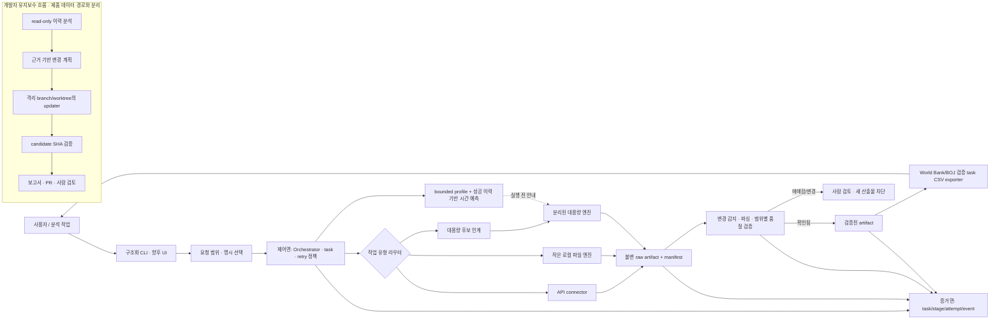

# 제품 및 시스템 아키텍처 — 사용자 신뢰에서 시작하는 설계

기준일: 2026-10-26. 이 문서는 목표 아키텍처의 상세 설명이며 모든 경로가 구현됐다는 뜻은 아닙니다.
현재 범위·우선순위는 [통합 제품 기획](../PROJECT_PLAN.md), 실제 호출 흐름은 [엔진 연결 설계](ENGINE_CONNECTIONS.md),
짧은 실행 요약은 [제품 로드맵](ROADMAP_2026_10_26.md)을 참조합니다.

## 1. 제품을 사용자 일에서 출발해 정의하기

MacroAtlas가 풀려는 일은 “기관 이름을 검색하는 것” 자체가 아닙니다. 분석가가 반복해서 하는 다음 작업입니다.

1. 필요한 지표와 기간을 정한다.
2. 그 정의와 범위를 제공하는 공식 자료를 확인한다.
3. 원본을 보존하면서 필요한 자료를 받아온다.
4. 개정·누락·형식·의미가 불확실하면 멈추고 설명한다.
5. 근거를 유지한 결과를 저장·전달하고 같은 요청을 재현한다.

초기 고객군은 반복 보고서·정책 분석을 위해 공식 경제통계를 수집하는 소규모 분석팀이라는 **검증 대상 가설**입니다.
이 가설이 확인되기 전에는 전체 기관을 대상으로 하는 넓은 제품을 약속하지 않습니다. 먼저 World Bank·BOJ의
고정 경로와 TIC/BIS 파일 감시처럼 실제로 검증할 수 있는 좁은 흐름을 안정화합니다.

사용자 가치는 세 가지입니다: 수작업 수집 시간을 줄임, 자료가 어디서 왔는지 설명 가능하게 함, 애매한 경우
조용히 잘못된 숫자를 내보내지 않음. 사용자 관점에서 좋은 중단은 실패를 숨기는 것보다 쓸모 있습니다.

## 2. 사용자 화면과 개발자 시스템을 분리하기

### 사용자 관점

첫 버전의 진입점은 고정된 구조화 CLI와 Python API입니다. 각 경로는 지원하는 기관·지표·기간·출력을
명확히 보여 줍니다. 사용자는 task ID로 진행 상태를 확인하고, 재시도 가능한 실패는 동일 task에서 이어갑니다.
다음 UI는 업무 인터뷰 후 결정합니다. CLI 위에 채팅창만 얹어도 미지원 source, 통계 의미, 불확실성이 해결되지는
않습니다.

사용자가 받아야 할 결과는 숫자만이 아닙니다. 상태, 원본 파일 참조·해시, 요청 범위, 검증한 스키마, 경고,
출력 파일과 재현 방법이 한 묶음이어야 합니다. `NEEDS_REVIEW`, `NOT_EXECUTED`, `FAILED_RETRYABLE`,
`FAILED_TERMINAL`은 서로 다른 다음 행동을 안내해야 합니다.

### 개발자·운영자 관점

개발자는 source별 동작을 connector/engine adapter에 넣고, 공통 task·artifact·품질 계약을 공유합니다.
매 실행은 source 범위, 코드·정책 버전, 시도 기록, 산출물 manifest로 재현 가능해야 합니다.
로그는 task와 artifact 참조를 사용하고 API secret이나 불필요한 원본 본문을 복제하지 않습니다.

유지보수 analyzer는 운영 source data path와 별도입니다. 기본은 read-only 분석이며, analyzer가 만든 제안은 코드 변경·승인·merge가
아닙니다. `run_improvement.ps1`은 별도 worktree에서 수정 후보를 만들고 경로 allowlist와 candidate SHA QA를 거쳐, 모든 검사가
통과했을 때만 branch를 push하고 review PR을 엽니다. QA runner는 해당 SHA를 detached worktree에서 확인합니다. 실제 Windows
Codex pilot과 scheduler 검토는 남아 있습니다. 제품 실행 경계와 남은 단절은 [엔진 통합·분리 개선안](ENGINE_CONSOLIDATION_PLAN.md)에 둡니다.

## 3. 목표 구조: 제어면·자료면·증거면

**제어면**은 요청·task·stage·resume 예산·명시 선택을 관리합니다. 현재 Orchestrator는 순차 stage runner이며,
일반 분산 queue나 exactly-once 외부 실행기는 아닙니다. **자료면**은 API 응답, 작은 로컬 파일, 대용량 파일을
작업 특성에 맞는 서로 다른 engine으로 처리합니다. 대용량 시간 예측은 최근 성공 stage 시간과 bounded workload profile을
읽고, 실행 전 예상 범위·신뢰도를 돌려줍니다. 예측기는 worker를 실행하거나 승인·예산을 바꾸지 않습니다. **증거면**은
raw hash·manifest·task attempt·변경 판정·품질
결과를 연결해 산출물의 출처를 설명합니다. 현재 exporter는 저장된 성공 task의 원본·manifest·quality를
재검증해 지원된 World Bank/BOJ CSV와 provenance sidecar를 만듭니다. 범용 파일 변환과 대용량 JSONL export는
별도 범위입니다.

## 4. 엔진 경계와 계약

| 경계 | 입력 | 책임 | 멈추는 조건 |
|---|---|---|---|
| 요청/선택 | 지표, 기관, 기간, dimensions, 출력 요구 | 사용자가 실제로 선택한 범위를 보존. 알 수 없는 값은 unknown으로 유지 | 범위 모호·미지원 기관/출력·선택 불일치 |
| Orchestrator | 고정 TaskPlan과 저장소 | 실행 전에 task/stage 기록, 시도·이벤트·resume 관리 | 예산 소진, retry 대기 미충족, 취소, 검토 필요 |
| 대용량 시간 예측 | 인계 event 또는 saved production task와 제한된 로컬 profile | 실행 전 예상·범위·신뢰도 표시, 성공 task elapsed time으로 후보 모델 보정 | 표본·이력 부족 시 낮은 confidence; 승인·실행 판정은 하지 않음 |
| API connector | 고정 endpoint/query와 전송 예산 | HTTPS 요청, 제한된 응답, raw 보존, provider별 parsing | 인증/권한·schema drift·redirect·용량 초과·transient 실패 |
| 작은 파일 엔진 | inbox 아래 명시한 파일과 parser scope | 보안 검사, 용량 preflight, 제한 parser, 변경 guard | 불명확한 표/형식, 용량 상한, 원본 변경 |
| 대용량 엔진 | 명시적으로 인계된 특정 원본 버전과 정책 | 별도 worker·예산, streaming chunk, checkpoint/resume | 자원 한도, 원본/manifest 불일치, 품질 불확실성 |
| exporter | 완료된 World Bank/BOJ task ID와 출력 경로 | provider별 검증, UTF-8 CSV/sidecar, 경로·덮어쓰기 안전성, provenance 보존 | 미완료/미지원 task, 품질·hash 불일치, source 변경/비교 불가, 경로 위험 |

API의 HTTP 오류와 파일 parser 용량 도달은 같은 실패가 아닙니다. 로컬 용량으로 중단된 원본은 이미 저장된
artifact와 함께 대용량 경로로 명시 인계합니다. 서버가 응답하지 않았으면 로컬 parser로 보내지 않습니다.
작은 엔진이 대용량 엔진을 암묵적으로 호출하거나, 격리 시험 통과가 production 실행 권한이 되는 경로는 두지 않습니다.

다음 공통 artifact 계약은 `artifact_id`, 상대 경로, media/schema version, bytes/hash, 원본·manifest 참조,
source scope, validation status, 생성 task/stage, parent artifact를 추적해야 합니다. 원본과 normalized output은
별도 artifact입니다. known hash가 없는 과거 파일에 소급 hash provenance를 주장하지 않습니다.

## 5. 신뢰 불변 조건

- 원본은 덮어쓰지 않습니다. 변경 비교는 동일 scope의 보존된 이전·새 raw를 사용합니다.
- source revision 또는 의미/스키마 불확실 시 새 normalized output과 export를 막습니다.
- `null`, 0, 빈 문자열, 알 수 없는 단위·주기는 다르게 보존합니다.
- 자동 retry는 하지 않습니다. retry 가능한 실패는 같은 task와 stage에서 `Retry-After` 및 시도 예산을 지킨 뒤 재개합니다.
- 대용량 엔진의 용량·시간·메모리·출력 한도는 실측으로 정합니다. 한도·환경을 만족하지 않으면 `NOT_EXECUTED`로 이유를 남깁니다.
- feedback은 범위와 출처를 유지하고 기본은 사람 검토가 필요합니다. 하나의 지시를 전 기관 규칙으로 승격하지 않습니다.
- 테스트 fixture, simulated failure, 실제 source change, 자연 provider failure는 각각 다른 evidence type입니다.
- 제품 Gate의 범위는 검증된 경로에 한정합니다. 한 provider의 성공을 전체 기관 지원으로 일반화하지 않습니다.

## 6. 스타트업식 집중과 확장 기준

### 먼저 검증할 가정

| 가정 | 검증 방법 | 통과 신호 |
|---|---|---|
| 사용자는 공식 자료를 다시 받을 때 출처·범위 이력을 필요로 한다 | 실제 반복 업무 3–5건을 따라가며 수동 단계와 재사용 여부를 기록 | 사용자가 저장된 원본/요청 이력을 다시 쓰고, 반복 정리 단계를 줄였다고 설명 |
| 안전한 중단이 신뢰를 높인다 | 개정·형식 불일치·지원 한도 화면을 사용자와 검토 | 사용자가 중단 이유와 다음 행동을 이해하고, 불확실한 값을 결과로 받는 것보다 이를 선택 |
| 별도 대용량 처리가 실제 병목을 해소한다 | BIS flat pilot에서 자원·속도·재개·결과 대조를 측정 | 완성 결과가 원본과 추적 가능하고, 제한 환경에서 실패를 안전하게 분류 |

이는 권장 검증 표본이지 이미 수행한 시장 조사 결과가 아닙니다. 관찰 결과가 부정적이면 기능을 늘리지 말고
사용자·업무 흐름이나 우선순위를 다시 정합니다.

### 확장 순서

고정된 한 업무를 끝까지 완성 → 검증된 artifact의 전달 → 한 명 이상의 실제 반복 사용에서 학습 → 다음 provider/업무
확장 순서를 권장합니다. broad search, 자연어 planner, 웹 UI, XLSX, 매일 자동 수집은 각각 사용자 증거와 신뢰 계약이
정해진 뒤 별도 투자로 결정합니다.

## 7. 운영 품질 지표

각 지표는 scope와 분모가 명확할 때만 사용합니다.

- 지원된 요청 중 근거·품질 검사를 통과해 전달된 비율, 및 실패 원인별 비율.
- raw부터 전달 파일까지 provenance가 완전한 작업 비율.
- 동일 task의 retryable failure에서 안전하게 resume된 비율.
- 사용자 작업 시작부터 첫 유효 artifact까지 걸린 시간, 반복 수작업 절감에 대한 사용자 관찰.
- `NEEDS_REVIEW`와 `NOT_EXECUTED`의 사유별 분포. 낮추기 위해 가드를 완화하지 않습니다.
- 저장소 내부 QA의 결정적 재현률: clean checkout에서 같은 검사와 결과를 얻는 비율.

원본 개정이나 transient provider 오류는 서비스가 원하는 빈도로 만들 수 없으므로, 이를 주기형 “성공률”로 포장하지
않습니다. 자연 발생 건수와 fixture 기반 계약 테스트를 따로 표시합니다.
