# 제품 평가·시계열 엔진 통합·Excel 실행 계획

기준일: 2026-10-27. 이 문서는 [`PROJECT_PLAN.md` §11](../PROJECT_PLAN.md)의 A–G 제품 작업을 회차별 구현·검증 일정으로 구체화한다. 제품 범위·정책·우선순위는 통합 기획서가 기준이며, 이 문서는 하위 실행 계획이다. 최종 40회차는 사용자가 요청한 23회차 분석가 관찰이다. 현재 상태는 **실행 전 계획**이며, 문서만으로 기능 구현이나 사용자 관찰을 완료했다고 보지 않는다.

## 1. 목표와 현재 범위

최종 목표는 지원되는 공식 자료를 찾고, 사용자가 명시적으로 선택한 자료를 원본·정의·단위·주기·출처와 함께 검증하며, 서로 호환되는 series의 원본 workbook과 날짜 정렬 workbook을 재현 가능하게 내보내는 것이다. 검색이 불확실하면 후보를 확정하지 않고, unknown을 추측으로 채우지 않으며, missing 값을 보간하지 않는다.

이번 제품 범위는 현재 지원된 World Bank, BOJ, BLS, Census API 경로와 제한된 공식 파일 경로다. 신규 기관을 추가하거나 범용 자연어 agent/UI를 만드는 일은 포함하지 않는다. TIC/BIS 감시와 대용량 worker는 서로 다른 운영·보안 목적의 경로이므로 공통 관측값 모델에 억지로 넣지 않는다.

한 번의 구현 task는 저장소 규칙대로 하나의 번호가 붙은 High 회차만 다룬다. 각 회차는 독립 PR, 테스트 결과, 현재 상태, 미완료 항목을 기록하고 gate가 실패하면 다음 회차로 넘어가지 않는다. 평가 코퍼스와 모든 실행은 로컬 fixture를 기본으로 하며, 평가는 네트워크·API key·task DB 쓰기·수집·제품 CSV/XLSX export를 하지 않는다. 필요할 때만 `.gitignore`된 `reports/evaluation/` 아래에 deterministic evaluation report를 쓴다. 사용자 피드백은 현재 운영/업무 상태를 기록하는 입력이며 SearchPolicy나 공통 규칙을 자동 수정하지 않는다.

## 2. 지금 있는 것과 없는 것

| 현재 코드 | 확인된 책임 | 남은 단절과 이번 계획의 경계 |
|---|---|---|
| `discovery/series_search.py`: `CandidateSearchEngine`, `rank_candidates`, `SelectionReceiptEngine` | 구조화 `DataRequest`로 로컬 근거 후보를 lexical ranking하고, 명시 선택을 수집 계획으로 전달 | 평가 사례·split·Top-1/MRR report·규칙 전후 비교·승격 기록은 없다. ranking은 동등성 판정이 아니다. |
| `workflow_contracts.py`: `DataRequest`, `Candidate`, `CandidateProposal`, `ConfirmedSelection` | 요청, 후보, 선택 상태를 검증하고 직렬화 | 시간축 관측값, canonical series identity, compatibility 계약은 없다. |
| `orchestration/runner.py`, `orchestration/models.py`, `contracts.py` | 공통 `Orchestrator`, `(engine, version)` 등록, `StageInput → StageResult`, attempt/history | 실행기는 이미 공통이다. 이를 대체할 새 최상위 만능 엔진은 추가하지 않는다. provider 작업 단계와 보존 정책을 차례로 공통화한다. |
| `connectors/{worldbank,boj,bls,census}.py`, `ingestion/{worldbank,boj,bls,census}.py` | source별 요청·HTTP·응답 확인·파싱과 기존 stage 저장 | source 클래스를 제거하지 않는다. protocol 차이는 어댑터에 두고 공통 실행 lifecycle 중복을 shared service로 옮긴다. |
| `ingestion/metadata.py`, `metadata/normalize.py`, `metadata/sdmx.py` | 일부 BLS/Census/BOJ/SDMX metadata 취득과 `known/unknown/conflict` 보존 | metadata normalized model과 observation model은 별개다. field 미제공은 unknown으로 유지한다. |
| `storage/feedback.py`, `feedback_cli.py`, `analysis/patterns.py` | task/stage에 연결된 versioned feedback, append-only revision 기록, 수동 review 상태, 반복 feedback의 draft pattern 분석 | 별도 `feedback_log` 평문 파일은 아니고 SQLite `feedback_current`/`feedback_revisions`가 저장소다. reviewed feedback→EvaluationCase 변환은 없으며, accepted feedback/pattern도 규칙이나 평가 세트로 자동 반영되지 않는다. |
| `ingestion/csv_export.py` | 완료·검증된 World Bank/BOJ task의 CSV와 provenance sidecar, read-only revalidation, 경로·덮어쓰기 방어 | XLSX 생성은 없다. `openpyxl`은 입력 XLSX parsing에 사용 중이며 프로젝트 의존성이다. |
| `connectors/tabular_files.py`, `ingestion/tabular_files.py`, `ingestion/gate_c_watch.py`, large-file trial/production | 작은 표의 구조 parsing, Gate C 파일 변경 감시, BIS flat 제한 worker | 표 parsing은 경제적 series 의미를 판정하지 않는다. Gate C 감시·대용량 worker의 안전 lifecycle은 exporter/normalizer와 합치지 않는다. |

각 구현 회차는 시작 시 최신 base와 작업 branch 상태를 확인하고 독립 branch/worktree에서 수행한다. 이전 task의 stage engine/version은 기존 resume 호환 기간 동안 registry에서 유지하고, 새 plan에만 새 engine version을 고정한다.

## 3. 목표 엔진 경계

```mermaid
flowchart LR
    CASE[EvaluationCase / DataRequest] --> SEARCH[CandidateSearchEngine]
    SEARCH --> SELECT[명시적 사용자 선택]
    SELECT --> PLAN[버전 고정 TaskPlan]
    PLAN --> META[공통 MetadataCollectionEngine]
    PLAN --> COLLECT[공통 ObservationCollectionEngine]
    META --> ADAPTER[명시 등록된 SourceAdapter]
    COLLECT --> ADAPTER
    ADAPTER --> RAW[불변 raw + request manifest]
    RAW --> NORMALIZE[공통 NormalizationEngine]
    NORMALIZE --> FRESH[FreshnessAssessmentEngine]
    FRESH --> QA[공통 QualityValidationEngine]
    QA --> ORIGINAL[OriginalWorkbookExporter]
    QA --> ALIGNED[ComparisonWorkbookExporter]
    CASE --> EVAL[동일 코퍼스 평가기]
    EVAL --> PROMOTION[RulePromotionRecord / PR 심사]
    FEEDBACK[task-linked feedback] --> STORE[별도 FeedbackStore revisions]
    STORE --> REVIEW[명시적 사람 검토]
    REVIEW --> DRAFT[익명 EvaluationCase draft]
    DRAFT -. 명시 승인 후 development set만 갱신 .-> CASE
```

공통 엔진은 공통 policy와 artifact lifecycle을 소유한다. source adapter는 공식 endpoint/method, 인증 방식, 요청 직렬화, 페이지 규칙, 응답 parsing, source-specific schema invariant, source metadata field mapping을 소유한다. `source_id -> adapter`는 명시 registry/capability로 등록하고, core에 provider 이름을 따라 분기하는 거대한 `if/else`를 만들지 않는다.

처음부터 모든 provider를 같은 stage 구성으로 바꾸지 않는다. 기존 task plan의 stage 순서·입출력을 보존하는 World Bank 수직 slice를 먼저 만든 뒤 provider별로 옮긴다. BOJ metadata/data가 분리된 단계, World Bank collect/validate 단계 등 source에서 필요한 의존성은 adapter capability와 명시 TaskPlan에서 나타낸다. 일반 DAG, 분산 queue, exactly-once 외부 실행은 이 작업의 요구가 아니다.

`LargeFileTrialEngine`, `LargeFileProductionEngine`, `GateCFileEngine`은 실행 격리·승인·원본 감시의 서로 다른 trust boundary라 별도 유지한다. 보통 파일 parser는 `UninterpretedTableArtifact` 같은 구조 보존 결과를 반환할 수 있으나, 공식 정의·단위·주기가 검증되지 않은 파일을 canonical economic `TimeSeries`라고 선언하지 않는다.

피드백은 `FeedbackStore`의 task/stage 연결, revision, accepted/rejected review 경계를 사용한다. feedback 승인도 규칙 변경 승인이 아니다. 검토자가 근거·범위·익명화 상태를 확인한 항목만 case draft로 옮기고, 별도 case 검토를 거쳐 development set에 넣는다. 후보 정책 변경은 코드/규칙 PR과 C/D gate를 통과한 경우에만 사람 승인으로 반영한다. 런타임에서 feedback, pattern, 평가결과를 읽어 코드를 고치는 경로는 만들지 않는다.

## 4. 데이터 계약

### 4.1 평가 사례와 세트

`EvaluationCase` v1은 다음을 필수로 갖는다.

| 필드 | 의미 |
|---|---|
| `case_id`, `case_version`, `case_family_id`, `split` | 불변 식별·버전·누수 방지 그룹·development/validation/holdout 구분 |
| `case_type` | `rankable`, `near_match`, `insufficient_evidence`, `unrelated` 중 하나; `expected_state`와 별개로 평가 유형을 고정 |
| `request` | 실제 `DataRequest` 직렬화 값 |
| `query_variants` | 의미가 보존되는 질문 표현; 각 변형은 원 case의 같은 family에 속함 |
| `expected_state` | `candidate_found`, `review_required`, `unmatched` 중 하나. 검색 결과·검토 필요·후보 없음의 안전한 기대 상태 |
| `relevant_candidate_ids`, `forbidden_candidate_ids` | 정답 후보 집합과 선택·추천하면 안 되는 후보 |
| `expected_match_status` | 채점 대상 후보별 기대 `exact/comparable/related/review_required` 상태. 근거가 부족하면 review_required를 기대 |
| `expected_fields` | 기관, series/dataset 식별자, geography/dimensions, 단위, 통화, 주기, 기간, 정의, override의 기대값 또는 `unknown` |
| `required_evidence` | 공식 근거 URI, 로컬 fixture/raw pointer, retrieval date/hash와 해당 근거가 뒷받침하는 claim |
| `feedback_ref` | 피드백에서 만든 사례인 경우 `feedback_id`와 reviewed revision; 개인 식별 정보나 자유 형식 feedback 원문은 포함하지 않음 |
| `prohibited_actions` | 자동 후보 선택, unknown 보정, 비선택 후보 수집, raw overwrite, export 등의 금지 행동 |
| `excel_policy` | series grouping 기대, 충돌 정책, 정렬 period, 집계/변환 명세, 결측 정책 |

파일은 `tests/fixtures/evaluation/v1/`에 저장한다. 사례는 JSONL UTF-8, schema/serializer는 버전 고정하고, split manifest에 파일 SHA-256 및 schema version을 기록한다. 초기 코퍼스는 **36 case, split별 12 case, 각 split의 case_type별 3개**로 고정한다. case family는 동일 request intent의 paraphrase/near-duplicate 묶음이며 family는 통째로 한 split에만 배치한다. 독립된 요청이면 같은 catalog candidate ID가 여러 split의 정답으로 재사용될 수 있지만, 같은 intent의 변형 질문을 쪼개지 않는다. 36개를 공식 근거로 채울 수 없으면 가짜 정답을 만들지 말고, 실제 확보 수와 비어 있는 유형을 기록한 뒤 B gate를 보류한다. 이 초기 표본은 해당 catalog snapshot에 대한 회귀 gate이며 전체 통계 검색 정확도나 일반화의 증명이 아니다.

schema validator는 cross-field 조건도 검사한다. `rankable`은 relevant candidate가 하나 이상이고 expected state가 `candidate_found`여야 한다. `near_match`는 relevant candidate와 최소 하나의 forbidden distractor가 있어야 하며 expected state는 `candidate_found` 또는 `review_required`다. `insufficient_evidence`는 expected state `review_required`, `unrelated`는 `unmatched`이며 둘 다 relevant candidate를 갖지 않는다. expected `unknown/conflict` field는 case 근거가 있어야 하고, 필요한 후보의 expected match status가 review_required여야 한다.

v1 검색 평가 후보는 고정 catalog snapshot으로부터 읽으며 World Bank seed와 검증된 BLS/Census metadata fixture를 포함한다. 후보가 없는 BOJ/파일 요청은 `unmatched`나 `review_required` 기대 사례가 될 수 있지만, 미등록 source를 지원한다고 채점하지 않는다. snapshot 출처·adapter version을 같이 고정한다. 유사 표현, 동일한 source/concept·period를 가진 paraphrase는 family가 같으므로 다른 split으로 나누지 않는다. Workbook pilot용 2-series target은 WDI 미국 GDP current US$ (`NY.GDP.MKTP.CD`)와 GDP growth (`NY.GDP.MKTP.KD.ZG`), 같은 연도 범위다. 이 indicator ID와 frequency는 33회차 전에 official source로 확인한다. 구조화 metadata가 unit을 비우거나 노출하지 않으면 D-094에 따라 `unit=unknown`을 유지하며, label이나 indicator ID만 보고 정규화 unit을 채우지 않는다. 확인 전에는 알려진 값처럼 case fixture에 넣지 않는다.

### 피드백에서 평가 사례까지

MacroAtlas에는 이미 `FeedbackStore`가 있다. `macro-feedback add/list/review`는 task/stage에 연결한 SQLite 기록을 만들고 revision/action을 남긴다. 반복 accepted feedback 분석은 review 대상 draft pattern을 만들 뿐, accepted feedback은 정답·case·규칙 승격과 같지 않다. 별도 평문 `feedback_log`를 하나 더 만들지 않는다. 대신 feedback을 평가 사례로 검토 전달하는 bridge를 추가한다.

1. 사용자가 `macro-feedback add`로 관측한 검색 오류, freshness 오판, workbook 문제를 기존 task/stage에 기록한다. 선택 scope에 bounded `series_key`, `policy_id`, `assessment_id`를 추가해 어떤 시계열/최신성 판정과 관련되는지 보존한다. category는 `search_quality`, `freshness_assessment`, `workbook_output`을 추가하고 schema 변경은 기존 feedback을 읽을 수 있게 backward-compatible하게 처리한다. credential·개인 식별 정보는 기록하지 않는다.
2. 사람이 `macro-feedback review`에서 accepted/rejected와 이유를 기록한다. accepted는 검토할 가치가 있다는 뜻이지 규칙 수정이나 평가 세트 등록 허가가 아니다.
3. accepted revision을 `macro-feedback case-draft --feedback-id ID --revision N --output evaluation/drafts/CASE_ID.json`으로 복사해 초안만 만든다. PII, credential, 민감한 자유문을 제거하고 request/provenance pointer만 남긴다. 이 명령은 split, expected answer, source mapping, 코드 규칙을 수정하지 않는다.
4. case author가 official source/evidence, expected candidate/field/status, counterexample, query variants, `case_family_id`를 보완한다. 별도 reviewer가 `python scripts/approve_evaluation_case.py --draft evaluation/drafts/CASE_ID.json --split development --reviewer REVIEWER_ID`를 명시 실행해야 versioned development JSONL/manifest가 바뀐다. accepted feedback마다 정답이 확인되지 않으면 사례로 승격하지 않고 별도 검토 queue에 남긴다.
5. 새로운 feedback case는 기본으로 development에만 추가한다. 같은 family가 fixed validation/holdout에 이미 있으면 development에 복제하지 않고 quarantine한다. validation/holdout 변경은 새 case-corpus version, 분할 manifest와 SHA를 별도 reviewer가 승인해야 하며 이전 버전을 보존한다. Holdout은 이미 평가에 사용됐으면 그 결과를 보고 같은 version을 재조정하지 않는다.
6. 엔진 규칙은 자동 변경되지 않는다. 개발자가 별도 policy/code PR을 만들고 development/validation의 유사 질문·near-match·관련 없는 질문 및 freshness regression을 통과시킨 뒤 D의 `RulePromotionRecord`와 사람 승인을 받아야만 기본 동작에 반영한다. feedback 및 pattern analyzer가 runtime module, SearchPolicy 또는 설정을 직접 쓰는 경로는 금지한다.

### 4.2 공통 시계열 v1

`TimeSeries`는 정의/식별과 observation을 분리한다. 직렬화 schema는 `timeseries-v1`로 고정하며 최소 필드는 다음과 같다.

| 영역 | 필수 값 |
|---|---|
| 요청·정체성 | 원 `DataRequest`/선택 receipt 참조, `source_id`, dataset/series ID와 source key, geography와 dimension codes |
| 정의 | 원 label/definition, metadata source refs, `known/unknown/conflict` state, common concept link와 link evidence/status |
| 비교 조건 | frequency, period convention/calendar, currency, unit, seasonal adjustment, price basis, 각 field의 state와 source ref |
| 관측값 | source period token, 검증된 정렬 key(있을 때만), source value decimal text, `value_status`, 원 status/token/reference |
| 변경 계보 | override와 transform의 입력 hash, operation/formula/version, 적용 이유·승인·생성 시점. 미변경은 빈 lineage로 명시 |
| 근거·검증 | raw/manifest 상대 경로와 SHA-256, source/document URL, request fingerprint, retrieved_at UTC, task/stage/run IDs, parser/adapter/engine/rule version, quality result |
| 최신성 | `FreshnessPolicy`/`FreshnessAssessment` ID·version, frequency/calendar, latest observation period, source update time(제공될 때), retrieved_at, expected period, as-of UTC, lag periods, basis와 status |

`value_status`는 최소 `observed`, `missing`, `suppressed`, `not_applicable`, `unavailable`, `unknown`, `conflict`를 지원한다. source가 세부 원인을 말하지 않으면 빈값을 `missing`이나 0으로 단정하지 않고 `unknown`과 원문 token을 보존한다. 값은 binary float로 canonicalize하지 않고 decimal text와 원본 pointer/hash를 남긴다. 날짜는 source period token을 보존하며 frequency/calendar adapter가 검증한 뒤에만 sortable key를 부여한다.

두 series의 **원본 배치 호환 서명**은 검증된 frequency, calendar/period convention, unit, currency, seasonal adjustment, price basis 및 정의/차원 적합성을 포함한다. 핵심 field 중 하나라도 `unknown`, `conflict`, source-only 의미면 자동 공동 배치를 허용하지 않고 각 series를 분리한다. 이름이나 label 유사성만으로 공통 concept·통계적 호환성을 만들지 않는다. 비교 workbook의 side-by-side 정렬은 같은 주기/calendar가 확인돼야 하며, 같은 행에 배치했다고 개념 동등성을 뜻하지 않는다는 경고와 metadata를 출력한다.

### 4.3 Series별 최신성 판정

최신성은 전역 `stale_days`가 아니라 series의 frequency, period calendar, 공식 발표 일정과 검토된 series override로 판정한다. 새 pure-Python 모듈 `analysis/freshness.py`의 `assess_freshness(series, policy, as_of_utc)`는 network/DB I/O 없이 `FreshnessAssessment`를 만든다. 요청은 `freshness_intent=latest_period|historical_as_of`를 구분한다. 호출자는 UTC `clock`을 주입한다. Python system clock은 한 번만 `datetime.now(UTC)`로 감싸고, 알고리즘/테스트 안에서 시간을 직접 읽지 않는다.

우선순위는 (1) 근거 URI가 있는 source-defined release calendar, (2) evidence·reviewer·effective date가 기록된 해당 series의 override, (3) frequency fallback이다. fallback은 초기 사용자 가정이며 source 사실로 표현하지 않는다.

| Frequency/calendar | fallback에서 허용하는 lag | 경계 해석 |
|---|---:|---|
| daily + 검증된 business calendar | 5 business periods | 주말·calendar holiday는 period count에서 제외 |
| daily + business calendar 없음 | 7 calendar days | provisional; 휴일·불규칙 거래일을 source 사실처럼 추정하지 않음 |
| weekly | 2 weekly periods | 마지막 완료 주 기준 |
| monthly | 3 monthly periods | 마지막 완료 월 기준 |
| quarterly | 2 quarters | 마지막 완료 분기 기준 |
| annual | 1 year | 마지막 완료 연도 기준 |
| unknown/unsupported frequency 또는 calendar | fallback 없음 | `FRESHNESS_UNVERIFIED` |

알고리즘은 `as_of_utc`에서 최근 완료된 expected period를 source schedule(정상 발표 지연 포함) 또는 주기 달력으로 구하고, latest observed period와의 lag를 period 단위로 센다. source schedule이 다음 release를 아직 예정하지 않은 경우 `RELEASE_PENDING`; observed period와 제공된 source `updated_at`이 policy 허용 범위 안이면 `CURRENT`; 어느 하나가 허용 lag를 넘으면 `STALE`다. period/date를 파싱할 수 없거나 frequency, 필요한 calendar, 적용 가능한 policy/expected period가 없으면 `FRESHNESS_UNVERIFIED`다. `latest_period` 요청에서 관측일은 필수이며, source update timestamp와 검증된 release schedule 둘 다 없어 최신성을 확인할 근거가 없으면 frequency fallback만으로 `CURRENT`라고 하지 않고 `FRESHNESS_UNVERIFIED` 처리한다. source의 `retrieved_at`은 “언제 확인했나”만 증명하고, source `updated_at`이나 관측 최신성을 대신하지 않는다. source update timestamp는 있으면 별도 보존·검증한다.

`freshness_intent=latest_period`이면 observation date와 판정 가능한 freshness basis가 반드시 있어야 한다. `STALE` 또는 `FRESHNESS_UNVERIFIED`인 최신성 요구 결과는 값/series payload를 사용자 결과로 반환하지 않고 CSV/XLSX에도 내보내지 않는다. raw 응답과 상태/근거는 보존하고, stage는 `NEEDS_REVIEW`와 구체 `STALE`/`FRESHNESS_UNVERIFIED` reason으로 멈춘다. `CURRENT` 또는 아직 release due가 아닌 `RELEASE_PENDING`만 상태를 명시해 전달한다. 명시적으로 과거 날짜 범위를 요청한 `historical_as_of`에서는 오래된 calendar date 자체를 stale로 부르지 않고 freshness claim을 하지 않지만, 관측 날짜 없는 값은 모든 intent에서 거부한다. 해당 요청에서는 freshness 판단 상태를 `NOT_A_LATESTNESS_CLAIM` 또는 근거 부족 시 `FRESHNESS_UNVERIFIED`로 provenance에 표시한다. 과거 범위 예외는 current/latest라고 주장하거나 임의로 최근 자료를 대체할 권한을 주지 않는다.

오래된 saved task를 나중에 export할 때 freshness는 pinned policy version과 export 시 주입한 `as_of_utc`로 read-only 재평가하고, assessment 시각·정책·expected/latest period를 workbook에 적는다. freshness 거부는 raw/DB를 수정·삭제하거나 source collection을 자동 실행하지 않는다. 새 데이터 수집은 사용자 요청·승인 범위에 따른 별도 task다.

### 4.4 Workbook 계약

- 기존 `macroatlas export ... --format csv` 계약은 유지한다. 새 CLI는 `macroatlas workbook {original,compare} --series TASK_ID:SERIES_KEY` 반복 입력과 새 `--output data/exports/name.xlsx` 경로를 받는다. `SERIES_KEY`는 source adapter가 versioned `TimeSeries`에서 발급한 canonical stable identity다. 동일 task의 복수 series도 정확한 key로 명시한다. task/series를 추측하지 않는다.
- 입력 task는 완료·quality-passed여야 하고 export 시 현행 CSV exporter와 같은 방식으로 task/audit/raw/manifest를 read-only 재검증한다. unsupported provider, conflict, source changed, unknown period alignment, malformed lineage면 파일을 게시하지 않고 명시 사유로 멈춘다.
- 출력은 `data/exports/` 아래만 허용하고 symlink/path traversal/덮어쓰기를 차단한다. 임시 파일 생성 후 no-overwrite 방식으로 최종 이름을 게시한다. DB/raw/history에는 쓰지 않는다.
- 원본 workbook은 `Readme`, series/compatibility-group별 `Data_*`, `Series_Metadata`, `Provenance`, 필요 시 `Conflicts` sheet를 둔다. 서로 호환되는 series만 같은 Data sheet에 열로 놓는다. 다른 단위·통화·주기·calendar·의미는 별도 sheet로 둔다. 동일 series/date conflict는 해당 출력값을 빈칸으로 두고 양쪽 원문/출처를 Conflicts에 보존하며 workbook에 review 상태를 표시한다.
- 모든 Data sheet는 날짜/period와 값 옆의 상태를 보존한다. 빈 셀을 숫자 0으로 표현하지 않는다. source decimal text를 보존하고 Excel 15자리 정밀도를 넘거나 숫자로 안전 변환할 수 없는 값은 정확한 text로 기록해 근사값을 숨기지 않는다.
- 비교 workbook은 원본 series reference와 metadata를 유지한 `Aligned_Data` 및 `Comparison_Policy` sheet를 추가한다. v1에서 허용할 변환은 `identity`, 동일 series의 인접한 검증 period 간 `difference`, `percent_change`로 제한한다. formula/version과 base/lag period 규칙을 기록하고, 중간 period 누락·unknown/suppressed input·0 분모는 빈 결과와 status로 남긴다. 집계는 v1에서 `none`만 지원하고 다른 집계/통화 환산/보간 요청은 거부한다. 서로 다른 frequency/calendar는 자동 변환하지 않는다.
- 출력 크기·행·series 수 한도를 코드 상수로 선언하고 경계 테스트한다. exporter는 write-only XLSX 생성으로 메모리 사용을 제한한다. 초과하면 partial workbook을 남기지 않고 명시적 거부한다.

## 5. 순차 실행 계획

아래 번호는 27회차 뒤의 제품 구현·검증 순서다. 28–39회차 gate를 순서대로 통과한 뒤, 기존 명칭의 23회차 분석가 관찰을 최종 제품 검증으로 수행한다. 유지보수 pilot과 자연 Gate C evidence는 별도 workstream이며 A–G 제품 gate로 계산하지 않는다.

| 회차 | 범위와 주요 산출물 | 필수 검증·통과 gate |
|---|---|---|
| 28 | A: `EvaluationCase` v1 schema/validator/reader, 근거 기반 36 JSONL 사례와 immutable initial manifest | case type·expected state cross-check, official evidence pointer, deterministic hash; 36개/유형별 수를 근거로 채우지 못하면 보류 |
| 29 | B + 피드백 bridge: family 단위 split/leakage validator, 개발/고정 검증/holdout manifest, `macro-feedback case-draft`와 explicit reviewer approval | FeedbackStore records remain separate; only accepted + evidence-reviewed, anonymized case drafts can enter development; no auto rule/corpus edit; near-duplicate family across splits rejected; split SHA stable |
| 30 | C: offline evaluator와 현행 `rank_candidates` baseline report; Top-1/MRR, specified-field exactness, abstention/false-exact, forbidden action 및 분모별 유형 표. CLI 예: `python scripts/evaluate_search.py --split validation --policy search-rules-v1 --report reports/evaluation/search-rules-v1-abc123-validation.json`; `--split`은 development/validation 중 선택 | 같은 request/catalog snapshot 반복 report 본문이 byte-identical; missing evidence·unknown을 무단 채점/추정하지 않음; 네트워크·API key·DB/raw/product-export side effect 없음. report는 input/case/catalog/policy SHA를 기록 |
| 31 | C: ranking policy를 명시 `SearchPolicy`/version으로 주입하고 기존/후보 version 비교 실행·JSON report 작성 | feedback에서 파생된 유사 query, near-match 다른 정답, unrelated input 및 freshness 사례를 같은 snapshot으로 비교; 목표 유형 개선, 미목표 유형 regression 0, false-exact/금지 행동 0. 이 조건이 안 되면 규칙 미승격 |
| 32 | D: `RulePromotionRecord`와 review 절차/저장 포맷; from/to policy, case/split/catalog SHA, reports, 공식 근거, reviewer, 적용 PR commit, rollback version | holdout은 frozen candidate가 validation gate 통과한 때 한 번 확인. holdout 실패 후 같은 holdout으로 튜닝 금지. 승인·rollback 없는 policy 기본값 변경을 거부하는 테스트 |
| 33 | E: typed `TimeSeries`/`Observation`, per-series `FreshnessPolicy`와 pure-Python `FreshnessAssessmentEngine`, World Bank collect/quality/export vertical slice. official metadata 확인 후 GDP current US$ / GDP growth 2-indicator pilot 확정 | injected UTC clock으로 period boundary test; daily/monthly 등 threshold 직전·직후, policy precedence, `STALE`/`FRESHNESS_UNVERIFIED` 차단, historical intent 구분; 보존 World Bank fixture의 null/unknown/raw lineage 및 기존 CSV 회귀 없음; indicator 정의/frequency 공식 확인; unit source 그대로 반영 |
| 34 | E: BOJ metadata/data adapter를 공통 stage lifecycle과 series freshness policy에 연결 | 기존 FM08/FXERD01 fixture와 30 observations/11 null 의미 유지; 검증 metadata에서 frequency/calendar 적용; freshness check와 이전 saved task resume fixture 통과 |
| 35 | E: BLS data/series metadata adapter 연결 | period token M/Q/A/S, original value, credential redaction, unknown field 보존; verified metadata의 frequency/calendar만 freshness에 사용; prior task format fixture 호환 |
| 36 | E: Census variable metadata/data adapter 연결 | geography/table/variable key, source null, query year, credential-free URL/raw lineage 보존; official release cadence 근거 없으면 provisional fallback 명시, unknown frequency 추정 금지 |
| 37 | E: `UninterpretedTableArtifact`와 공식 file adapter lifecycle 경계 문서·등록 연결. Gate C watch 및 large-file worker는 별도 유지 | TIC/BIS/table parser의 기존 watch, trust boundary, structural-only semantics 동일; meaning mapping 없는 파일은 `TimeSeries`/CSV/XLSX series로 진입하지 않음 |
| 38 | F: read-only original XLSX exporter, workbook command, provenance/metadata/compatibility/conflict/freshness sheets | known-compatible grouping, unknown 분리, duplicate conflict 보존, null/zero, decimal precision, stale/latest unverified 차단, historical range 표시, no-overwrite/path/symlink, DB/raw 불변 |
| 39 | G: aligned comparison workbook과 허용 변환, period alignment/status 처리 | 같은 주기·calendar만 정렬; missing blank, no interpolation/forward-fill, gap/zero denominator status, transform/freshness policy version 기록, stale/latest unverified 값 차단, unsupported aggregation/frequency mismatch 거부 |
| 40 | 최종 사용자 검증: 기존 “23회차” 프로토콜을 완성 workbook workflow로 갱신하고 분석가 1–2명 관찰 | 28–39 gate 통과, frozen scenario/expected sheet, 최신 base의 격리 checkout, freshness warning과 feedback 절차 이해 확인, 동의·익명 기록. 작은 표본은 사용성 관찰일 뿐 전체 사용자 성공률/시장 증거로 과장하지 않음 |

각 회차 branch는 회차 하나만 포함한다. 최소 검사 명령은 `pytest`, `ruff check src tests scripts`, `git diff --check`, 관련 CLI help/smoke test 및 해당 provider의 전체 regression subset이다. 28–40회차 구현 시작 전 최신 base에서 전체 suite/Ruff를 baseline으로 한 번 실행하고 결과를 회차 28 보고서에 기록한다. 각 회차 report에는 base/candidate SHA, Python/OS, fixture와 live evidence의 구분, 변경 파일, 검사별 정확한 결과, 실패/미실행 이유를 기록한다. GitHub Actions가 계정 결제/사용 한도로 step 시작 전 차단되면 CI 통과로 쓰지 않는다. 로컬 검증 결과와 CI 미실행 상태를 각각 기록하고, project PR 정책상 필요한 사람 검토 전에는 gate를 통과 처리하지 않는다.

## 6. 공통 판정 규칙

검색 후보 품질과 사용자 선택은 분리한다. `Top-1`은 첫 후보가 relevant ID인지, `MRR`은 첫 relevant ID 순위 역수의 평균이다. `field exactness`는 case에서 기대 state가 명시된 필드만 채점하고 unknown은 정확한 unknown-state여야 맞다. `false_exact`는 expected state가 `review_required/unmatched`이거나 해당 후보의 expected match status가 review_required인데 `exact`로 판정하는 사건, 또는 evidence 부족 후보를 자동 선택/수집하는 사건이다. `prohibited_action`은 case에 열거한 금지 행위와 부작용을 각각 센다. report에 전체 및 case type별 분자/분모를 항상 표시하고 denominator 0이면 0%가 아니라 `N/A`로 표시한다.

고정 validation 통과 조건은 31회차 표의 기준 그대로다. feedback에서 만든 새 case는 development set으로 학습·점검하고, 기존 validation은 후보 규칙의 일반화 검사로 유지한다. holdout은 candidate policy/code/corpus version과 report schema가 고정된 후에만 실행한다. holdout은 채택 판정 자료이며 조정용 데이터가 아니다. 규칙이나 freshness threshold 수정은 새 candidate version으로 development/validation에서 재실행한 뒤 새로운 승인된 holdout version이 준비될 때까지 채택하지 않는다. 하나라도 false-exact, prohibited-action 또는 freshness policy의 날짜/상태 오류가 있으면 다른 평균 점수와 무관하게 실패다. 최종 적용은 사람 review가 있는 PR과 D의 `RulePromotionRecord`로만 이뤄진다.

공통 엔진 migration은 이전·신규 path를 동일 fixture와 같은 request fingerprint로 실행해 canonical `TimeSeries` 직렬화, quality result, provenance, StageStatus가 일치하는지 비교한다. 차이는 허용 목록에 없는 한 실패다. source adapter의 version 변경, rule version, normalizer version, calendar/value mapping version은 TaskPlan fingerprint 및 artifact manifest에 포함한다. 이전 task는 고정된 과거 engine/version으로 재개한다.

## 7. 최종 분석가 관찰의 준비·판정

기존 [23회차 계획](ITERATION_23_PLAN.md)은 관찰 프로토콜의 이력으로 보존한다. 실제 관찰은 순차 계획의 마지막 회차(40)에서만 진행하고, 이 실행 전에 시나리오를 38/39회차의 명령과 산출물에 맞게 다시 쓴다. 기본 scenario target은 공식 근거를 확인해 저장한 World Bank USA GDP current US$와 GDP growth series다. 1인 과제로 각 값을 원본 workbook에 저장하고 unit/frequency/source/freshness warning을 설명하게 한다. comparison 과제는 날짜 정렬·서로 다른 단위/정의의 sheet와 열 표시·결측 처리를 설명하게 하며, 서로 다른 개념의 값을 빼거나 환산하도록 요구하지 않는다. 참가자가 오해 없이 별도 `macro-feedback add`로 문제를 기록할 수 있는지도 확인하되, feedback이 즉시 평가 세트나 엔진을 바꾸지는 않는다고 진행자가 안내한다. 해당 두 series의 조건이나 보존 task가 준비되지 않으면 참가자 세션을 진행하지 않고 필요한 source/series scope를 별도 결정으로 남긴다. 참가자에게 정답/holdout case는 보여주지 않는다.

진행자는 최신 base SHA의 폐기 가능한 checkout, 고정된 저장 task/raw/manifest, 빈 `data/exports/`, no-network·no-credentials 환경, 기대 결과 sheet와 중단 조건을 사전 확인한다. 동의 후 익명으로 명령 실수·도움 요청·완료/미완료·시간·unknown/blank/conflict 오해·사후 발언을 기록한다. 녹화는 별도 동의가 없으면 하지 않는다. 완료 여부는 사례별 관찰로 남기며 1–2명의 결과로 시장 수요나 통계적 성공률을 추정하지 않는다. 관찰 후 다음 투자(provider/UI/자연어) 한 가지를 결정 기록으로 남긴다.

## 8. 이번 문서에서 미리 결정하지 않는 것

- 새로운 common-concept mapping의 경제적 정답은 공식 정의와 검증된 metadata를 확인해 각 evaluation case에서 확정한다. 이름이 같다는 이유만으로 매핑하지 않는다.
- 원본 series의 동시 배치 가능성은 source별 known metadata가 충족할 때 결정한다. Unknown 필드는 임시 기본값으로 대체하지 않는다.
- 통화 환산, 주기 변환, aggregation은 v1에서 비지원이다. 나중에 추가하려면 정확한 입력 단위·calendar·source evidence, deterministic formula/version, 기대 workbook, 부작용/실패 case를 새 결정과 회차 범위에 기록한다.
- 실제 참여자 모집과 세션은 28–39 gate 이전에 진행하지 않는다. 자연 Gate C 이벤트와 updater candidate pilot은 별도 운영 evidence 흐름이며 이 계획의 차단 조건이 아니다.
