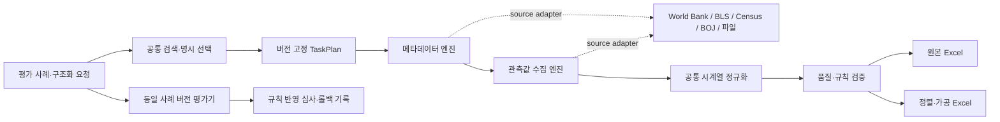

# 제품 평가·시계열 엔진 통합·Excel 계획

기준일: 2026-10-27. 분석가 사용 관찰(23회차)은 이 계획의 마지막 사용자 검증으로 둔다. 사용자 요청에 따라 먼저 A–G의 사례 평가,
엔진 경계, 시계열 모델, Excel 출력까지 구현·검증한다. 자연 Gate C 증거와 유지보수 pilot은 별도 흐름으로 계속 기록하며,
자연 이벤트가 생기지 않았다는 이유로 최종 제품 관찰을 무기한 막지 않는다.

현재 상태는 **기획**이다. 이 문서 작성으로 엔진 통합·평가 세트·Excel 기능이 구현된 것은 아니다. 한 번의 구현 작업은 기존 규칙에 따라
하나의 회차 범위만 처리한다.

## 대상 범위

기존 지원 어댑터(World Bank, BLS, Census, BOJ, TIC/BIS 파일)로 한정한다. 신규 기관을 늘리는 작업은 포함하지 않는다. 기관별 endpoint,
인증, 요청 파라미터, 원본 파서와 소스별 특수 검증은 어댑터 안에 남긴다. 공통화할 대상은 수집·정규화·검증·내보내기의 업무 흐름과
데이터 계약이다.

`Orchestrator`와 `Engine.run(StageInput) -> StageResult`는 이미 공통이다. 새 상위 만능 엔진을 추가하지 않는다. 현재 기관별 ingestion
클래스의 공통 lifecycle을 단계별 엔진으로 옮기고, 기관별 클래스는 그 단계에 주입되는 `SourceAdapter` 구현으로 줄인다.

## 엔진 경계

| 공통 엔진·계약 | 기관/형식 어댑터의 책임 | 현행 구현 이전 방향 |
|---|---|---|
| `CatalogEngine`·`CandidateSearchEngine` | 공식 카탈로그 접근, provider 고유 ID와 정의 해석 | `InstitutionDiscoveryEngine`와 metadata reader 결과를 공통 카탈로그 입력으로 연결. 현재 lexical rank는 평가 대상 정책으로 유지하며 의미 동등성을 주장하지 않음 |
| `MetadataCollectionEngine` | metadata endpoint, 인증, 응답 포맷·페이지 방식 | `BLSMetadataEngine`, `CensusVariableMetadataEngine`, `BOJMetadataEngine`의 수집·저장 반복을 공통화. Codebook/SDMX 파서는 제공된 입력용 어댑터로 유지 |
| `ObservationCollectionEngine` | URL/HTTP method, 요청/인증, provider 응답 파싱 | `WorldBankGDPEngine`, `BLSEngine`, `CensusEngine`, `BOJObservationEngine`의 단계 lifecycle 통합. 기관별 connector는 별도 어댑터 |
| `FileCollectionEngine`·shared parser | TIC/BIS의 고정 URL, archive/member, 구분자·헤더 | `GateCFileEngine`와 `TabularFileEngine`의 source watch와 공통 원본 보존 경계를 분리. 형식별 parser는 유지 |
| `NormalizationEngine` | source field와 코드의 의미 매핑 | `WorldBankValidation` 등 provider별 정규화를 공통 `TimeSeries` 출력 계약에 맞춤. 필드가 없으면 unknown으로 둠 |
| `QualityValidationEngine` | source-specific 허용 범위, API schema invariants | 중복·기간·차원 검증은 공통 rule protocol로, provider schema 확인은 adapter rule로 분리. 규칙은 독립 버전과 근거를 가짐 |
| `OriginalWorkbookExporter` | 없음 | CSV-only exporter를 원본 provenance를 포함한 XLSX 원본 출력으로 확장 |
| `ComparisonWorkbookExporter` | 없음 | 날짜 정렬·명시적 변환을 위한 별도 비교 시트 생성 |
| 격리 trial/production worker | 위험한 파일의 실행·자원 경계 | `LargeFileTrialEngine`과 `LargeFileProductionEngine`은 시험과 승인형 처리의 trust boundary가 달라 별도 유지 |

기관별 어댑터는 사라지지 않는다. 다만 `BLSEngine` 같은 클래스가 HTTP·parse·저장·검증·출력 정책을 모두 소유하지 않게 한다.
등록표가 `source_id -> SourceAdapter`를 제공하고, 공통 단계 엔진이 adapter capability와 버전을 확인해 호출한다. source ID, adapter version,
engine version, rule-set version은 작업 fingerprint와 산출 manifest에 기록한다. 예전 task 재개가 새로운 의미로 실행되지 않도록 기존 엔진
버전 등록은 호환 기간 동안 보존한다.

## A–G 구현과 완료 조건

| 순서 | 범위 | 완료 기준 |
|---|---|---|
| A | 사례 형식 | `EvaluationCase`가 원 질문·변형 질문·기대 후보/종목/필드·필수 근거·금지 동작·Excel 정책·근거 URI/해시·사례 버전을 담고, 실패 이유를 판정할 수 있음 |
| B | 세트 분리 | 개발·고정 회귀·holdout을 분리하고, 유사 질문/비슷하지만 다른 정답/비관련 입력을 포함. 같은 개념의 near-duplicate가 서로 다른 split으로 새지 않게 관리 |
| C | 변경 전후 평가 | 기존 규칙과 후보 규칙을 같은 고정 사례 버전에서 실행. 유형별 후보 정확도·Top-1/MRR 순위 지표·필드 정확도·오확정·금지 동작을 보고. 목표 유형 개선, 허용된 비퇴행 조건 통과, 오확정·금지 동작 0건이어야 함 |
| D | 규칙 반영 심사 | 실패 유형, 사례·공식 근거, 평가 데이터/규칙 버전, 고정·holdout 지표, 승인자, 롤백 대상 버전을 `RulePromotionRecord`로 남김. holdout 확인 전 채택 금지 |
| E | 공통 시계열 모델 | 요청 조건, series identity, country/dimensions, currency와 unit, frequency와 calendar, revisions, source codes, override/transform lineage, 관측값 상태, provenance와 검증 시점을 추적 |
| F | 원본 Excel | 호환 정의는 같은 sheet에 두고, 주기·통화·단위·의미·calendar가 다르면 분리. 같은 series/date의 값이 충돌하면 덮어쓰지 않고 충돌 자료를 보존해 검토 표시 |
| G | 비교 Excel | 날짜 정렬 시트에 원본 series link, 날짜 기준, 집계, 변환식, 결측 정책을 명시. 기본 결측은 빈칸. 자동 보간/forward-fill 금지. 변환 결과와 수식/정책 버전을 manifest에 기록 |

평가 수치는 모호한 정답을 억지로 만들지 않는다. 출처 근거가 부족한 필드는 expected value 대신 expected state를 `unknown/review_required`로
정의할 수 있어야 한다. holdout은 후보 규칙 선택에 사용하지 않고, 채택 전 고정된 평가 버전에서 한 번 확인한다. 규칙이 바뀌면 개발 세트에
반영하되 기존 고정 세트와 holdout은 사례 버전을 올리지 않는 한 수정하지 않는다.

## 단계별 일정

1. **A+B — 평가 사례와 분리 세트:** 사례 schema, 공식 근거 포인터, split manifest를 만든다. 기존 unit tests를 이 사례 평가로 간주하지 않는다.
2. **C+D — 기준 평가기와 승격 게이트:** 현행 search/rule 동작의 baseline을 만든 뒤, 변경 후보 비교와 사람 승인/rollback 기록을 추가한다. 이 단계 전에는 검색·매핑 규칙을 목표 지표에 맞춰 조정하지 않는다.
3. **E — 공통 시계열 계약과 공통 단계 엔진:** 현재 World Bank 경로로 계약과 lossless 변환을 검증하고, 이어 BOJ/BLS/Census를 adapter 단위로 이전한다. 단계마다 기존·신규 path를 동일 fixture/case로 비교한다.
4. **F — 원본 workbook:** 먼저 한 provider/한 series 원본 경로와 provenance를 검증하고, 이어 호환 가능한 다중 series 배치와 충돌 보존을 추가한다.
5. **G — 비교 workbook:** 날짜 정렬, 호환성 검사, 명시적 집계/변환, blank missing 기본을 구현한다. 임의 자동변환은 제공하지 않는다.
6. **23회차 — 최종 분석가 관찰:** A–G가 고정 사례에서 통과하고 실제 최종 workflow가 사용 가능한 상태가 된 뒤에만 진행한다. 현재 World Bank CSV 시나리오는 준비 자료로 남기되, 최종 관찰은 완성된 Excel 기능과 실제로 비교 가능한 series 사례를 검증하도록 참가자 모집 전에 갱신한다. holdout 사례를 사용자 교육 자료로 노출하지 않는다.

자연 source revision, provider 장애, Windows updater candidate는 이 제품 선행순서의 일부가 아니라 별도 증거 흐름이다. 발생 시 같은 scope의 증거를
계속 기록하되, 발생 여부가 A–G의 구현이나 23회차 착수를 막지는 않는다. 신규 기관 추가는 최종 관찰 결과를 보고 별도 계획한다.

## 보류 사항

- 실제 사례의 정답·필수 근거는 공식 원문과 검증된 observation을 대조해 확정한다. 빈 unit/frequency 같은 unknown을 임의 채우지 않는다.
- XLSX 의존성과 호환 정의의 구체적인 signature는 exporter 회차의 선행 설계에서 확정한다.
- 보간·환율 환산·주기 변환은 명시적인 사용자 조건, 공식 calendar, 재현 가능한 수식, 품질 규칙과 사례가 생기기 전까지 자동 지원하지 않는다.
- 이 문서는 계획이다. 실제 채택은 해당 회차의 테스트·평가 결과와 PR 리뷰가 완료된 경우에만 기록한다.
