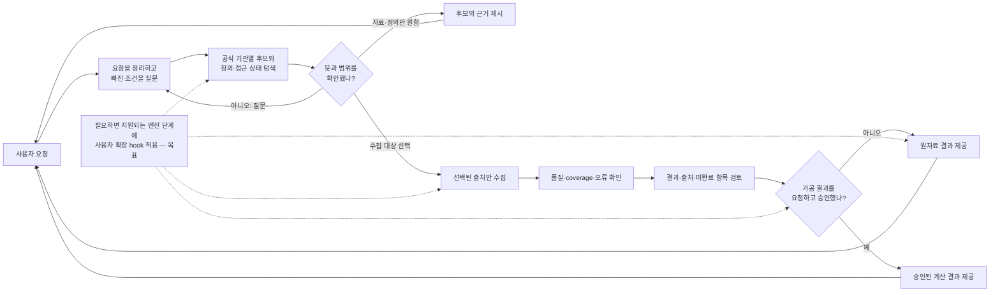

# MacroAtlas 사용자 흐름과 개발자 아키텍처

Iteration 29의 제한 데이터셋 실행 경로: `DatasetProfile → 기관별 binding/client → 공통 raw archive → dataset validator → profile/validation receipt → hash read-back`. API와 공식 파일은 같은 보존 계약을 쓰고 source별 요청·표 검증은 분리합니다. API 4개·TIC/BoE CSV 3개 synthetic 검증이며 일반 자연어 workflow와 정규화 DB 연결은 아닙니다. [데이터셋 계약](connectors/DATASET_CONTRACTS.md) 참조.

**기준일:** 2026-10-25
**제품 범위:** [PROJECT_PLAN.md](../../PROJECT_PLAN.md)
**현재 구현 순서:** [IMPLEMENTATION_PLAN.md](IMPLEMENTATION_PLAN.md)
**운영 주기 및 트랙:** [OPERATING_PLAN.md](../operator/OPERATING_PLAN.md)
**다기관 선택·계산·XLSX 제안:** [MULTI_SOURCE_SELECTION_AND_XLSX_OUTPUT_PLAN.md](planning/MULTI_SOURCE_SELECTION_AND_XLSX_OUTPUT_PLAN.md)
**사용자 관점 전체 흐름:** [사용자 아키텍처](../user/USER_ARCHITECTURE.md)

## 1. 사용자 관점 아키텍처

사용자는 원하는 통계와 목적을 자연어로 말하고, MacroAtlas는 후보와 차이를 설명한 뒤 확인된 범위만 수집한다. 사용자에게는 내부 클래스명보다 **무슨 자료를 왜 찾았는지, 어떤 선택이 필요한지, 어디서 멈췄는지**를 보여준다.

자연어 제품 UI와 이 전체 대화 흐름은 목표 구조다. 현재 저장소에는 일부 workflow와 데이터 모듈이 있지만, 이 도식처럼 사용자를 안내하는 완성된 대화형 에이전트는 없다.

### 오류가 생겼을 때 누가 개입하나

오류마다 사용자에게 기술적 로그를 보여주거나 전부 사용자 책임으로 돌리지 않는다. 기관별 오류 코드는 달라도 사용자에게 보여주는 공통 분류와 조치 주체는 통일하고, 기관별 복구 세부사항은 운영자 reference에서 따로 관리한다.

| 상황 | 시스템 처리 | 개입 주체와 사용자 안내 |
|---|---|---|
| 통계 정의·국가·기간·계산 방식이 불명확 | 해당 선택에 의존하는 다음 단계에서 일시 정지 | **사용자**에게 선택지를 묻는다. 답 전 수집·계산하지 않는다. |
| 일시적 timeout·429 등 제한된 재시도 대상 | 기관 정책에 맞춰 횟수와 대기시간을 제한해 재시도 | 재시도 중임을 표시한다. 한도 후 실패하면 해당 기관 상태와 다음 선택지를 보여준다. |
| 일부 선택 기관만 실패 | 실패 기관을 표시하고 다른 독립 기관의 상태는 따로 보존. 출처를 조용히 대체하지 않는다. | 완전한 비교가 필요한 계산은 멈춘다. 부분 결과를 받을지, 실패 기관을 제외해 다시 진행할지 **사용자 확인**을 받는다. |
| 사용자 Python 확장에 문법·계약·실행 오류 | 실행 전 오류는 hook 실행을 막고, 실행 중 오류는 그 hook을 실패 처리한다. 앞 단계 raw/결과를 보존하고 공통 엔진을 직접 덮어쓰지 않는다. | 사용자는 오류 ID와 파일/행 위치, 안전하게 정리한 원인을 보고 확장 코드를 고친다. 허용된 대체 경로가 미리 설정되지 않았다면 자동으로 기본 동작으로 바꾸지 않는다. |
| API 키, 권한, 약관, quota 등 운영 설정 문제 | 해당 기관 실행을 보류하고 비밀값을 로그/대화에 노출하지 않는다. | **운영자**가 보안 설정에서 조치한다. 사용자가 채팅에 key를 붙여 넣게 하지 않는다. |
| 원자료 손상 가능성, 출처·값 불일치, 보안 문제, 결과 신뢰 불가 | 영향을 받는 작업을 즉시 중단하고 결과 계산·내보내기를 막는다. raw와 실패 증거는 보존·격리한다. | 사용자에게 안전한 상태 설명을 알리고 **운영자와 개발자**에게 조사·복구를 넘긴다. 재개는 원인 확인과 검증 뒤에만 한다. |

다른 기관에서도 같은 공통 오류 분류와 사용자 선택 원칙을 적용한다. 다만 인증, quota, 응답 코드, 데이터 개정처럼 실제 복구 절차는 기관별로 다르므로 기관 reference에 기록한다. 한 source의 문제를 전체 서비스의 성공으로 숨기지 않으며, 심각한 무결성 문제는 부분 결과로도 우회하지 않는다.

### 사용자 확장 모듈 제안 — 미구현

hook 계약, Python/Markdown 역할, 폴더와 오류 처리의 상세 제안은 [사용자 Python 확장 설계](extensions/USER_PYTHON_EXTENSIONS.md)에 정리한다.

사용자가 필요할 때 엔진의 일부 동작을 바꾸려면 엔진 소스 파일을 직접 수정하거나 임의 위치에 코드를 주입하게 하지 않는다. `candidate_filter`, `metadata_enrichment`, `post_ingestion_transform`, `output_layout`처럼 이름과 입출력 계약이 정해진 **확장 hook** 중 하나를 선택해 사용자별 Python 모듈을 끼우는 방식으로 계획한다. hook이 제공되지 않는 엔진 영역은 임의로 교체하지 못하게 한다.

실행 파일은 저장소/`src/`/`docs/`가 아니라 사용자별 데이터 영역(예: `MACROATLAS_DATA_DIR/extensions/<user_id>/<extension_id>/`)에 보관한다. Python package는 실제 코드를 담고, JSON/YAML manifest는 ID·버전·hook·입출력 schema·필요 권한·resource limit을 선언하며, Markdown은 사용법과 제한을 설명한다. Markdown이나 manifest 안의 임의 코드를 실행하지 않는다. 사용자 확장은 기본적으로 네트워크·credential·raw 파일 변경·SQLite 직접 쓰기 권한이 없다.

각 작업은 사용할 확장 ID/version/hash를 시작 시점에 고정해 이력에 남긴다. 실행 중 파일을 바꿔 끼우는 hot-swap은 하지 않는다. 변경이 필요하면 안전한 단계에서 멈추고 새 버전으로 새 작업 또는 명시적 checkpoint 재개를 시작한다. Python 확장의 실행 격리·시간/메모리 제한은 현재 구현됐다고 간주하지 않으며, 이를 기술적으로 검증한 뒤에만 확장 실행 기능을 개발한다.

## 2. 개발자 아키텍처

개발자 관점에서도 위 사용자 흐름을 먼저 기준으로 삼고, 아래에서 그 흐름을 구현하는 Python 모듈·엔진과 현재 구현 경계를 설명한다. MacroAtlas는 공통 실행·검증 계층과 기관별 connector들로 구성한다. 각 사용자에게 엔진 복제본을 주는 방식은 아니며, 사용자별 작업·권한·결과 경계를 분리하고 공통 코드를 재사용한다. 각 네모가 독립된 LLM agent라는 뜻은 아니다.

## 보이는 역할과 엔진 경계

| 역할 | 책임 | 현재 확인된 경계 |
|---|---|---|
| 요청 분석 | 자연어 요구를 대상/기간/빈도/단위/목적/산출물로 만들고, 모호한 점을 묻는다 | 자연어 사용자 UI는 목표 단계 |
| 오케스트레이터 | 의존성, 병렬 구간, budget, 사용자 확인, 상태, 취소/재개를 관리 | Python workflow 일부 구현. 일반 대화형 요청 UI 아님 |
| 기관별 탐색 | catalog, dataset, series, 공식 문서와 검색 evidence를 찾는다 | registry/guide/fixture가 일부 있음. 모든 기관의 live discovery 아님 |
| metadata 정규화 | 원문 표현을 보존하고 공통 필드·언어·출처를 연결한다 | 일부 metadata models/adapters 구현 |
| 방법론·비교가능성 엔진 (작업명) | 공식 방법론 근거로 정의·stock/flow·관측 시점·주기·단위·coverage 및 alignment feasibility 평가 | 목표 기능; 이름은 추후 확정 |
| 개념 매핑 | 통계 개념 관계와 차이를 근거와 함께 표현 | relation·근거 기반 구성요소 일부 구현 |
| source API connector | endpoint/auth/IDs/paging/response/revision/limit/licence 처리 | 기관·dataset별로 구현/fixture/live 범위 다름 |
| ingestion·quality | raw 응답, 파싱, 관측 상태, missing/zero, 오류 유형, 제한 재시도 | 지원 경로만 가능 |
| transformation | 사용자가 확인한 계산·가중치·집계와 파생 provenance | 목표 기능. connector/analysis에 섞지 않음 |
| XLSX export | 승인된 값과 정의를 기본 XLSX 계약으로 저장 | writer 미구현; XLSX input parser와 구분 |
| storage/audit | raw, request manifest, hash, 상태, 작업·승인 이력을 연결 | 현재 지원 범위에 해당하는 기능 있음 |
| 개선 분석·유지보수 | 사람 피드백·오류를 재현하고 격주 메모리/성능 측정으로 수정 후보를 고른다 | `improvement/`에는 일부 후보 분석 코드가 있음; 자동 수정/승인 없음. 향후 코드는 대상 엔진·모듈별 task로 수정 |
| 모델 실행자·사람 검토자 | task별 모델을 정해 제한된 엔진/모듈을 수정하고, 결과 diff·시험·근거를 검토한다 | 모델 배정은 향후 수동 운영안. 대규모·다중 엔진 변경은 사람이 강한 모델을 지정하고 통합 범위를 주도 |

## 개발자 관점 구성요소와 코드 모듈

| 구성요소/엔진 | 주요 모듈 | 책임과 상태 |
|---|---|---|
| 요청 분석 역할 | 자연어 UI/agent contract — 모듈 미구현 | 자연어에서 지표·국가·기간·목적·산출물을 구조화하고 모호성을 사용자에게 질문 |
| 오케스트레이션 | `orchestration/`, `workflow_contracts.py`, `workflow_extensions.py` | 단계·상태·확인·재개 연결. workflow 일부 구현, 전체 대화형 UX는 목표 |
| Discovery | `discovery/` | 기관·catalog·dataset·series·공식 문서 검색. 일부 registry/guide/fixture 구현 |
| Metadata·mapping | `metadata/`, `mapping/` | 원문 보존, 공통 metadata 필드, 근거 있는 개념 관계. 일부 구성요소 구현 |
| 방법론·비교가능성 | 향후 엔진 모듈 | 정의·시점·단위·주기·coverage와 정렬 feasibility 평가. 미구현, 최종 이름 미확정 |
| 기관 connector | `connectors/` | 기관별 endpoint/auth/ID/paging/schema/revision/terms. 지원 범위는 기관별 상이 |
| 수집·품질 | `ingestion/` | 응답 parsing, 관측값 상태, 제한 재시도와 validation. 일부 경로 구현 |
| 저장·감사 | `storage/` | raw, provenance, metadata, run/audit 기록. 지원 경로 중심 구현 |
| 계산·가공 | `analysis/` (현재 기반 수준) | 승인된 deterministic 변환과 lineage. 계획 기능 |
| XLSX export | 향후 exporter 모듈 | Data/Definitions 및 derived output. writer 미구현 |
| 피드백·성능 개선 | `improvement/`, 운영 문서·benchmark scripts | 오류 후보 분석은 일부 구현. 메모리 측정·코드 변경·재검토는 Track M 운영 절차이며 자동 수정 기능이 아님 |
| 사용자 확장 hook | `MACROATLAS_DATA_DIR/extensions/<user>/<extension>/` 제안 | 안정된 한 hook만 확장. loader/sandbox/manifest 검사 미구현 |

**기능**은 사용자에게 제공할 결과(예: 기관 비교, 수집, 국가별 계산)이고, **엔진**은 그 기능을 이루는 입출력 계약이 있는 처리 경계이며, **모듈**은 Python에서 실제 변경할 패키지/파일입니다. `에이전트`는 자연어 이해·질문·설명을 맡는 언어 모델 역할에만 사용합니다. 특정 기관의 연결 코드는 `connector`/`adapter`라고 부릅니다.

## 공통 엔진과 source별 connector

공통 계층은 사용자 요청 스냅샷, 상태 전이, source 선택, 요청량 상한, raw 보존, 공통 metadata/validation, retry/resume, lineage를 담당한다. connector는 해당 source의 API base/version, credentials interface, indicator identifiers, query dimensions, language, pagination, response schema, revisions, rate limits, attribution과 이용 규칙을 맡는다.

공식 API 문서가 있다는 것은 그 source의 특정 데이터셋을 MacroAtlas에서 수집할 수 있다는 증거가 아니다. 각 계층은 독립 상태로 기록한다.

- 공식 dataset/series와 metadata evidence
- API 문서 확인, 미확인 또는 공식 no-API evidence
- auth, terms, quota 확인
- adapter 구현
- deterministic fixture 범위
- bounded live 요청 범위
- 저장·read-back·복구까지 확인된 live ingestion 범위

API 상태가 미확인인 곳에 endpoint를 추측해서 보내지 않는다. 그 데이터셋의 API가 공식적으로 없거나 맞지 않는다고 확인한 경우에만 공식 파일/SDMX bulk 등 대안을 비교한다.

### HTTP transport와 API 계열은 다른 경계다

World Bank와 SDMX는 둘 다 HTTP GET을 사용하지만 같은 API 계약은 아니다. World Bank client는 WDI Indicators JSON의 고정 country/indicator/query 규칙과 `[page metadata, rows]` 응답 envelope를 다룬다. SDMX clients는 provider별 data/structure 자원, flow·agency·version·dimension key, content negotiation과 원 응답 형식을 다룬다. 경로와 payload parser를 한 기관 공통 코드로 합치면 기관 규칙이 조건문으로 섞이고 source 차이가 가려진다.

반면 HTTPS GET 세션 준비, `trust_env=False`, TLS 기본 검증, redirect 거부, connect/read timeout, elapsed/byte 상한, 제한된 raw entity-byte 수신은 API 계열에 걸쳐 반복되는 전송 기초다. 이 부분은 `connectors/http_transport.py`의 bounded HTTP GET primitive로 공유한다. `WorldBankTransport`, `JsonApiTransport`, `SdmxApiTransport`는 유지하되 이 공통 primitive를 호출하고, 각 계열의 endpoint allowlist와 기존 입력·오류·응답 계약을 adapter 경계에서 적용한다. `http_transport.py`는 기관을 탐색하거나 API route를 만들거나 JSON/SDMX를 파싱하지 않는다.

요약하면 **공통 HTTP 안전 전송층 하나 + API 계열 adapter + 기관별 client와 검증** 구조다. SDMX provider route는 SDMX family 안에서 공유 가능한 계약을 따르고, World Bank는 WDI JSON API로 별도 유지한다. 이 경계와 오류 대응표는 [HTTP transport 설계](connectors/HTTP_TRANSPORT.md)에 기록한다. 구현 상태는 [Iteration 26 보고서](history/ITERATION_26_REPORT.md)를 따른다.

Iteration 28에서 FRED·Census JSON GET 및 BLS v1 JSON POST client를 추가했다. BLS 기간 지정 조회를 위해 공통 HTTP에 body 16 KiB 제한 POST를 제공하되 JSON wrapper는 공식 BLS v1 경로에만 허용한다. 기관별 응답 계약 검사와 파일 저장·read-back을 합성 fixture로 검증하며, 일반 workflow·관측치 정규화·live 인증과는 구별한다. [FRED](connectors/FRED.md), [Census](connectors/CENSUS.md), [BLS v1](connectors/BLS.md)의 독립 범위와 [회차 보고서](history/ITERATION_28_REPORT.md)를 따른다.

## 방법론·비교가능성 엔진과 변환 엔진의 분리

현재 이름은 작업명이다. 사용자가 최종 명칭을 다시 정하기 전까지 제품 용어로 확정하지 않는다.

방법론·비교가능성 엔진은 official methodology 문서, API metadata, classification, 단위·주기 정의를 근거로 series의 의미를 검토한다. stock/flow, reference period, end-of-period/average, 월말/월평균, valuation, coverage, revisions를 비교하고 각 판단에 source URL·조회 시점·근거 수준을 연결한다. 결과는 comparable, conditionally_comparable, not_comparable, unknown_requires_review 같은 상태와 이유를 반환한다. 근거가 부족하면 판단을 보류하고 사용자의 확인 또는 통계 담당자 review를 요청한다.

이 엔진은 값 자체를 변환하지 않는다. 변환 엔진은 방법론 판정과 사용자 선택 snapshot을 입력으로 받아 날짜 key 정규화, 승인된 as-of/aggregation/join, unit conversion, ratio/weight calculation 등 명시적으로 허용된 작업만 deterministic하게 실행한다. 계산의 순서, source series ID/revision/hash, 정책·공식 버전, 출력 lineage를 보존한다.

월말 표기는 원천이 실제 월말 stock인지 월평균/월중 유량인지 확인한 뒤 정한다. 일별 관측에서 월말값을 택하는 경우 calendar-day/business-day, 마지막 가용치와 결측 fallback을 명시한다. 분기/연간값을 월별로 복제하거나 임의 보간하지 않는다. align 불가/미확인은 수치 변환을 중단하고 source-native long output, 계열별 별도 sheet, 별도 workbook, 계산 보류 중 선택지를 이유와 함께 제안한다. 기본 workbook이 Data/Definitions 두 sheet라는 D-079는 유지하며 별도 sheet는 사용자 승인으로 output spec이 바뀐 경우만 허용한다.

## 사용자별 프로필

각 사용자는 본인의 작업에서 적용된 엔진 단계와 source 상태를 볼 수 있다. 사용자별 설정에는 다음이 들어갈 수 있다.

- 기본 언어와 설명 수준
- 관심 기관, 국가/지역, 통계 유형
- 후보 비교, metadata-only, data collection 선호
- 출력 레이아웃과 승인된 calculation preset
- API budget과 credential reference/권한
- 본인의 과거 확인·피드백·작업 이력

별도 사용자는 별도 엔진 코드 복사본을 뜻하지 않는다. 민감값, raw 응답, 승인, 사용자 피드백은 사용자/workspace 경계를 넘어 노출하지 않는다. 개인 피드백을 공통 규칙으로 적용하려면 근거·영향 평가와 별도 승인 과정이 필요하다.

## 다기관 요청의 순서와 병렬 실행

1. 요청 역할은 통계 개념, 목적, 국가, 기간, 빈도, 단위, 원하는 결과를 구조화하고 불명확한 점을 표시한다.
2. 오케스트레이터는 기관별 discovery를 병렬로 실행하며, 각 기관 결과와 대기/실패 상태를 사용자에게 보여준다.
3. metadata normalizer는 원문 정의·ID·언어와 공통 필드를 함께 보존한다.
4. 방법론·비교가능성 엔진(작업명)은 공식 근거를 사용해 정의·측정 기준·period semantics·coverage와 날짜 정렬 가능성을 평가한다. 미확인은 미확인으로 돌린다.
5. 개념 매핑·비교 단계는 차이를 보여주고 사용자가 고를 조건을 묻는다. metadata-only 요청은 여기서 끝날 수 있다.
6. 사용자가 source, 기간, 국가 집합, 가공 정책을 확인한 snapshot을 만든 뒤 선택 source만 API 우선으로 수집한다.
7. ingestion과 quality 엔진은 raw를 보존하고 schema·단위·기간·국가·missing/zero·revision을 검증한다.
8. 계산 요청이 있으면 transformation engine이 방법론 판정 및 사용자 승인에 맞는 deterministic operation만 실행한다. 요청되지 않은 변환은 하지 않는다.
9. exporter는 선택된 source/derived layout에 맞춰 XLSX를 작성하고, raw/manifest와 원천·파생 lineage는 별도로 보존한다.
10. 사용자는 결과와 함께 각 엔진/source의 근거·성공·실패·대기·미지원 상태를 본다.

독립 source 검색과 source별 파싱은 병렬화 가능하다. 방법론 비교, 사용자의 의미 확인, 공통 period/country 집합·분모 확정, 계산, 최종 workbook 작성은 앞선 gate가 해결된 뒤 진행한다.

## 예시: ‘국가별 총부채’와 채권 위험

BIS의 Credit to the non-financial sector는 40개 초과 경제의 분기 자료이며 정부와 민간 비금융 부문의 credit을 나눈다. IMF Global Debt Database는 공공·민간 비금융 부문의 총 gross debt를 190개 경제의 불균형 패널로 설명한다. World Bank IDS/QEDS는 외채 자료로 coverage와 보고·주기 방식이 다른 별도 후보이며, 외채를 국내 채무까지 포함한 모든 부채로 부르면 안 된다. OECD financial indicator는 넓은 부채 수단을 담을 수 있지만 country/sector coverage가 다를 수 있다.

따라서 에이전트는 “BIS가 있으니 전 세계 국가 부채를 받을 수 있다”고 결론내지 않는다. 기관 후보를 보여준 후, 부문·부채 범위·stock valuation·국가 모집단·시점·통화·위험 산식이 확정되면 선택 source를 수집한다.

사용자가 원하는 계산이 각 국가 absolute debt stock의 선택 모집단 내 share라면 승인된 공식과 denominator population으로 계산한다. GDP 대비 ratio를 debt stock share처럼 취급하지 않고, 결측을 0으로 간주하지 않는다. 이 분포 비중은 포트폴리오 exposure weight 또는 credit-risk score와 구분한다. 계산 engine은 입력 ID/revision, formula version, denominator, coverage, missing states, exchange-rate/alignment policy를 결과에 남긴다.

자세한 후보·질문·XLSX 계약은 [다기관 실행 기획](planning/MULTI_SOURCE_SELECTION_AND_XLSX_OUTPUT_PLAN.md)을 참고한다. 공식 내용의 근거는 [BIS](https://data.bis.org/topics/TOTAL_CREDIT), [IMF GDD](https://data.imf.org/Datasets/FAD_GDD), [World Bank IDS/QEDS](https://www.worldbank.org/en/programs/debt-statistics/faq), [OECD](https://data-explorer.oecd.org/vis?df%5Bag%5D=OECD.SDD.NAD&df%5Bds%5D=dsDisseminateFinalDMZ&df%5Bid%5D=DSD_FIN_DASH%40DF_FIN_DASH_S1M&df%5Bvs%5D=1.0&pg=0&snb=30&tm=health+coverage) 공식 페이지다. 링크 조사와 MacroAtlas API/live 검증은 다른 증거다.

## 유지보수와 기관 추가 흐름

유지보수는 한 엔진에 계속 덧대는 일이 아니라, 오류나 피드백의 원인을 찾아 해당 엔진·모듈만 고치는 반복 절차다.

1. **매주 오류·피드백:** 사용자 보고와 실행 실패를 재현하고, 사용자 입력·기관 connector·공통 엔진·운영 설정 중 원인을 분류한다. 재현 가능한 최소 fixture를 만든다.
2. **수정 범위 결정:** 바뀌는 입출력 계약, 영향 받는 코드·테스트·문서와 유지할 동작을 적고, 작업 크기와 위험도에 맞춰 모델을 정한다. 방법론·통계 의미나 여러 엔진 계약 변경은 사람 검토를 앞단에 둔다.
3. **모듈 수정과 검증:** 한정된 모듈을 수정하고 fixture, 관련 회귀, raw·출처·단위·결측/0·저장/재개 invariant를 확인한다. diff와 근거는 사람이 검토한다.
4. **격주 성능·메모리 확인:** 고정 seed·fixture·환경에서 wall time, CPU, peak RSS, Python allocation, 요청 수와 전송량을 측정한다. 반복 가능한 병목이 보일 때만 코드를 최적화하고 같은 조건으로 다시 측정한다. 효과가 변동과 구별되지 않으면 기준선을 유지한다.
5. **기관 추가:** Track C는 수요가 생긴 기관의 공식 문서 → 기관별 fixture → adapter → offline workflow → source gate 순서로 진행한다. 독립적인 offline 조사·fixture 작업은 Track M과 병렬로 할 수 있다.
6. **오케스트레이터 통합:** 엔진 내부가 기존 계약을 지키면 오케스트레이터를 수정하지 않는다. 입출력 계약, workflow 순서·병렬성, 사용자 확인, 오류 상태 전파, retry·cancel·resume, budget·provenance가 달라질 때만 대상 엔진의 검증 뒤 통합 작업을 별도로 연다.
7. **심각한 오류:** 출처·값 무결성, 보안, raw 손상 또는 계산 신뢰성에 문제가 있으면 영향을 받은 작업을 즉시 멈춘다. raw와 실행 증거를 격리·보존하고 계산·내보내기를 막는다. 사용자에게 상태와 필요한 선택을 알리고 운영자·개발자가 원인을 확인한 뒤에만 재개한다.

이 일정은 운영 계획이지 자동 수정·예약 실행·모델 자동 라우팅을 뜻하지 않는다. live 실행은 공통 platform gate와 기관별 gate를 모두 통과한 뒤 별도 승인한다.

## 현재 기관 상태

현재 기준 문서에 기록된 목록은 21개 source profile이다. 공식 API 문서 확인 15개, 조사 범위에서 명세 미확인 6개, 공식 no-API 확인 0개다. 미확인은 부재 증거가 아니다. 실 API 검증은 World Bank USA/WDI/GDP 고정 경로 하나다. Iteration 25에서 이미 client가 있는 9개 source의 파일 보존과 hash/manifest read-back을 공통 모듈로 구현했다. World Bank의 기존 workflow 저장 연결은 유지하고, 다른 8곳은 저장 helper의 offline/mock round-trip만 확인했다. source payload parsing, 다른 workflow 연결, 실제 API 접근은 미검증이며 live readiness로 간주하지 않는다. 최신 세부는 [INSTITUTION_CATALOG.md](../operator/reference/INSTITUTION_CATALOG.md), [INSTITUTION_API_AUDIT.md](../operator/reference/INSTITUTION_API_AUDIT.md), [API response 저장 명세](connectors/API_RESPONSE_STORAGE.md)와 회차 보고서에서 확인한다.

## 데이터 무결성 경계

- Source values와 raw 응답을 조용히 덮어쓰지 않는다.
- institution, agency, provider, dataset/series ID, request params, retrieval time, source URL, hash, unit/frequency/dimensions/revision을 가능한 범위에서 보존한다.
- zero, missing, suppressed, unavailable, not applicable을 구별한다.
- concept mapping은 비교 근거이지 동일성 인증이 아니다.
- retry는 제한·기록되며, retry 후에도 같은 source의 provenance가 유지돼야 한다.
- 번역문은 원문을 대체하지 않는다.
- 변환 값은 원천값과 다른 데이터 유형으로 기록한다.

실제 구현 작업은 AGENTS.md의 단일 High iteration 규칙, [IMPLEMENTATION_PLAN](IMPLEMENTATION_PLAN.md), [운영 계획](../operator/OPERATING_PLAN.md)을 따른다. 이번 아키텍처 재작성은 제품 UI, new connector, 변환 엔진, XLSX exporter의 구현을 주장하지 않는다.
