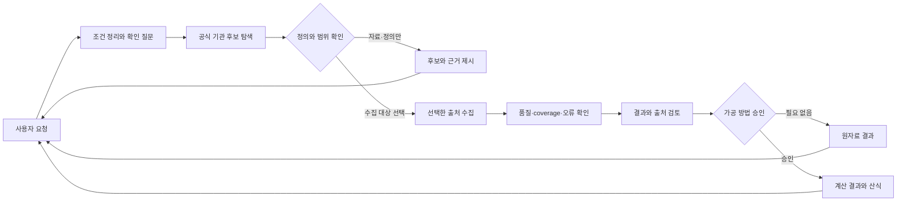

# 사용자는 MacroAtlas를 어떻게 쓰나

MacroAtlas에서 사용자는 통계와 목적을 자연어로 설명합니다. 시스템은 공식 출처 후보와 정의·단위·주기·국가 범위를 비교하고, 의미가 불분명한 부분을 사용자에게 질문합니다. 사용자가 확인한 범위만 수집하며, 가공을 요청하면 계산 방법을 먼저 확인합니다.

## 오류가 나면

| 상황 | 시스템 동작 | 사용자가 받는 안내 또는 필요한 조치 |
|---|---|---|
| 통계 정의, 기간, 국가, 계산 기준이 모호함 | 해당 조건에 의존하는 단계를 멈춤 | 선택지를 보고 기준을 정합니다. 확인 전 수집·계산하지 않습니다. |
| timeout이나 호출 제한 | 기관별로 정해둔 범위 안에서만 재시도 | 재시도 횟수와 결과를 보여줍니다. 실패하면 가능한 다음 선택지를 안내합니다. |
| 일부 기관 수집 실패 | 성공·실패 상태를 기관별로 보존하고 출처를 임의 대체하지 않음 | 전체 비교가 필요한 계산은 멈춥니다. 부분 결과를 받을지, 실패 기관을 빼고 다시 진행할지 선택합니다. |
| 개인 Python 확장 오류 | 해당 확장 단계를 실패시키고 이전 결과와 raw를 보존 | 확장 ID/버전, 오류 ID, 파일·행 위치와 정리된 원인을 제공합니다. 허용되지 않은 기본 동작으로 몰래 바꾸지 않습니다. |
| 원자료 훼손, 출처 불일치, 보안 문제 의심 | 영향을 받은 작업의 계산·내보내기를 중단하고 증거를 격리 | 운영자·개발자가 원인을 확인할 때까지 해당 작업을 재개하지 않습니다. |

API 키·권한·quota 설정 오류는 사용자가 대화창에 키를 붙이는 방식으로 해결하지 않습니다. 운영자에게 보안 설정 확인을 요청합니다.

## 사용자별 Python 확장 — 제안 단계

특정 사용자에게 필요한 동작은 공통 엔진 코드를 복제하거나 중간 파일을 임의 수정하는 대신, 미리 정의한 hook에 한정해 확장하는 방향을 제안합니다. 예를 들면 후보 필터, metadata 보강, 수집 이후 승인된 계산, 출력 형식입니다. 확장을 둘 위치는 사용자 데이터 영역의 `MACROATLAS_DATA_DIR/extensions/<user_id>/<extension_id>/`이며, 저장소의 엔진 코드 및 `docs/`와 분리합니다.

실행은 Python 모듈이 담당하고, JSON/YAML manifest는 hook·버전·입출력 계약·권한을 선언하며, Markdown은 사람이 읽을 설명을 제공합니다. Markdown이나 manifest를 실행 코드로 취급하지 않습니다. 실행 격리, 시간·메모리 제한, 파일·네트워크 권한은 별도 검증 전까지 구현된 것으로 간주하지 않습니다.

현재 저장소에는 이 확장 실행기와 hook registry가 없습니다. 코드를 안전하게 격리할 수 있는지 검증한 뒤에만 구현해야 합니다. 확장이 실패했을 때는 원자료를 보존하고, 사전 승인된 fallback이 없으면 기본 엔진으로 자동 대체하지 않습니다.

## 구현 상태

이 문서는 목표 사용 흐름을 설명합니다. 현재 저장소에는 일부 Python workflow와 데이터 모듈이 있지만, 완성된 자연어 대화형 UI, 사용자별 Python 확장 실행기, 범용 XLSX writer는 아직 없습니다.
